# 🎯 Coding Interview Preparation Handbook

Welcome to the **Coding Interview Preparation** guide! This repository is crafted to help candidates master algorithmic problem-solving through clean, well-documented code, intuitive visual breakdowns, and humorous animated cartoon guides that make tricky concepts stick effortlessly during technical interviews.

---

## 📌 Repository Mission & Objectives

1. **Intuitive Visual Mental Models**: Replace wall-of-text explanations with funny, memorable animated cartoon diagrams and flowcharts.
2. **Standardized Interview Communication**: Teach candidates how to articulate constraints, base cases, edge scenarios, and trade-offs clearly.
3. **Optimized Solutions**: Provide clean, tested JavaScript implementations with explicit Big-O Time & Space complexities.
4. **Fast Revision Cheat Sheet**: Review core patterns (two pointers, frequency hashing, constant-time math, leap year conditions) in minutes before interviews.

---

## 📚 Problem Directory & Quick Navigation

| # | Problem | Domain / Pattern | Time Complexity | Space Complexity | Visual Animation | Solution File |
|---|---|---|:---:|:---:|:---:|---|
| 1 | [Cats and a Mouse](#1-cats-and-a-mouse) | Math / Distance | $O(1)$ | $O(1)$ | 🐱 🐭 🐱 | [`catsAndMouse.js`](Javascript/catsAndMouse.js) |
| 2 | [Day of the Programmer](#2-day-of-the-programmer) | Calendar / Edge Cases | $O(1)$ | $O(1)$ | ⏳ 🇷🇺 📅 | [`dayOfProgrammer.js`](Javascript/dayOfProgrammer.js) & [`dayOfProgrammerII.js`](Javascript/dayOfProgrammerII.js) |
| 3 | [Divisible Sum Pairs](#3-divisible-sum-pairs) | Two Pointers / Remainder Math | $O(n^2) \rightarrow O(n)$ | $O(1)$ | 💖 🔢 ➗ | [`divisibleSumPairs.js`](Javascript/divisibleSumPairs.js) |
| 4 | [Drawing Book](#4-drawing-book-page-count) | Math / Page Flipping | $O(1)$ | $O(1)$ | 📖 ⏩ ⏪ | [`drawingBook.js`](Javascript/drawingBook.js) |
| 5 | [Electronics Shop](#5-electronics-shop) | Optimization / Search Space | $O(n \times m)$ | $O(1)$ | ⌨️ 💾 💵 | [`electronicsShop.js`](Javascript/electronicsShop.js) |
| 6 | [Migratory Birds](#6-migratory-birds) | Frequency Map / Hash Table | $O(n)$ | $O(1)$ | 🦅 👑 📊 | [`migratoryBirds.js`](Javascript/migratoryBirds.js) & [`migratoryBirdsWithLessComplexity.js`](Javascript/migratoryBirdsWithLessComplexity.js) |
| 7 | [Sales by Match](#7-sales-by-match-sock-merchant) | Frequency Map / Pairing | $O(n)$ | $O(u)$ | 🧦 🧺 ❤️ | [`salesByMatch.js`](Javascript/salesByMatch.js) |

---

## 🧩 Visual Problem Breakdowns & Solutions

### 1. Cats and a Mouse

#### 📋 Problem Statement
Two cats and a mouse are positioned at coordinates on a 1D line:
- Cat A starts at position $x$.
- Cat B starts at position $y$.
- Mouse C starts at position $z$.

Both cats travel at the same constant speed towards the mouse. If both cats arrive at the mouse simultaneously, they fight each other, allowing Mouse C to escape. Determine which entity prevails: `"Cat A"`, `"Cat B"`, or `"Mouse C"`.

#### 🎨 Graphical Cartoon Animation

  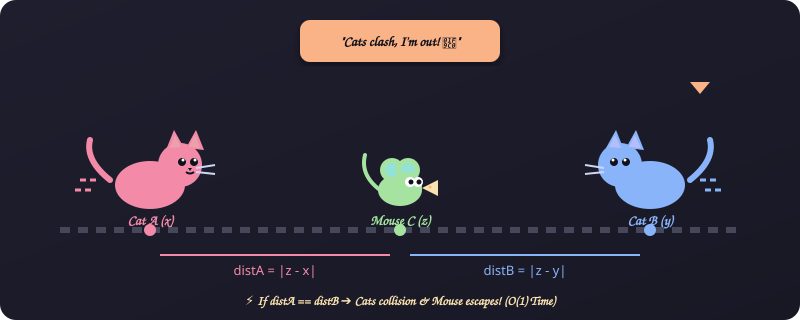

#### 🖼️ Logic Flow
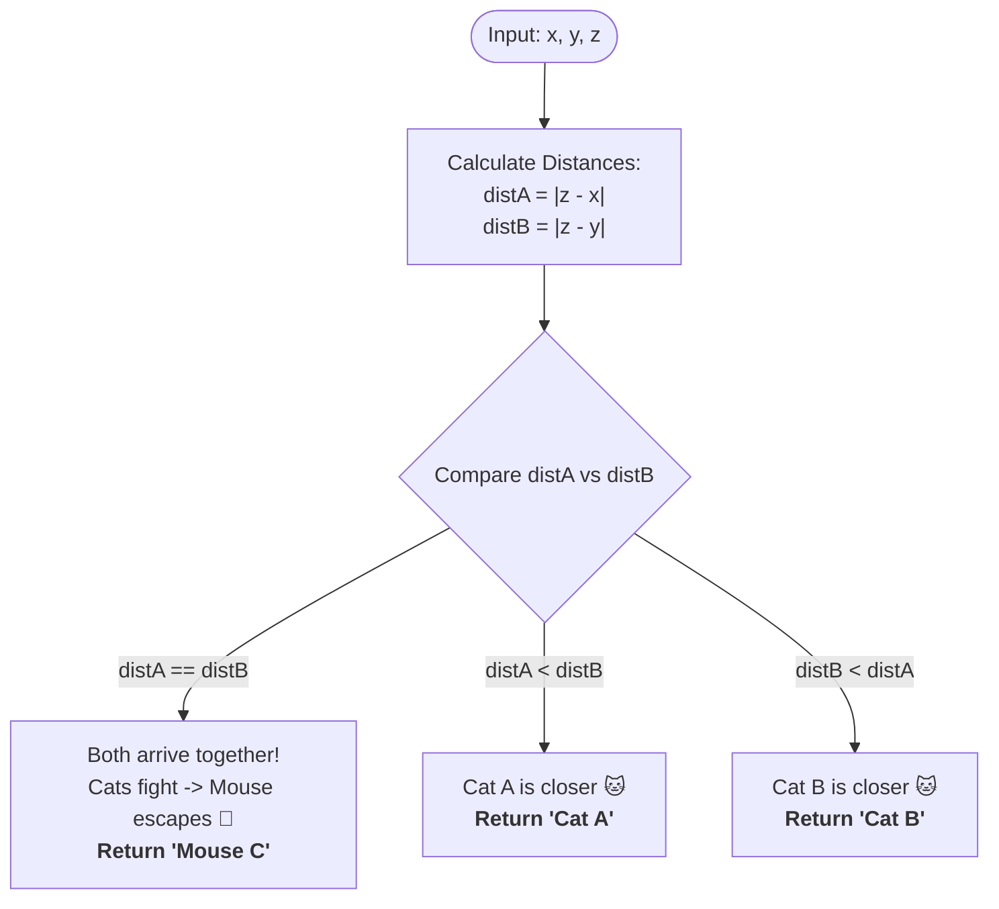

#### 💡 Key Takeaway
- **Formula**: Simple absolute distance check `Math.abs(z - x)` vs `Math.abs(z - y)`.
- **Complexity**: $O(1)$ Time, $O(1)$ Space.
- **Source Code**: [`catsAndMouse.js`](Javascript/catsAndMouse.js)

---

### 2. Day of the Programmer

#### 📋 Problem Statement
Given a year in Russia between 1700 and 2700, find the date of the **256th day** (`dd.mm.yyyy`).
Russia shifted calendar systems across three eras:
1. **Julian Calendar (1700 – 1917)**: Leap year if `year % 4 === 0`.
2. **Transition Year (1918)**: Day after Jan 31 was Feb 14 (13 days omitted).
3. **Gregorian Calendar (1919 – present)**: Leap year if `year % 400 === 0` OR (`year % 4 === 0` and `year % 100 !== 0`).

#### 🎨 Graphical Cartoon Animation

  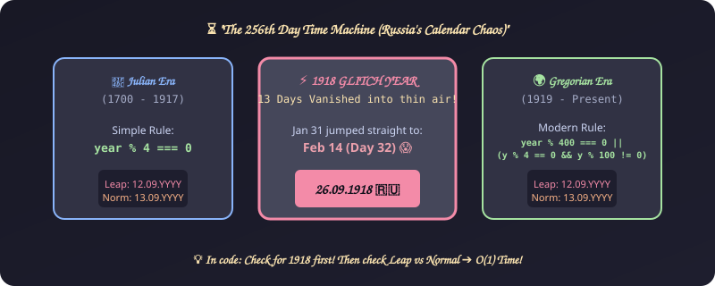

#### 🖼️ Logic Flow
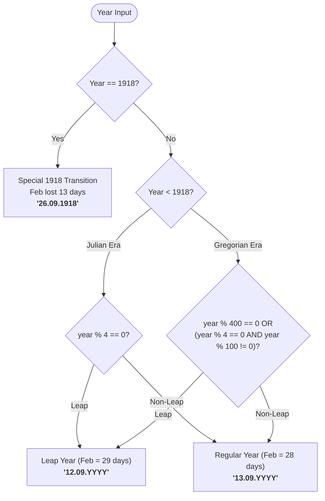

#### 💡 Key Takeaway
- Avoid manual month loops in interviews! Day 256 is **always** in September (`09`). If leap year: `12.09.YYYY`, else `13.09.YYYY`, with the unique 1918 exception: `26.09.1918`.
- **Complexity**: $O(1)$ Time, $O(1)$ Space.
- **Source Code**: [`dayOfProgrammer.js`](Javascript/dayOfProgrammer.js) (iterative) | [`dayOfProgrammerII.js`](Javascript/dayOfProgrammerII.js) (direct formula)

---

### 3. Divisible Sum Pairs

#### 📋 Problem Statement
Given an array of integers `ar` of size `n` and a positive integer `k`, count the number of pairs $(i, j)$ such that:
$$i < j \quad \text{and} \quad (ar[i] + ar[j]) \pmod k = 0$$

#### 🎨 Graphical Cartoon Animation

  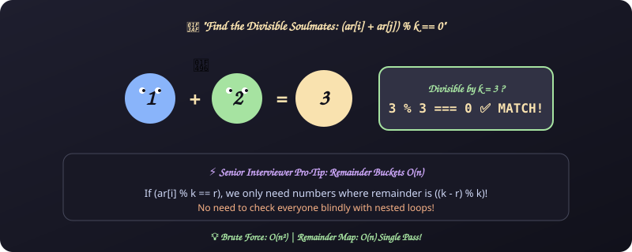

#### 🖼️ Logic Flow
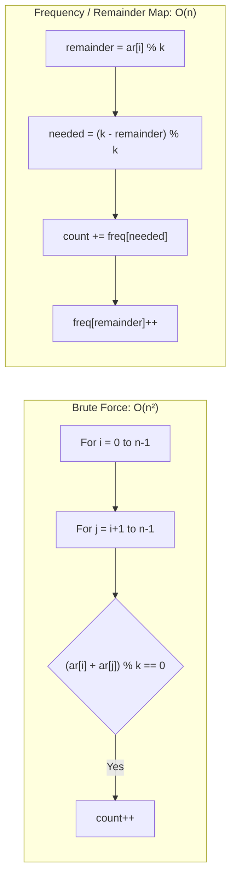

#### 💡 Key Takeaway
- While the nested loop is simple ($O(n^2)$), mentioning the $O(n)$ remainder frequency bucket approach demonstrates senior-level optimization skills.
- **Source Code**: [`divisibleSumPairs.js`](Javascript/divisibleSumPairs.js)

---

### 4. Drawing Book (Page Count)

#### 📋 Problem Statement
A book has `n` pages. Page 1 is always on the right side. Every two subsequent pages are printed on opposite sides of a single leaf:
- Pages `(2, 3)` are revealed on Turn 1.
- Pages `(4, 5)` are revealed on Turn 2, and so on.

A student wants to reach page `p`. They can start turning from the front (page 1) or from the back (page `n`). Find the minimum number of page turns required.

#### 🎨 Graphical Cartoon Animation

  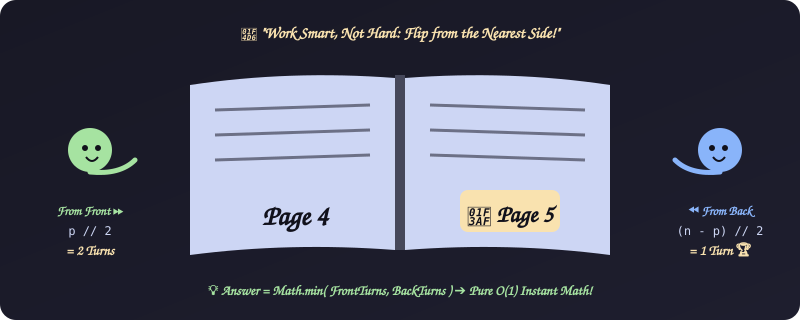

#### 🖼️ Logic Flow
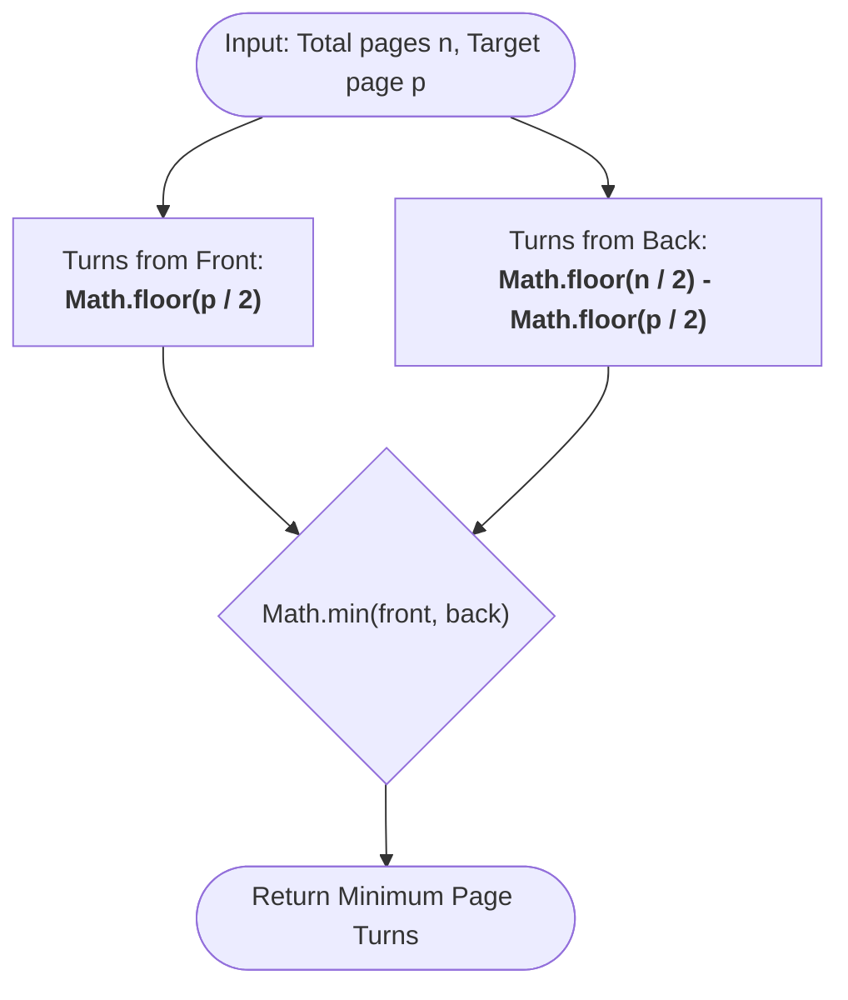

#### 💡 Key Takeaway
- Both page $2k$ and $2k+1$ require exactly $k$ turns from the front.
- **Complexity**: $O(1)$ Time, $O(1)$ Space.
- **Source Code**: [`drawingBook.js`](Javascript/drawingBook.js)

---

### 5. Electronics Shop

#### 📋 Problem Statement
A buyer wants to purchase **exactly one keyboard** and **exactly one USB drive** with a given budget $b$.
Given keyboard prices and USB drive prices:
- Maximize the total spend: $\max(\text{keyboards}[i] + \text{drives}[j])$ such that total $\le b$.
- If no combination is within budget, return `-1`.

#### 🎨 Graphical Cartoon Animation

  

#### 🖼️ Logic Flow
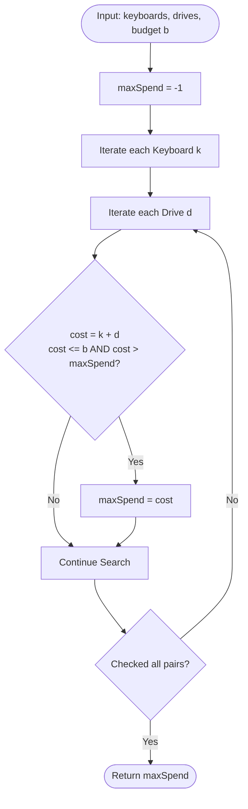

#### 💡 Key Takeaway
- $O(n \times m)$ brute force is acceptable for smaller constraints ($n, m \le 1000$).
- Can be optimized to $O(n \log n + m \log m)$ by sorting one array ascending and the other descending, then applying a two-pointer scan.
- **Source Code**: [`electronicsShop.js`](Javascript/electronicsShop.js)

---

### 6. Migratory Birds

#### 📋 Problem Statement
You are given an array of bird sightings, where each number denotes a bird type id ($1 \le \text{id} \le 5$). Find the most frequently sighted bird type. If there is a tie between multiple types, return the **smallest type id**.

#### 🎨 Graphical Cartoon Animation

  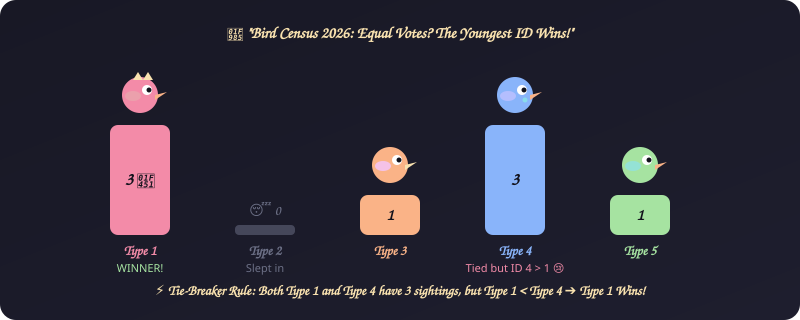

#### 🖼️ Logic Flow
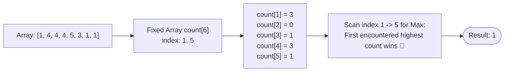

#### 💡 Key Takeaway
- Since bird types are strictly bounded ($1$ through $5$), a static array of size 6 gives $O(n)$ time and $O(1)$ extra space.
- Scanning indices from 1 to 5 naturally breaks ties by picking the lowest ID first.
- **Source Code**: [`migratoryBirds.js`](Javascript/migratoryBirds.js) | [`migratoryBirdsWithLessComplexity.js`](Javascript/migratoryBirdsWithLessComplexity.js)

---

### 7. Sales by Match (Sock Merchant)

#### 📋 Problem Statement
Given an array representing the colors of $n$ socks, determine how many matching pairs of socks can be formed.

#### 🎨 Graphical Cartoon Animation

  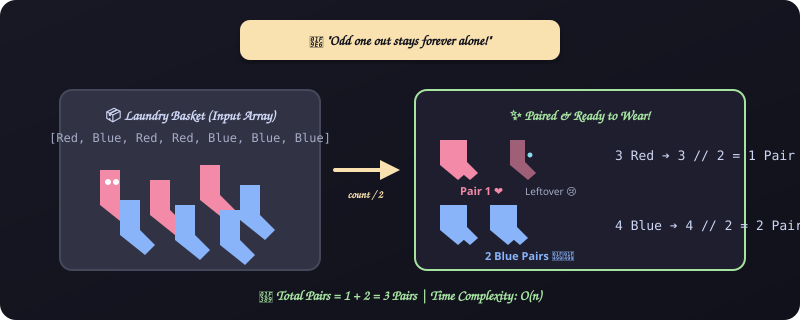

#### 🖼️ Logic Flow
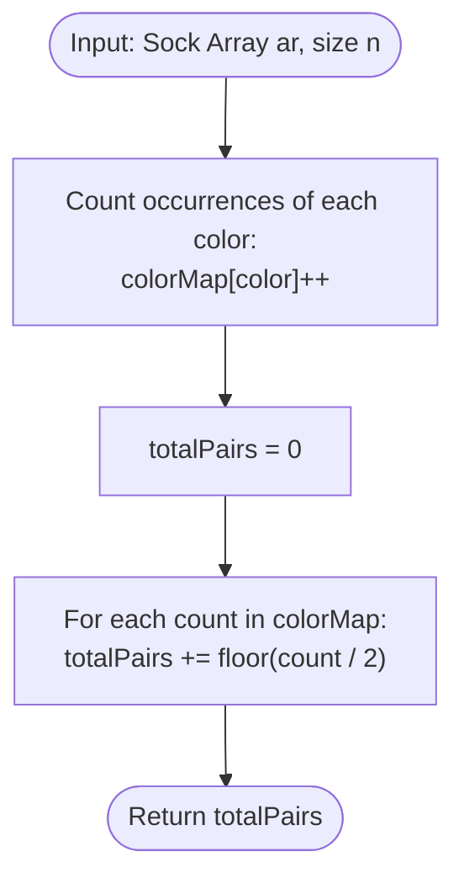

#### 💡 Key Takeaway
- For each unique color $c$ with count $k$, pairs = $\lfloor k / 2 \rfloor$.
- **Complexity**: $O(n)$ Time, $O(u)$ Space (where $u$ is unique colors).
- **Source Code**: [`salesByMatch.js`](Javascript/salesByMatch.js)

---

## 🚀 How to Practice with this Repository

1. **Read the Problem Statement**: Understand constraints and edge cases.
2. **Enjoy the Cartoon Animation**: Get an intuitive visual grasp of the problem narrative.
3. **Trace the Algorithm**: Check the Mermaid flowchart to follow execution steps.
4. **Implement**: Try writing your own solution, then compare against the repository solutions.
5. **Analyze Complexity**: Articulate why the solution runs in $O(n)$ or $O(1)$.
