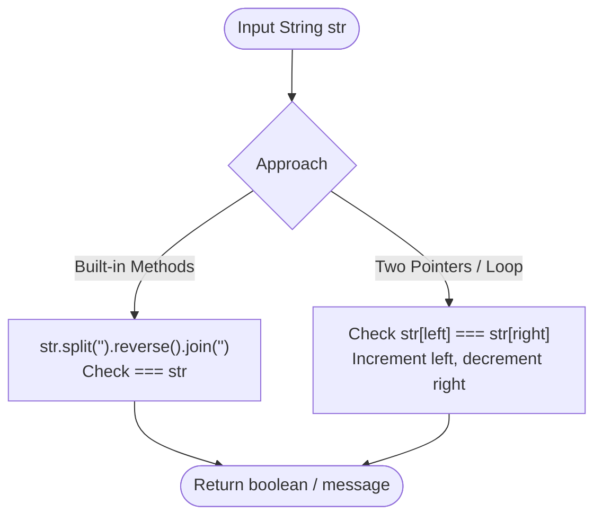
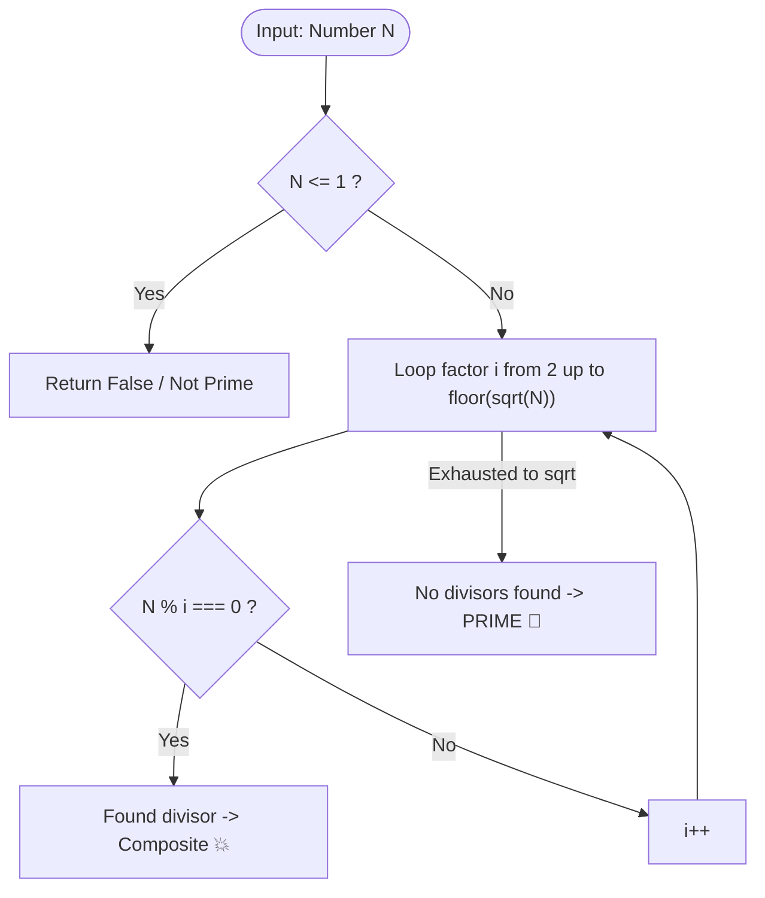

# 🎯 Coding Interview Preparation Handbook

Welcome to the **Coding Interview Preparation** guide! This repository is carefully crafted to help candidates master algorithmic problem-solving and software engineering interview questions through clean, well-documented code, intuitive visual breakdowns, and humorous animated cartoon diagrams that make core concepts stick effortlessly during technical interviews.

---

## 📌 Repository Mission & Objectives

1. **Intuitive Visual Mental Models**: Replace walls of text with memorable animated cartoon diagrams and flowcharts for every single problem.
2. **Standardized Interview Communication**: Help candidates articulate constraints, base cases, edge scenarios, and trade-offs systematically.
3. **Optimized Solutions**: Provide clean, tested JavaScript implementations with explicit Big-O Time & Space complexities.
4. **Fast Revision Cheat Sheet**: Review core patterns (two pointers, frequency hashing, constant-time math, Catalan recursion, 2D matrix traversal, and calendar edge cases) in minutes.

---

## 📚 Complete Problem Directory & Quick Navigation

| # | Problem | Domain / Pattern | Time Complexity | Space Complexity | Cartoon Animation | Solution File(s) |
|---|---|---|:---:|:---:|:---:|---|
| 1 | [Cats and a Mouse](#1-cats-and-a-mouse) | Math / Distance | $O(1)$ | $O(1)$ | 🐱 🐭 🐱 | [`catsAndMouse.js`](Javascript/catsAndMouse.js) |
| 2 | [Day of the Programmer](#2-day-of-the-programmer) | Calendar / Edge Cases | $O(1)$ | $O(1)$ | ⏳ 🇷🇺 📅 | [`dayOfProgrammerWay1.js`](Javascript/dayOfProgrammerWay1.js) & [`dayOfProgrammerWay2.js`](Javascript/dayOfProgrammerWay2.js) |
| 3 | [Divisible Sum Pairs](#3-divisible-sum-pairs) | Two Pointers / Remainder Math | $O(n^2) \rightarrow O(n)$ | $O(1)$ | 💖 🔢 ➗ | [`divisibleSumPairs.js`](Javascript/divisibleSumPairs.js) |
| 4 | [Drawing Book](#4-drawing-book-page-count) | Math / Page Flipping | $O(1)$ | $O(1)$ | 📖 ⏩ ⏪ | [`drawingBook.js`](Javascript/drawingBook.js) |
| 5 | [Electronics Shop](#5-electronics-shop) | Optimization / Search Space | $O(n \times m)$ | $O(1)$ | ⌨️ 💾 💵 | [`electronicsShop.js`](Javascript/electronicsShop.js) |
| 6 | [Migratory Birds](#6-migratory-birds) | Frequency Map / Hash Table | $O(n)$ | $O(1)$ | 🦅 👑 📊 | [`migratoryBirds.js`](Javascript/migratoryBirds.js) & [`migratoryBirdsWithLessComplexity.js`](Javascript/migratoryBirdsWithLessComplexity.js) |
| 7 | [Sales by Match](#7-sales-by-match-sock-merchant) | Frequency Map / Pairing | $O(n)$ | $O(u)$ | 🧦 🧺 ❤️ | [`salesByMatch.js`](Javascript/salesByMatch.js) |
| 8 | [Palindrome Verification](#8-palindrome-verification) | Two Pointers / String Manipulation | $O(n)$ | $O(1)$ | 🪞 ✨ 🔄 | [`validatePalidrom.js`](Javascript/validatePalidrom.js) & [`validatePalidromUsingFor.js`](Javascript/validatePalidromUsingFor.js) |
| 9 | [Prime Number Validator](#9-prime-number-validator--filter) | Math / Square Root Optimization | $O(\sqrt{N})$ | $O(1)$ | 🛡️ 👑 🔢 | [`validatePrimeNumber.js`](Javascript/validatePrimeNumber.js) |
| 10 | [2D Hourglass Max Sum](#10-2d-array-hourglass-max-sum) | 2D Arrays / Sliding Window | $O(1)$ | $O(1)$ | ⏳ 🪟 🏆 | [`hourGalss.js`](Javascript/hourGalss.js) |
| 11 | [Military Time Conversion](#11-military-time-conversion-12h-to-24h) | String Parsing / Modulo Time | $O(1)$ | $O(1)$ | ⏰ ☀️ 🪖 | [`militaryTimeConverstion.js`](Javascript/militaryTimeConverstion.js) |
| 12 | [First Duplicate Occurrence](#12-first-duplicate-occurrence) | Hash Set / Array Frequency | $O(n)$ | $O(n)$ | 🔍 🎟️ 🚨 | [`problemNew.js`](Javascript/problemNew.js) & [`problenNewSet.js`](Javascript/problenNewSet.js) |
| 13 | [Bracket Combinations](#13-bracket-combinations-catalan-numbers) | Recursion / Catalan Numbers | $O(4^n / n^{3/2})$ | $O(n)$ | 🎋 🎭 🏆 | [`bracket.js`](Javascript/bracket.js) |
| 14 | [Reverse Array / String](#14-reverse-array-or-string) | Iteration / Pointer Swap | $O(n)$ | $O(1)$ | 🔄 🤸 📦 | [`reverseString.js`](Javascript/reverseString.js) |
| 15 | [Character Frequency Count](#15-character-frequency-count) | Hash Map / Object Counting | $O(n)$ | $O(u)$ | 🍌 📊 🔤 | [`chharCount.js`](Javascript/chharCount.js) |
| 16 | [Cyclic Permutation Digits](#16-cyclic-permutation-of-digits-number-doubling) | Number Theory / Anagram Sorting | $O(N \cdot D \log D)$ | $O(1)$ | 🔢 ⚡ 🔀 | [`question.js`](Javascript/question.js) & [`sixDigit.js`](Javascript/sixDigit.js) |

---

## 🧩 Visual Problem Breakdowns & Solutions

### 1. Cats and a Mouse

#### 📋 Problem Statement
Two cats and a mouse are positioned at coordinates on a 1D line:
- Cat A starts at position $x$.
- Cat B starts at position $y$.
- Mouse C starts at position $z$.

Both cats travel at the same constant speed towards the mouse. If both cats arrive at the mouse simultaneously, they clash, allowing Mouse C to escape. Determine which entity prevails: `"Cat A"`, `"Cat B"`, or `"Mouse C"`.

#### 🎨 Graphical Cartoon Animation
<p align="center">
  
</p>

#### 💡 Key Takeaway
- **Formula**: Simple absolute distance check `Math.abs(z - x)` vs `Math.abs(z - y)`.
- **Complexity**: $O(1)$ Time, $O(1)$ Space.
- **Source Code**: [`catsAndMouse.js`](Javascript/catsAndMouse.js)

---

### 2. Day of the Programmer

#### 📋 Problem Statement
Given a year in Russia between 1700 and 2700, find the date of the **256th day** (`dd.mm.yyyy`).
Russia shifted calendar systems across three eras:
1. **Julian Calendar (1700 – 1917)**: Leap year if `year % 4 === 0`.
2. **Transition Year (1918)**: Day after Jan 31 was Feb 14 (13 days omitted).
3. **Gregorian Calendar (1919 – present)**: Leap year if `year % 400 === 0` OR (`year % 4 === 0` and `year % 100 !== 0`).

#### 🎨 Graphical Cartoon Animation
<p align="center">
  
</p>

#### 💡 Key Takeaway
- In 1918, February lost 13 days, placing Day 256 on **`26.09.1918`**.
- For all other years: Leap year is **`12.09.YYYY`**, Normal year is **`13.09.YYYY`**.
- **Complexity**: $O(1)$ Time, $O(1)$ Space.
- **Source Code**: [`dayOfProgrammerWay1.js`](Javascript/dayOfProgrammerWay1.js) (iterative) | [`dayOfProgrammerWay2.js`](Javascript/dayOfProgrammerWay2.js) (direct arithmetic)

---

### 3. Divisible Sum Pairs

#### 📋 Problem Statement
Given an array of integers `ar` of size `n` and a positive integer `k`, count the number of pairs $(i, j)$ such that:
$$i < j \quad \text{and} \quad (ar[i] + ar[j]) \pmod k = 0$$

#### 🎨 Graphical Cartoon Animation
<p align="center">
  
</p>

#### 💡 Key Takeaway
- While the nested loop is simple ($O(n^2)$), mentioning the $O(n)$ remainder frequency bucket approach demonstrates senior-level optimization skills.
- **Source Code**: [`divisibleSumPairs.js`](Javascript/divisibleSumPairs.js)

---

### 4. Drawing Book (Page Count)

#### 📋 Problem Statement
A book has `n` pages. Page 1 is always on the right side. Every two subsequent pages are printed on opposite sides of a single leaf. Find the minimum page turns needed to reach page `p`, starting either from the front (page 1) or from the back (page `n`).

#### 🎨 Graphical Cartoon Animation
<p align="center">
  
</p>

#### 💡 Key Takeaway
- Front turns: $\lfloor p / 2 \rfloor$. Back turns: $\lfloor n / 2 \rfloor - \lfloor p / 2 \rfloor$.
- **Complexity**: $O(1)$ Time, $O(1)$ Space.
- **Source Code**: [`drawingBook.js`](Javascript/drawingBook.js)

---

### 5. Electronics Shop

#### 📋 Problem Statement
A buyer wants to purchase **exactly one keyboard** and **exactly one USB drive** with budget $b$. Find the maximum spend $\le b$, or return `-1` if unaffordable.

#### 🎨 Graphical Cartoon Animation
<p align="center">
  
</p>

#### 💡 Key Takeaway
- $O(n \times m)$ brute force is optimal for small constraints; sorting + two-pointer approach offers $O(n \log n + m \log m)$.
- **Source Code**: [`electronicsShop.js`](Javascript/electronicsShop.js)

---

### 6. Migratory Birds

#### 📋 Problem Statement
Given an array of bird sightings ($1 \le \text{id} \le 5$), find the most frequently sighted bird type. In case of a tie, return the **smallest type id**.

#### 🎨 Graphical Cartoon Animation
<p align="center">
  
</p>

#### 💡 Key Takeaway
- Using a fixed frequency array of size 6 gives $O(n)$ time and $O(1)$ extra space, naturally resolving ties by checking indices $1 \dots 5$.
- **Source Code**: [`migratoryBirds.js`](Javascript/migratoryBirds.js) | [`migratoryBirdsWithLessComplexity.js`](Javascript/migratoryBirdsWithLessComplexity.js)

---

### 7. Sales by Match (Sock Merchant)

#### 📋 Problem Statement
Given an array representing the colors of $n$ socks, determine how many matching pairs can be assembled.

#### 🎨 Graphical Cartoon Animation
<p align="center">
  
</p>

#### 💡 Key Takeaway
- Count frequencies: each color with count $c$ gives $\lfloor c / 2 \rfloor$ pairs.
- **Complexity**: $O(n)$ Time, $O(u)$ Space.
- **Source Code**: [`salesByMatch.js`](Javascript/salesByMatch.js)

---

### 8. Palindrome Verification

#### 📋 Problem Statement
Determine whether a given string reads the exact same forwards and backwards (e.g., `"racecar"`, `"madam"`, `"121"`).

#### 🎨 Graphical Cartoon Animation
<p align="center">
  
</p>

#### 🖼️ Logic Flow


#### 💡 Key Takeaway
- In interviews, demonstrate both:
  1. Quick JS idiom: `str === str.split('').reverse().join('')`
  2. Optimal two-pointer approach: avoids extra string allocation, achieving $O(n)$ time and $O(1)$ space.
- **Source Code**: [`validatePalidrom.js`](Javascript/validatePalidrom.js) & [`validatePalidromUsingFor.js`](Javascript/validatePalidromUsingFor.js)

---

### 9. Prime Number Validator & Filter

#### 📋 Problem Statement
Determine if an integer is prime (divisible only by 1 and itself) or filter an array to extract all prime numbers.

#### 🎨 Graphical Cartoon Animation
<p align="center">
  
</p>

#### 🖼️ Logic Flow


#### 💡 Key Takeaway
- **Square Root Optimization**: Any factor pair $(a \times b = N)$ must have at least one factor $\le \sqrt{N}$. Stopping checks at $\sqrt{N}$ reduces tests from $N$ to $\sqrt{N}$ (e.g., testing up to 10 instead of 100).
- **Source Code**: [`validatePrimeNumber.js`](Javascript/validatePrimeNumber.js)

---

### 10. 2D Array - Hourglass Max Sum

#### 📋 Problem Statement
In a $6 \times 6$ 2D integer array, an hourglass shape is defined by 7 indices:
```
a  b  c
   d
e  f  g
```
Compute all 16 possible hourglass sums and return the **maximum** value.

#### 🎨 Graphical Cartoon Animation
<p align="center">
  
</p>

#### 💡 Key Takeaway
- **Trap**: Cell values can be negative (down to $-9$). The minimum possible sum is $7 \times (-9) = -63$. **Never** initialize `max` with `0`; use `-Infinity` or `-63`.
- **Complexity**: $O(1)$ Time (fixed $4 \times 4 = 16$ windows), $O(1)$ Space.
- **Source Code**: [`hourGalss.js`](Javascript/hourGalss.js)

---

### 11. Military Time Conversion (12h to 24h)

#### 📋 Problem Statement
Convert a 12-hour AM/PM timestamp string (e.g. `"07:05:45PM"`) into a 24-hour military clock string (`"19:05:45"`).

#### 🎨 Graphical Cartoon Animation
<p align="center">
  
</p>

#### 💡 Key Takeaway
- Midnight: `"12:xx:xxAM"` $\rightarrow$ `"00:xx:xx"`
- Noon: `"12:xx:xxPM"` $\rightarrow$ `"12:xx:xx"`
- Other PM: Add $12$ to hours. Other AM: hours remain unchanged.
- **Source Code**: [`militaryTimeConverstion.js`](Javascript/militaryTimeConverstion.js)

---

### 12. First Duplicate Occurrence

#### 📋 Problem Statement
Given an array of integers, identify the first number whose duplicate is encountered as you scan from left to right. If no duplicate exists, return `-1`.

#### 🎨 Graphical Cartoon Animation
<p align="center">
  
</p>

#### 💡 Key Takeaway
- **Brute Force**: $O(n^2)$ nested loops ([`problemNew.js`](Javascript/problemNew.js)).
- **Optimal**: $O(n)$ single pass using a `Set` ([`problenNewSet.js`](Javascript/problenNewSet.js)). The moment `set.has(item)` is true, return immediately.

---

### 13. Bracket Combinations (Catalan Numbers)

#### 📋 Problem Statement
Given an integer $N \ge 0$, calculate the number of valid (balanced) bracket combinations that can be formed using $N$ pairs of parentheses.

#### 🎨 Graphical Cartoon Animation
<p align="center">
  
</p>

#### 💡 Key Takeaway
- Follows the **Catalan Number** recurrence:
  $$C(n) = \sum_{i=0}^{n-1} C(i) \times C(n - 1 - i)$$
- Sequence: $C(0)=1, C(1)=1, C(2)=2, C(3)=5, C(4)=14, \dots$
- **Source Code**: [`bracket.js`](Javascript/bracket.js)

---

### 14. Reverse Array or String

#### 📋 Problem Statement
Reverse the order of elements in an array or string without using native `Array.prototype.reverse()`.

#### 🎨 Graphical Cartoon Animation
<p align="center">
  
</p>

#### 💡 Key Takeaway
- Can be solved iteratively by looping backwards from $n - 1$ down to $0$, or in-place using two pointers (swapping elements from outer ends inwards).
- **Complexity**: $O(n)$ Time, $O(1)$ auxiliary Space.
- **Source Code**: [`reverseString.js`](Javascript/reverseString.js)

---

### 15. Character Frequency Count

#### 📋 Problem Statement
Given a string, count the occurrences of each individual character and return a frequency dictionary.
Example: `"banana"` $\rightarrow$ `{ b: 1, a: 3, n: 2 }`.

#### 💡 Key Takeaway
- Single-pass hash map: `map[char] = (map[char] || 0) + 1`.
- **Complexity**: $O(n)$ Time, $O(u)$ Space ($u \le 26$ or charset size).
- **Source Code**: [`chharCount.js`](Javascript/chharCount.js)

---

### 16. Cyclic Permutation of Digits (Number Doubling)

#### 📋 Problem Statement
Identify 6-digit integers $N \in [100000, 999999]$ such that doubling $N$ ($2 \times N$) produces a number comprised of the **exact same digits** (an anagram of digits).
Famous example: $142857 \times 2 = 285714$.

#### 💡 Key Takeaway
- Sorting the digit characters of $N$ and $2N$ allows direct equality comparison:
  `num.toString().split('').sort().join('') === (2 * num).toString().split('').sort().join('')`.
- **Source Code**: [`question.js`](Javascript/question.js) & [`sixDigit.js`](Javascript/sixDigit.js)

---

## 🚀 How to Practice with this Repository

1. **Read the Problem Statement**: Understand inputs, outputs, and edge cases.
2. **Enjoy the Cartoon Animation**: Visualize the narrative and intuition behind the algorithm.
3. **Trace the Logic**: Follow the Mermaid flowchart and complexity trade-offs.
4. **Implement**: Write your solution, compare it against the repository files, and analyze your Big-O!
