# 🎯 Coding Interview Preparation Handbook

Welcome to the **Coding Interview Preparation** guide! This repository is carefully crafted to help candidates master algorithmic problem-solving and software engineering technical interviews through clean, well-documented code, intuitive visual breakdowns, embedded animated cartoon diagrams, rigorous decision flowcharts, and exact mathematical Time & Space complexity formulations.

---

## 📌 Repository Mission & Objectives

1. **Intuitive Visual Mental Models**: Replace walls of text with memorable animated cartoon diagrams and flowcharts for every single problem.
2. **Systematic Complexity Proofs**: Provide exact formulas for Big-O Time Complexity ($T(n)$) and Space Complexity ($S(n)$).
3. **Structured Interview Decision Trees**: Model algorithmic branching, base cases, and edge case handling with GitHub-rendered Mermaid flowcharts.
4. **Optimized Solutions**: Provide clean, tested JavaScript implementations with benchmarked comparisons (e.g., Brute Force vs. Hash Maps).

---

## 📚 Complete Problem Directory & Quick Navigation

| # | Problem | Domain / Pattern | Time Complexity $T(n)$ | Space Complexity $S(n)$ | Cartoon Animation | Solution File(s) |
|---|---|---|:---:|:---:|:---:|---|
| 1 | [Cats and a Mouse](#1-cats-and-a-mouse) | Math / 1D Distance | $\mathcal{O}(1)$ | $\mathcal{O}(1)$ | 🐱 🐭 🐱 | [`catsAndMouse.js`](Javascript/catsAndMouse.js) |
| 2 | [Day of the Programmer](#2-day-of-the-programmer) | Calendar / Modular Arithmetic | $\mathcal{O}(1)$ | $\mathcal{O}(1)$ | ⏳ 🇷🇺 📅 | [`dayOfProgrammerWay1.js`](Javascript/dayOfProgrammerWay1.js) & [`dayOfProgrammerWay2.js`](Javascript/dayOfProgrammerWay2.js) |
| 3 | [Divisible Sum Pairs](#3-divisible-sum-pairs) | Remainder Hashing / Two Pointers | $\mathcal{O}(n)$ | $\mathcal{O}(k)$ | 💖 🔢 ➗ | [`divisibleSumPairs.js`](Javascript/divisibleSumPairs.js) |
| 4 | [Drawing Book](#4-drawing-book-page-count) | Math / Symmetrical Page Flipping | $\mathcal{O}(1)$ | $\mathcal{O}(1)$ | 📖 ⏩ ⏪ | [`drawingBook.js`](Javascript/drawingBook.js) |
| 5 | [Electronics Shop](#5-electronics-shop) | Search Space / Two Pointers | $\mathcal{O}(n \cdot m)$ | $\mathcal{O}(1)$ | ⌨️ 💾 💵 | [`electronicsShop.js`](Javascript/electronicsShop.js) |
| 6 | [Migratory Birds](#6-migratory-birds) | Frequency Array / Tie-Breaking | $\mathcal{O}(n)$ | $\mathcal{O}(1)$ | 🦅 👑 📊 | [`migratoryBirds.js`](Javascript/migratoryBirds.js) & [`migratoryBirdsWithLessComplexity.js`](Javascript/migratoryBirdsWithLessComplexity.js) |
| 7 | [Sales by Match](#7-sales-by-match-sock-merchant) | Frequency Map / Pairing Division | $\mathcal{O}(n)$ | $\mathcal{O}(u)$ | 🧦 🧺 ❤️ | [`salesByMatch.js`](Javascript/salesByMatch.js) |
| 8 | [Palindrome Verification](#8-palindrome-verification) | Two Pointers / String Reversal | $\mathcal{O}(n)$ | $\mathcal{O}(1)$ | 🪞 ✨ 🔄 | [`validatePalidrom.js`](Javascript/validatePalidrom.js) & [`validatePalidromUsingFor.js`](Javascript/validatePalidromUsingFor.js) |
| 9 | [Prime Number Validator](#9-prime-number-validator--filter) | Math / Square Root Boundary | $\mathcal{O}(\sqrt{N})$ | $\mathcal{O}(1)$ | 🛡️ 👑 🔢 | [`validatePrimeNumber.js`](Javascript/validatePrimeNumber.js) |
| 10 | [2D Hourglass Max Sum](#10-2d-array-hourglass-max-sum) | 2D Arrays / Fixed Window Convolution | $\mathcal{O}(1)$ | $\mathcal{O}(1)$ | ⏳ 🪟 🏆 | [`hourGalss.js`](Javascript/hourGalss.js) |
| 11 | [Military Time Conversion](#11-military-time-conversion-12h-to-24h) | String Slicing / Modulo Arithmetic | $\mathcal{O}(1)$ | $\mathcal{O}(1)$ | ⏰ ☀️ 🪖 | [`militaryTimeConverstion.js`](Javascript/militaryTimeConverstion.js) |
| 12 | [First Duplicate Occurrence](#12-first-duplicate-occurrence) | Hash Set / Sliding Membership | $\mathcal{O}(n)$ | $\mathcal{O}(n)$ | 🔍 🎟️ 🚨 | [`problemNew.js`](Javascript/problemNew.js) & [`problenNewSet.js`](Javascript/problenNewSet.js) |
| 13 | [Bracket Combinations](#13-bracket-combinations-catalan-numbers) | Catalan Numbers / Divide & Conquer | $\mathcal{O}\left(\frac{4^n}{n^{3/2}}\right)$ | $\mathcal{O}(n)$ | 🎋 🎭 🏆 | [`bracket.js`](Javascript/bracket.js) |
| 14 | [Reverse Array / String](#14-reverse-array-or-string) | In-Place Two Pointers / Iteration | $\mathcal{O}(n)$ | $\mathcal{O}(1)$ | 🔄 🤸 📦 | [`reverseString.js`](Javascript/reverseString.js) |
| 15 | [Character Frequency Count](#15-character-frequency-count) | Hash Map / Occurrence Counting | $\mathcal{O}(n)$ | $\mathcal{O}(u)$ | 🍌 📊 🔤 | [`chharCount.js`](Javascript/chharCount.js) |
| 16 | [Cyclic Permutation Digits](#16-cyclic-permutation-of-digits-number-doubling) | Number Theory / Anagram Sorting | $\mathcal{O}(N \cdot D \log D)$ | $\mathcal{O}(D)$ | 🔢 ⚡ 🔀 | [`question.js`](Javascript/question.js) & [`sixDigit.js`](Javascript/sixDigit.js) |

---

## 🧩 Visual Problem Breakdowns & Solutions

### 1. Cats and a Mouse

#### 📋 Problem Statement
Two cats and a mouse are positioned at coordinates on a 1D line:
- Cat A starts at position $x$.
- Cat B starts at position $y$.
- Mouse C starts at position $z$.

Both cats travel at the same constant speed towards the mouse. If both cats arrive at the mouse simultaneously, they clash and fight, allowing Mouse C to escape. Determine which entity prevails: `"Cat A"`, `"Cat B"`, or `"Mouse C"`.

#### 🎨 Graphical Cartoon Animation
<p align="center">
  
</p>

#### 🌲 Decision Flowchart
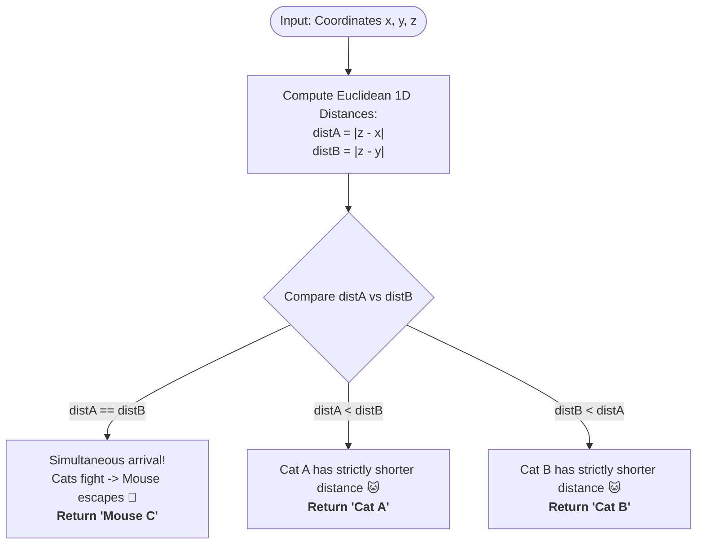

#### 📐 Complexity Formulas
- **Time Complexity**:
  $$T(n) = \mathcal{O}(1)$$
  *Explanation*: Involves exactly two absolute subtractions and a single ternary branch.
- **Space Complexity**:
  $$S(n) = \mathcal{O}(1)$$
  *Explanation*: Only two primitive float/integer variables (`distA`, `distB`) stored on the execution stack.
- **Source Code**: [`catsAndMouse.js`](Javascript/catsAndMouse.js)

---

### 2. Day of the Programmer

#### 📋 Problem Statement
Given a year in Russia between 1700 and 2700, determine the exact date string (`dd.mm.yyyy`) of the **256th day of the year**.
Russia shifted calendar systems across three distinct eras:
1. **Julian Calendar (1700 – 1917)**: Leap year if $year \pmod 4 = 0$.
2. **Transition Year (1918)**: The day after Jan 31 was Feb 14 (13 calendar days dropped).
3. **Gregorian Calendar (1919 – present)**: Leap year if $(year \pmod{400} = 0) \lor (year \pmod 4 = 0 \land year \pmod{100} \neq 0)$.

#### 🎨 Graphical Cartoon Animation
<p align="center">
  
</p>

#### 🌲 Decision Flowchart
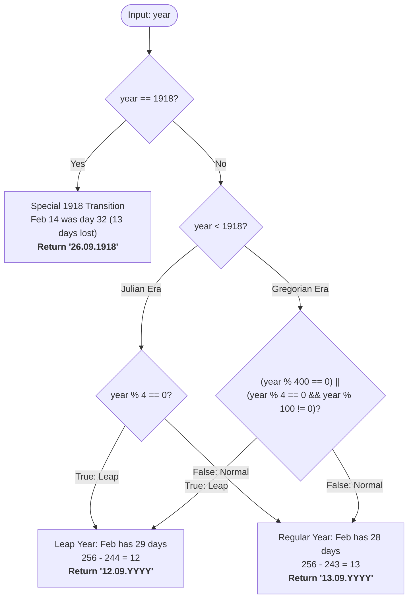

#### 📐 Complexity Formulas
- **Time Complexity**:
  $$T(n) = \mathcal{O}(1)$$
  *Explanation*: Evaluates constant modulo conditions and direct arithmetic offsets ($256 - 244 = 12$ or $256 - 243 = 13$).
- **Space Complexity**:
  $$S(n) = \mathcal{O}(1)$$
  *Explanation*: Zero dynamic heap allocations; formats a single output string.
- **Source Code**: [`dayOfProgrammerWay1.js`](Javascript/dayOfProgrammerWay1.js) (iterative) | [`dayOfProgrammerWay2.js`](Javascript/dayOfProgrammerWay2.js) (direct formula)

---

### 3. Divisible Sum Pairs

#### 📋 Problem Statement
Given an array of integers $ar$ of size $n$ and a positive integer $k$, calculate the total number of pairs $(i, j)$ such that:
$$0 \le i < j < n \quad \text{and} \quad (ar[i] + ar[j]) \equiv 0 \pmod k$$

#### 🎨 Graphical Cartoon Animation
<p align="center">
  
</p>

#### 🌲 Decision Flowchart
```mermaid
flowchart TD
    Start([Input: Array ar, Divisor k]) --> Init["Initialize remainder frequency array:<br/>freq = new Array(k).fill(0)<br/>pairCount = 0"]
    Init --> Loop["For each num in ar"]
    Loop --> Rem["rem = num % k<br/>complement = (k - rem) % k"]
    Rem --> AddPairs["pairCount += freq[complement]"]
    AddPairs --> UpdateFreq["freq[rem]++"]
    UpdateFreq --> More{"More elements?"}
    More -->|Yes| Loop
    More -->|No| Done([Return pairCount])
```

#### 📐 Complexity Formulas
- **Brute Force Approach**:
  $$T(n) = \sum_{i=0}^{n-1} (n - 1 - i) = \frac{n(n - 1)}{2} = \mathcal{O}(n^2), \quad S(n) = \mathcal{O}(1)$$
- **Optimal Frequency Bucketing**:
  $$T(n) = \mathcal{O}(n), \quad S(n) = \mathcal{O}(k)$$
  *Explanation*: A single scan maps elements into $k$ remainder buckets. For remainder $r$, its valid counterpart is $(k - r) \pmod k$.
- **Source Code**: [`divisibleSumPairs.js`](Javascript/divisibleSumPairs.js)

---

### 4. Drawing Book (Page Count)

#### 📋 Problem Statement
A book has $n$ pages. Page 1 is always on the right-hand side. Every subsequent turn exposes two pages: $(2, 3)$, $(4, 5)$, etc.
Given target page $p$, find the minimum number of page turns required starting either from the front (page 1) or from the back (page $n$).

#### 🎨 Graphical Cartoon Animation
<p align="center">
  
</p>

#### 🌲 Decision Flowchart
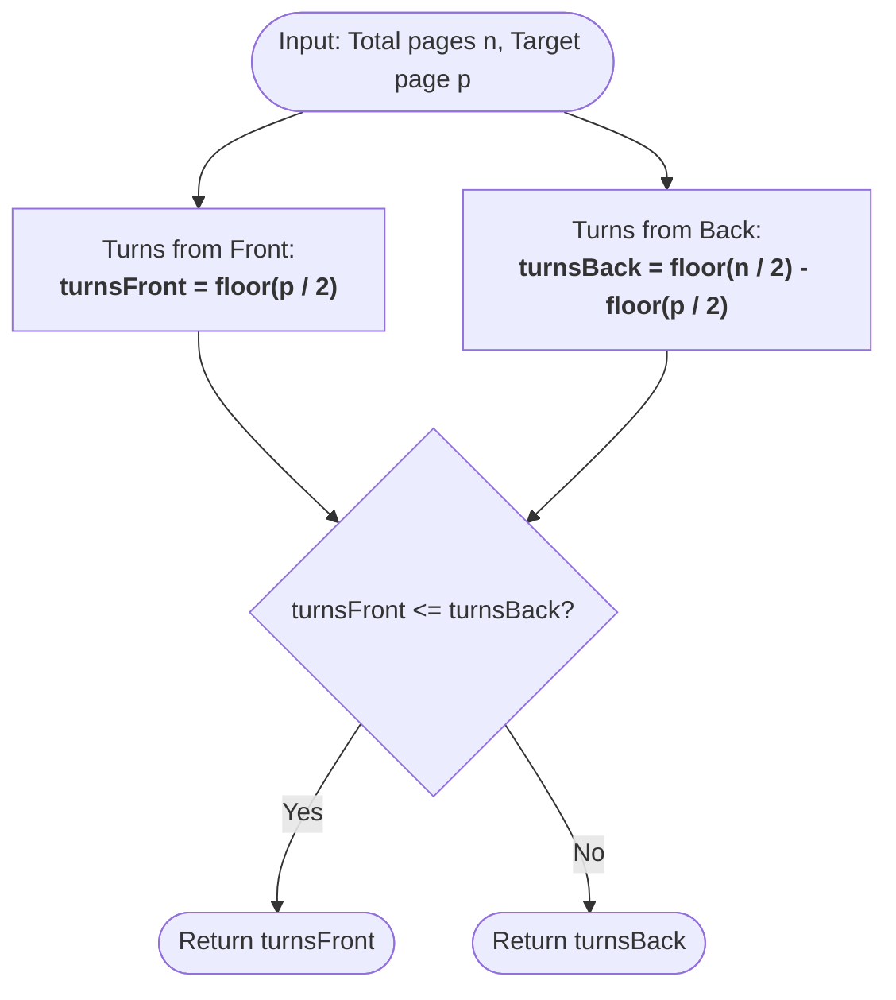

#### 📐 Complexity Formulas
- **Time Complexity**:
  $$T(n) = \mathcal{O}(1)$$
  *Explanation*: Evaluated via closed-form integer division:
  $$\text{minTurns}(n, p) = \min\left(\left\lfloor \frac{p}{2} \right\rfloor, \left\lfloor \frac{n}{2} \right\rfloor - \left\lfloor \frac{p}{2} \right\rfloor\right)$$
- **Space Complexity**:
  $$S(n) = \mathcal{O}(1)$$
  *Explanation*: Requires only two intermediate scalar values.
- **Source Code**: [`drawingBook.js`](Javascript/drawingBook.js)

---

### 5. Electronics Shop

#### 📋 Problem Statement
A buyer wants to purchase **exactly one keyboard** and **exactly one USB drive** with budget $b$.
Given keyboard prices array $K$ of size $n$ and USB drive prices array $D$ of size $m$:
- Maximize the spend: $\max(K[i] + D[j])$ such that $K[i] + D[j] \le b$.
- If no combination is within budget, return `-1`.

#### 🎨 Graphical Cartoon Animation
<p align="center">
  
</p>

#### 🌲 Decision Flowchart
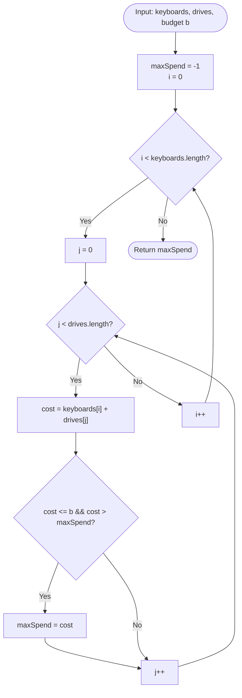

#### 📐 Complexity Formulas
- **Brute Force Approach**:
  $$T(n, m) = \mathcal{O}(n \cdot m), \quad S(n, m) = \mathcal{O}(1)$$
- **Sorted Two-Pointer Optimization**:
  $$T(n, m) = \mathcal{O}(n \log n + m \log m + (n + m)), \quad S(n, m) = \mathcal{O}(1)$$
  *Explanation*: Sort keyboards ascending and drives descending; increment or decrement pointers based on whether current sum exceeds budget $b$.
- **Source Code**: [`electronicsShop.js`](Javascript/electronicsShop.js)

---

### 6. Migratory Birds

#### 📋 Problem Statement
Given an array of bird sightings where each number denotes a bird type id ($1 \le \text{id} \le 5$). Find the most frequently sighted bird type. In case of frequency ties, return the **smallest type id**.

#### 🎨 Graphical Cartoon Animation
<p align="center">
  
</p>

#### 🌲 Decision Flowchart
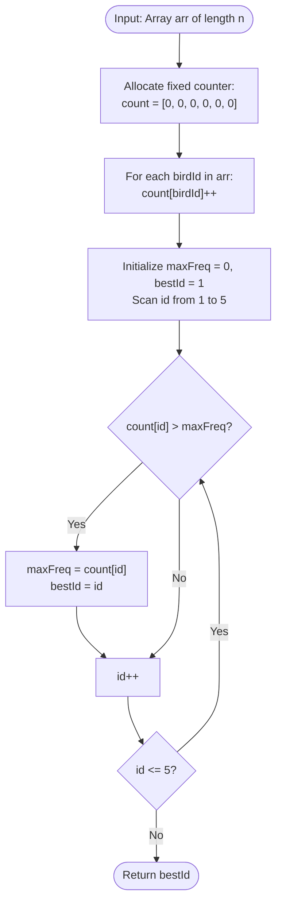

#### 📐 Complexity Formulas
- **Time Complexity**:
  $$T(n) = \mathcal{O}(n) + \mathcal{O}(K) = \mathcal{O}(n) \quad \text{where } K = 5$$
  *Explanation*: A single linear pass increments counts; scanning indices $1 \dots 5$ is bounded by constant 5 operations.
- **Space Complexity**:
  $$S(n) = \mathcal{O}(1)$$
  *Explanation*: Uses a fixed-size auxiliary array of length 6 regardless of $n$.
- **Source Code**: [`migratoryBirds.js`](Javascript/migratoryBirds.js) & [`migratoryBirdsWithLessComplexity.js`](Javascript/migratoryBirdsWithLessComplexity.js)

---

### 7. Sales by Match (Sock Merchant)

#### 📋 Problem Statement
Given an array of $n$ socks represented by integer color IDs, determine how many matching pairs of identical colors can be formed.

#### 🎨 Graphical Cartoon Animation
<p align="center">
  
</p>

#### 🌲 Decision Flowchart
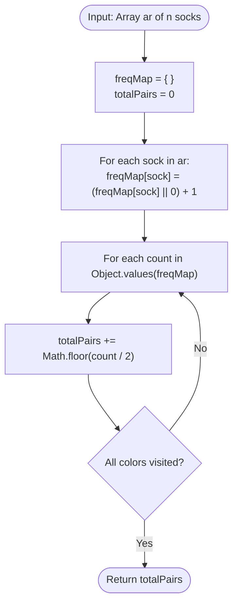

#### 📐 Complexity Formulas
- **Time Complexity**:
  $$T(n) = \mathcal{O}(n) + \mathcal{O}(u) = \mathcal{O}(n)$$
  *Explanation*: Where $u \le n$ is the number of distinct sock colors. Tallying takes $n$ steps and pair division takes $u$ steps.
- **Space Complexity**:
  $$S(n) = \mathcal{O}(u)$$
  *Explanation*: Hash table stores frequency keys for each distinct color $u$.
- **Source Code**: [`salesByMatch.js`](Javascript/salesByMatch.js)

---

### 8. Palindrome Verification

#### 📋 Problem Statement
Determine whether a given string reads identical forwards and backwards (e.g. `"racecar"`, `"121"`, `"madam"`).

#### 🎨 Graphical Cartoon Animation
<p align="center">
  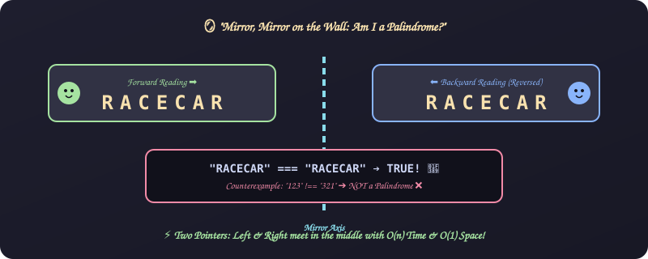
</p>

#### 🌲 Decision Flowchart
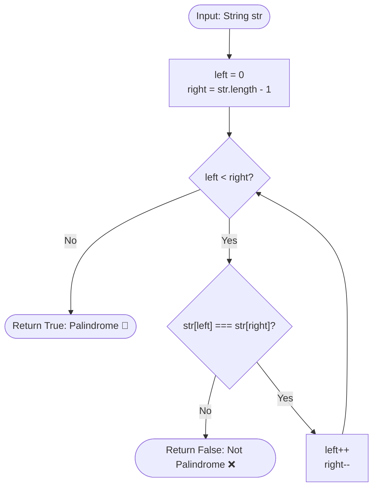

#### 📐 Complexity Formulas
- **Two-Pointer Approach**:
  $$T(n) = \mathcal{O}\left(\frac{n}{2}\right) = \mathcal{O}(n), \quad S(n) = \mathcal{O}(1)$$
  *Explanation*: Pointers converge from outer ends towards center without auxiliary heap memory.
- **Built-in String Reversal (`split.reverse.join`)**:
  $$T(n) = \mathcal{O}(n), \quad S(n) = \mathcal{O}(n)$$
  *Explanation*: Creates an intermediate array and new reversed string buffer.
- **Source Code**: [`validatePalidrom.js`](Javascript/validatePalidrom.js) & [`validatePalidromUsingFor.js`](Javascript/validatePalidromUsingFor.js)

---

### 9. Prime Number Validator & Filter

#### 📋 Problem Statement
Determine if an integer $N$ is prime (divisible only by 1 and itself) or filter an array of numbers to extract all primes.

#### 🎨 Graphical Cartoon Animation
<p align="center">
  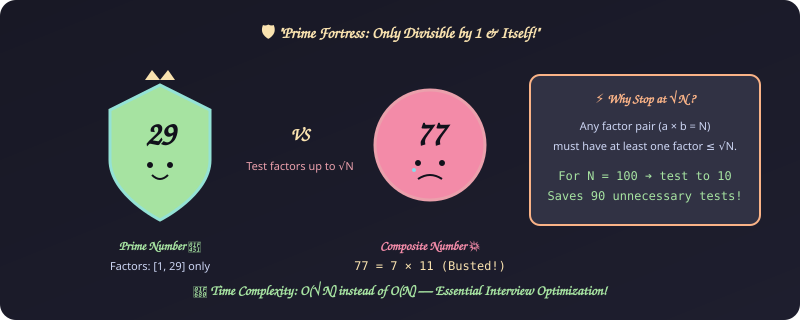
</p>

#### 🌲 Decision Flowchart
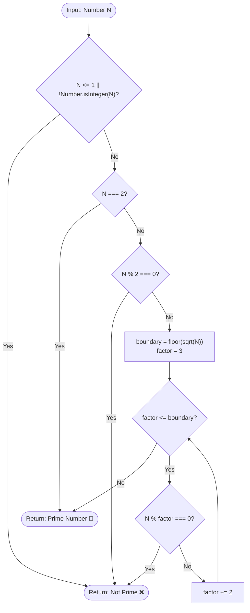

#### 📐 Complexity Formulas
- **Time Complexity**:
  $$T(N) = \mathcal{O}(\sqrt{N})$$
  *Explanation*: Any factor pair $a \times b = N$ requires $\min(a, b) \le \sqrt{N}$. If no divisor is found in $[2, \lfloor\sqrt{N}\rfloor]$, $N$ is guaranteed prime.
- **Space Complexity**:
  $$S(N) = \mathcal{O}(1)$$
  *Explanation*: Constant scalar memory for loop index and square root boundary.
- **Source Code**: [`validatePrimeNumber.js`](Javascript/validatePrimeNumber.js)

---

### 10. 2D Array - Hourglass Max Sum

#### 📋 Problem Statement
In a $6 \times 6$ 2D integer array, an hourglass shape is defined by 7 values:
```
a  b  c
   d
e  f  g
```
Compute all 16 hourglass sums and return the **maximum** value.

#### 🎨 Graphical Cartoon Animation
<p align="center">
  
</p>

#### 🌲 Decision Flowchart
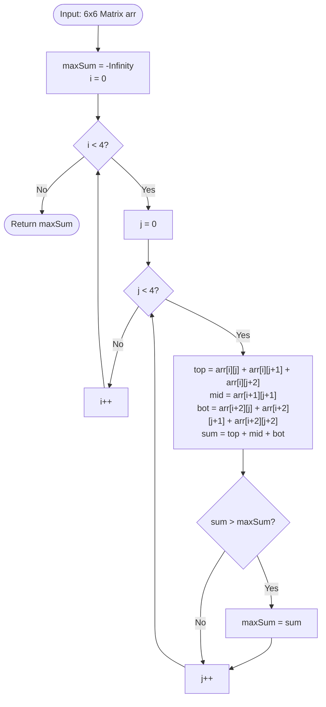

#### 📐 Complexity Formulas
- **Time Complexity**:
  $$T(R, C) = (R - 2) \times (C - 2) \times 7 = 4 \times 4 \times 7 = 112 \text{ operations} = \mathcal{O}(1)$$
  *Explanation*: Strictly bounded to 16 sliding windows on a fixed $6 \times 6$ grid.
- **Space Complexity**:
  $$S(R, C) = \mathcal{O}(1)$$
  *Explanation*: Operates directly in-place on the input matrix without auxiliary structures.
- **Source Code**: [`hourGalss.js`](Javascript/hourGalss.js)

---

### 11. Military Time Conversion (12h to 24h)

#### 📋 Problem Statement
Convert a 12-hour AM/PM timestamp string (e.g. `"07:05:45PM"`) into a 24-hour military clock string (`"19:05:45"`).

#### 🎨 Graphical Cartoon Animation
<p align="center">
  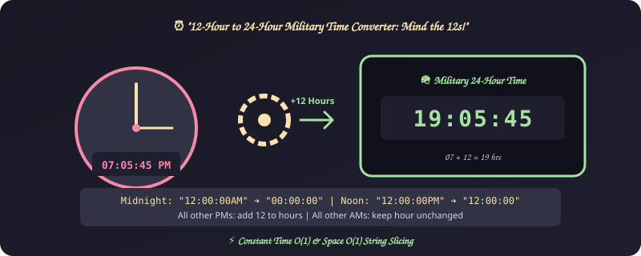
</p>

#### 🌲 Decision Flowchart
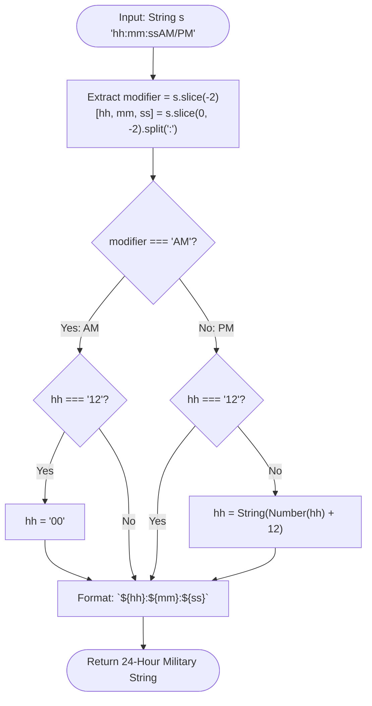

#### 📐 Complexity Formulas
- **Time Complexity**:
  $$T(n) = \mathcal{O}(1)$$
  *Explanation*: Slices and parses a string of constant length (exactly 10 characters).
- **Space Complexity**:
  $$S(n) = \mathcal{O}(1)$$
  *Explanation*: Allocates fixed substrings of size 2.
- **Source Code**: [`militaryTimeConverstion.js`](Javascript/militaryTimeConverstion.js)

---

### 12. First Duplicate Occurrence

#### 📋 Problem Statement
Given an array of integers, identify the first number whose duplicate is encountered as you scan from left to right. If all numbers are distinct, return `-1`.

#### 🎨 Graphical Cartoon Animation
<p align="center">
  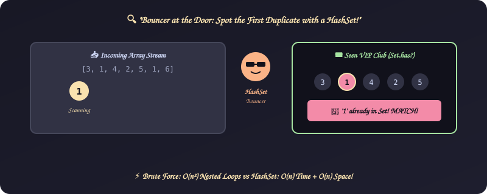
</p>

#### 🌲 Decision Flowchart
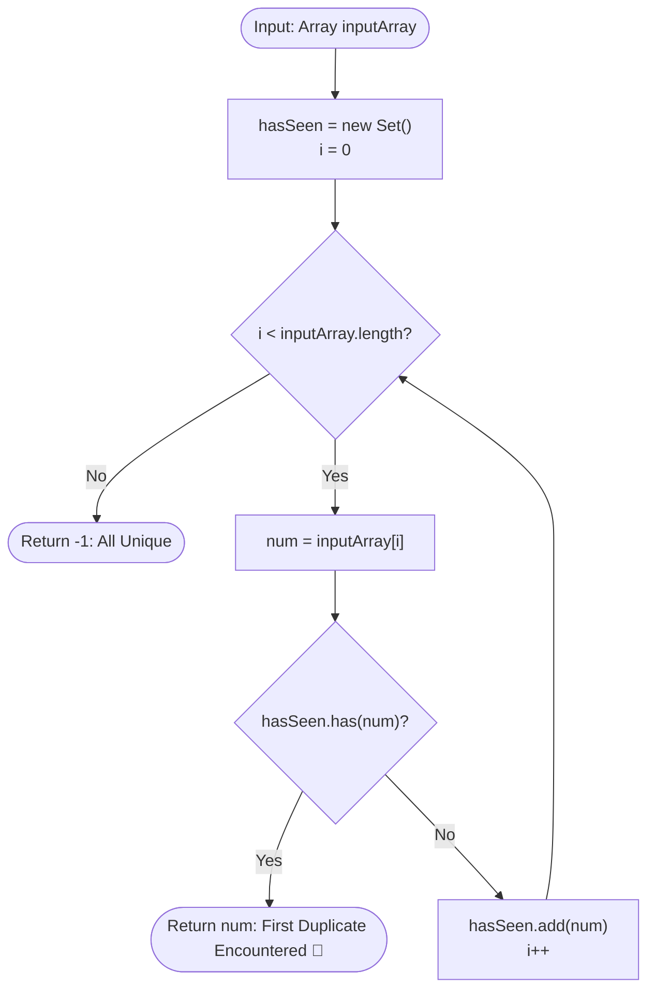

#### 📐 Complexity Formulas
- **Brute Force Nested Search**:
  $$T(n) = \mathcal{O}(n^2), \quad S(n) = \mathcal{O}(1)$$
- **Optimal Hash Set Lookup**:
  $$T(n) = \mathcal{O}(n), \quad S(n) = \mathcal{O}(n)$$
  *Explanation*: Hash set provides average $\mathcal{O}(1)$ insertion and lookup, completing search in at most $n$ queries.
- **Source Code**: [`problemNew.js`](Javascript/problemNew.js) (brute force) | [`problenNewSet.js`](Javascript/problenNewSet.js) (optimal set)

---

### 13. Bracket Combinations (Catalan Numbers)

#### 📋 Problem Statement
Given an integer $N \ge 0$, calculate the total number of well-formed, balanced bracket combinations that can be formed using $N$ pairs of parentheses.

#### 🎨 Graphical Cartoon Animation
<p align="center">
  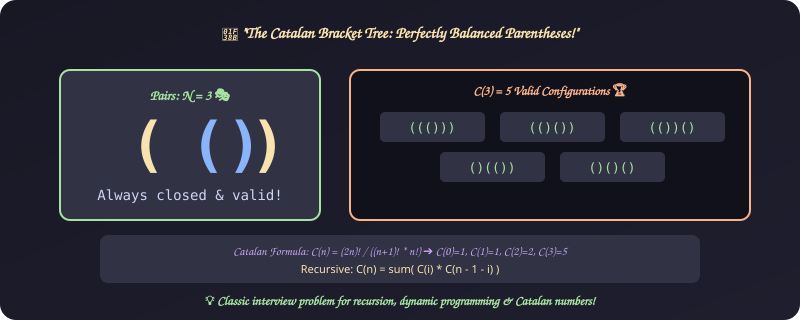
</p>

#### 🌲 Decision Flowchart
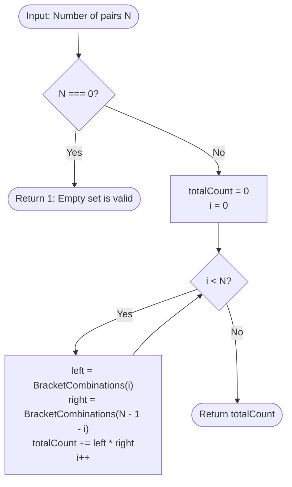

#### 📐 Complexity Formulas
- **Closed-Form Catalan Number**:
  $$C_n = \frac{1}{n + 1} \binom{2n}{n} = \frac{(2n)!}{(n + 1)! \, n!}$$
- **Time Complexity (Unmemoized Divide & Conquer)**:
  $$T(n) = \mathcal{O}\left(\frac{4^n}{n^{3/2}}\right)$$
- **Time Complexity (Dynamic Programming / Memoization)**:
  $$T(n) = \sum_{i=1}^n i = \mathcal{O}(n^2), \quad S(n) = \mathcal{O}(n)$$
- **Source Code**: [`bracket.js`](Javascript/bracket.js)

---

### 14. Reverse Array or String

#### 📋 Problem Statement
Reverse the elements of an array or string without using native `Array.prototype.reverse()`.

#### 🎨 Graphical Cartoon Animation
<p align="center">
  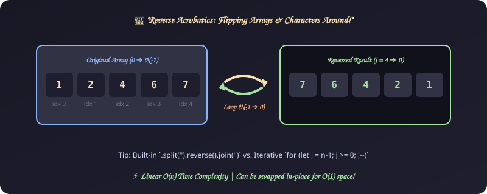
</p>

#### 🌲 Decision Flowchart
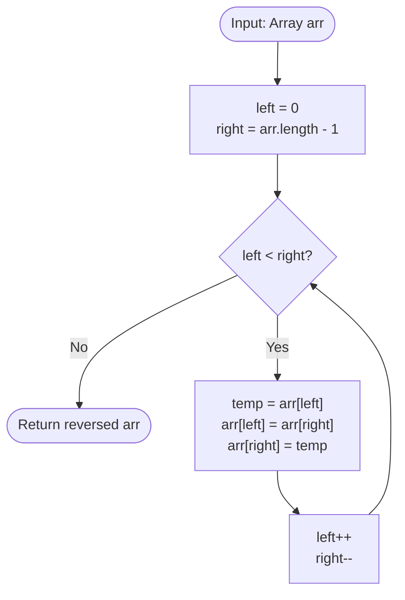

#### 📐 Complexity Formulas
- **Time Complexity**:
  $$T(n) = \mathcal{O}\left(\frac{n}{2}\right) = \mathcal{O}(n)$$
  *Explanation*: Performs $\lfloor n / 2 \rfloor$ pairwise swaps.
- **Space Complexity**:
  $$S(n) = \mathcal{O}(1) \text{ in-place}$$
  *Explanation*: Only a single temporary variable is used for pointer swapping.
- **Source Code**: [`reverseString.js`](Javascript/reverseString.js)

---

### 15. Character Frequency Count

#### 📋 Problem Statement
Given a string, count the occurrences of each individual character and return a frequency dictionary object `{ char: count }`.
Example: `"banana"` $\rightarrow$ `{ b: 1, a: 3, n: 2 }`.

#### 🎨 Graphical Cartoon Animation
<p align="center">
  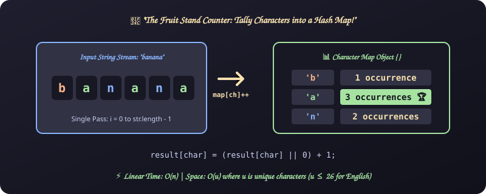
</p>

#### 🌲 Decision Flowchart
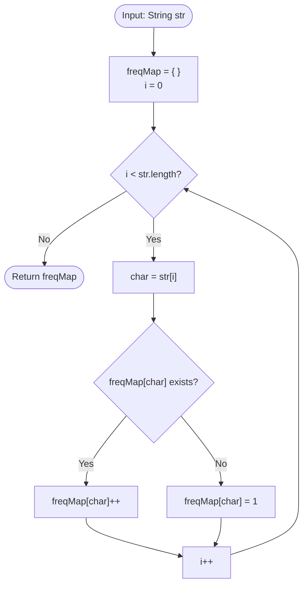

#### 📐 Complexity Formulas
- **Time Complexity**:
  $$T(n) = \mathcal{O}(n)$$
  *Explanation*: Traverses $n$ characters once with $\mathcal{O}(1)$ average object property lookups.
- **Space Complexity**:
  $$S(n) = \mathcal{O}(u)$$
  *Explanation*: Where $u \le n$ is the number of unique characters in string $str$ ($u \le 26$ for lowercase English alphabets).
- **Source Code**: [`chharCount.js`](Javascript/chharCount.js)

---

### 16. Cyclic Permutation of Digits (Number Doubling)

#### 📋 Problem Statement
Identify 6-digit integers $N \in [100000, 999999]$ such that multiplying $N$ by 2 produces a number containing the **exact same digits** in any permutation.
Famous example: $142857 \times 2 = 285714$.

#### 🎨 Graphical Cartoon Animation
<p align="center">
  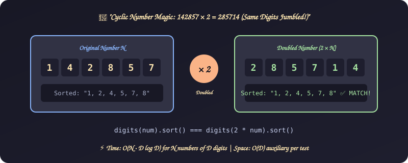
</p>

#### 🌲 Decision Flowchart
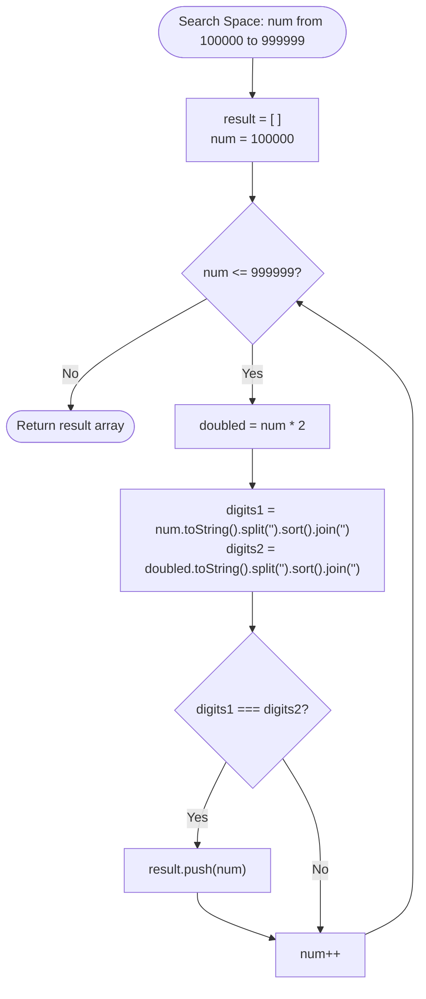

#### 📐 Complexity Formulas
- **Time Complexity**:
  $$T(N, D) = \mathcal{O}(N \cdot D \log D)$$
  *Explanation*: For $N = 900,000$ six-digit numbers ($D = 6$), each digit array of length $D$ is sorted in $D \log D$ steps. Since $D$ is a constant ($6$), runtime is effectively linear $\mathcal{O}(N)$.
- **Space Complexity**:
  $$S(D) = \mathcal{O}(D) = \mathcal{O}(1)$$
  *Explanation*: Digits array uses at most 6 characters per comparison iteration.
- **Source Code**: [`question.js`](Javascript/question.js) & [`sixDigit.js`](Javascript/sixDigit.js)

---

## 🚀 How to Practice with this Repository

1. **Read the Problem Statement**: Identify constraints, input types, and required return formats.
2. **Review the Cartoon Animation**: Form an intuitive visual mental model of the problem narrative.
3. **Trace the Decision Flowchart**: Step through base cases, condition branching, and edge cases.
4. **Inspect the Complexity Formulas**: Ensure you can mathematically justify $T(n)$ and $S(n)$ during interviews.
5. **Implement & Benchmark**: Code your solution independently and compare against the repository implementations!
