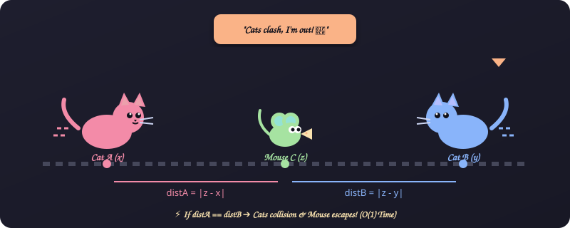
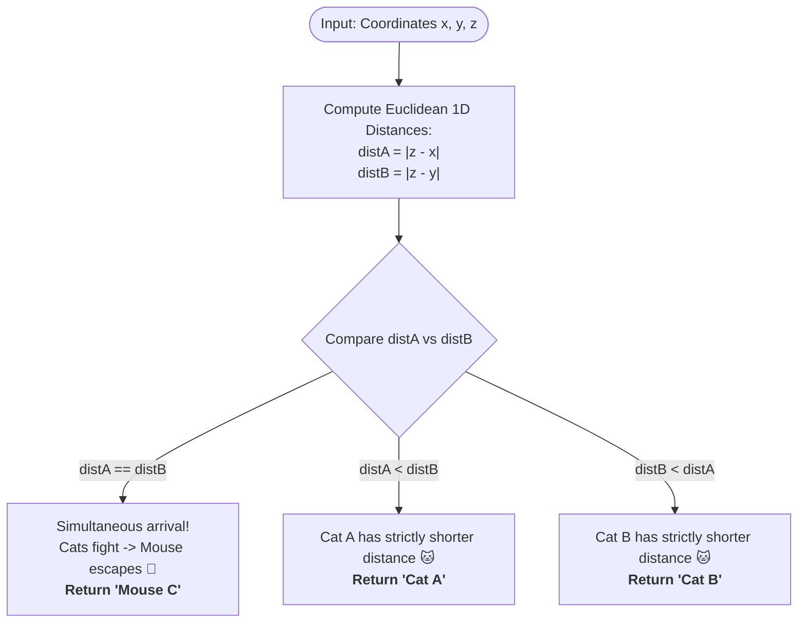

# 1. Cats and a Mouse

[⬅️ Back to Main Directory](../README.md)

---

### 📋 Problem Statement
Two cats and a mouse are positioned at coordinates on a 1D line:
- Cat A starts at position $x$.
- Cat B starts at position $y$.
- Mouse C starts at position $z$.

Both cats travel at the same constant speed towards the mouse. If both cats arrive at the mouse simultaneously, they clash and fight, allowing Mouse C to escape. Determine which entity prevails: `"Cat A"`, `"Cat B"`, or `"Mouse C"`.

---

### 🎨 Graphical Cartoon Animation

  

---

### 🌲 Decision Flowchart

---

### 📐 Complexity Formulas
- **Time Complexity**:
  $$T(n) = \mathcal{O}(1)$$
  *Explanation*: Involves exactly two absolute subtractions and a single ternary branch.
- **Space Complexity**:
  $$S(n) = \mathcal{O}(1)$$
  *Explanation*: Only two primitive float/integer variables (`distA`, `distB`) stored on the execution stack.

---

### 💻 Solution Code
- **Solution File**: [`Javascript/catsAndMouse.js`](../Javascript/catsAndMouse.js)
