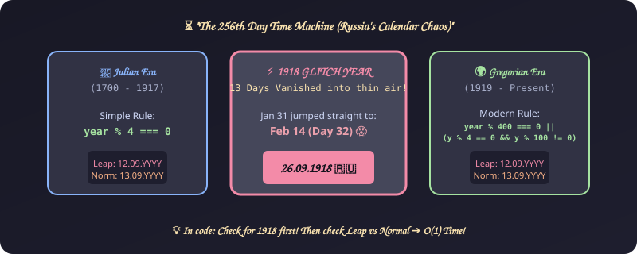
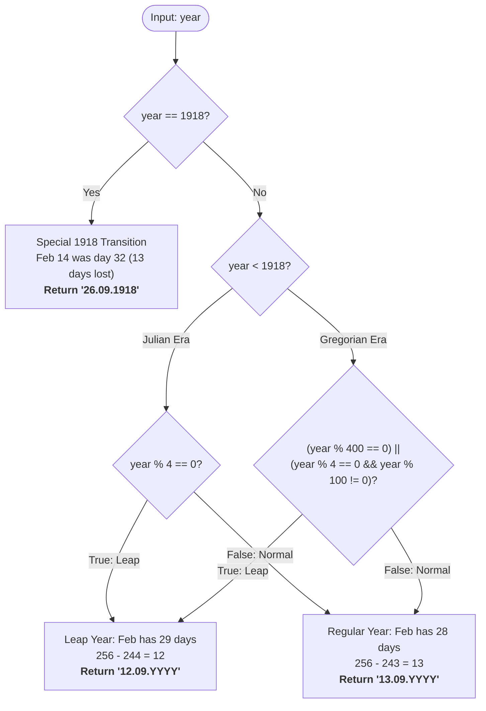

# 2. Day of the Programmer

[⬅️ Back to Main Directory](../README.md)

---

### 📋 Problem Statement
Given a year in Russia between 1700 and 2700, determine the exact date string (`dd.mm.yyyy`) of the **256th day of the year**.
Russia shifted calendar systems across three distinct eras:
1. **Julian Calendar (1700 – 1917)**: Leap year if $year \pmod 4 = 0$.
2. **Transition Year (1918)**: The day after Jan 31 was Feb 14 (13 calendar days dropped).
3. **Gregorian Calendar (1919 – present)**: Leap year if $(year \pmod{400} = 0) \lor (year \pmod 4 = 0 \land year \pmod{100} \neq 0)$.

---

### 🎨 Graphical Cartoon Animation

  

---

### 🌲 Decision Flowchart

---

### 📐 Complexity Formulas
- **Time Complexity**:
  $$T(n) = \mathcal{O}(1)$$
  *Explanation*: Evaluates constant modulo conditions and direct arithmetic offsets ($256 - 244 = 12$ or $256 - 243 = 13$).
- **Space Complexity**:
  $$S(n) = \mathcal{O}(1)$$
  *Explanation*: Zero dynamic heap allocations; formats a single output string.

---

### 💻 Solution Code
- **Approach 1 (Iterative month accumulation)**: [`Javascript/dayOfProgrammerWay1.js`](../Javascript/dayOfProgrammerWay1.js)
- **Approach 2 (Direct arithmetic formula)**: [`Javascript/dayOfProgrammerWay2.js`](../Javascript/dayOfProgrammerWay2.js)
