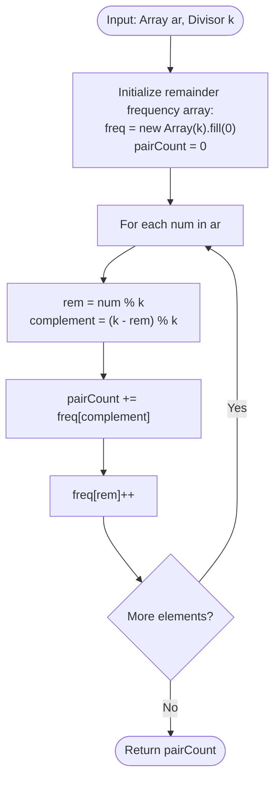

# 3. Divisible Sum Pairs

[⬅️ Back to Main Directory](../README.md)

---

### 📋 Problem Statement
Given an array of integers $ar$ of size $n$ and a positive integer $k$, calculate the total number of pairs $(i, j)$ such that:
$$0 \le i < j < n \quad \text{and} \quad (ar[i] + ar[j]) \equiv 0 \pmod k$$

---

### 🎨 Graphical Cartoon Animation

  

---

### 🌲 Decision Flowchart

---

### 📐 Complexity Formulas
- **Brute Force Approach**:
  $$T(n) = \sum_{i=0}^{n-1} (n - 1 - i) = \frac{n(n - 1)}{2} = \mathcal{O}(n^2), \quad S(n) = \mathcal{O}(1)$$
- **Optimal Frequency Bucketing**:
  $$T(n) = \mathcal{O}(n), \quad S(n) = \mathcal{O}(k)$$
  *Explanation*: A single scan maps elements into $k$ remainder buckets. For remainder $r$, its valid counterpart is $(k - r) \pmod k$.

---

### 💻 Solution Code
- **Solution File**: [`Javascript/divisibleSumPairs.js`](../Javascript/divisibleSumPairs.js)
