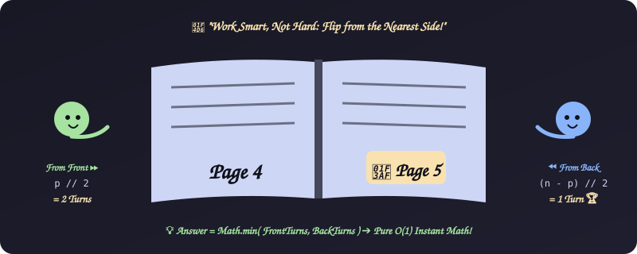
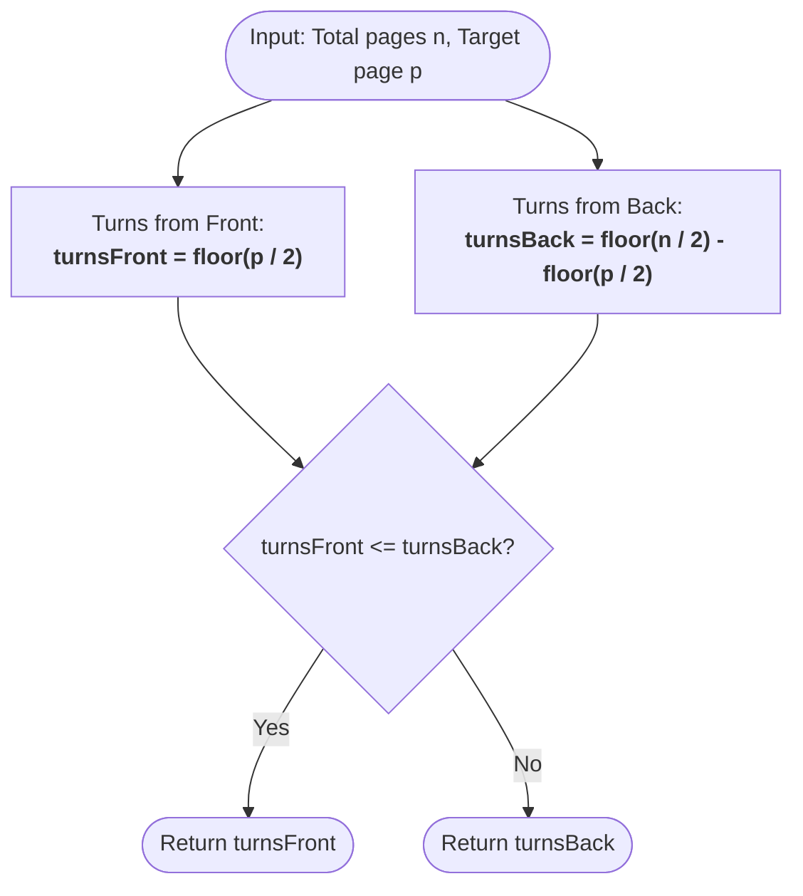

# 4. Drawing Book (Page Count)

[⬅️ Back to Main Directory](../README.md)

---

### 📋 Problem Statement
A book has $n$ pages. Page 1 is always on the right-hand side. Every subsequent turn exposes two pages: $(2, 3)$, $(4, 5)$, etc.
Given target page $p$, find the minimum number of page turns required starting either from the front (page 1) or from the back (page $n$).

---

### 🎨 Graphical Cartoon Animation

  

---

### 🌲 Decision Flowchart

---

### 📐 Complexity Formulas
- **Time Complexity**:
  $$T(n) = \mathcal{O}(1)$$
  *Explanation*: Evaluated via closed-form integer division:
  $$\text{minTurns}(n, p) = \min\left(\left\lfloor \frac{p}{2} \right\rfloor, \left\lfloor \frac{n}{2} \right\rfloor - \left\lfloor \frac{p}{2} \right\rfloor\right)$$
- **Space Complexity**:
  $$S(n) = \mathcal{O}(1)$$
  *Explanation*: Requires only two intermediate scalar values.

---

### 💻 Solution Code
- **Solution File**: [`Javascript/drawingBook.js`](../Javascript/drawingBook.js)
