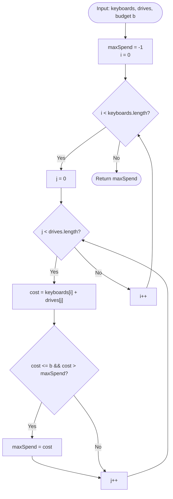

# 5. Electronics Shop

[⬅️ Back to Main Directory](../README.md)

---

### 📋 Problem Statement
A buyer wants to purchase **exactly one keyboard** and **exactly one USB drive** with budget $b$.
Given keyboard prices array $K$ of size $n$ and USB drive prices array $D$ of size $m$:
- Maximize the spend: $\max(K[i] + D[j])$ such that $K[i] + D[j] \le b$.
- If no combination is within budget, return `-1`.

---

### 🎨 Graphical Cartoon Animation

  

---

### 🌲 Decision Flowchart

---

### 📐 Complexity Formulas
- **Brute Force Approach**:
  $$T(n, m) = \mathcal{O}(n \cdot m), \quad S(n, m) = \mathcal{O}(1)$$
- **Sorted Two-Pointer Optimization**:
  $$T(n, m) = \mathcal{O}(n \log n + m \log m + (n + m)), \quad S(n, m) = \mathcal{O}(1)$$
  *Explanation*: Sort keyboards ascending and drives descending; increment or decrement pointers based on whether current sum exceeds budget $b$.

---

### 💻 Solution Code
- **Solution File**: [`Javascript/electronicsShop.js`](../Javascript/electronicsShop.js)
