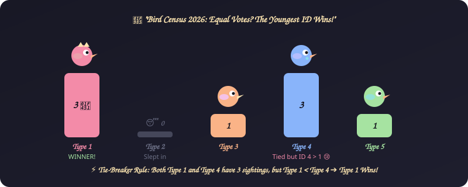
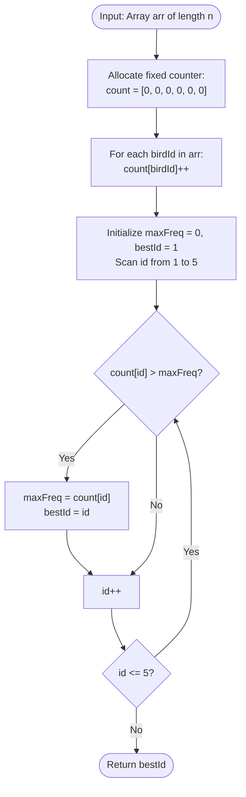

# 6. Migratory Birds

[⬅️ Back to Main Directory](../README.md)

---

### 📋 Problem Statement
Given an array of bird sightings where each number denotes a bird type id ($1 \le \text{id} \le 5$). Find the most frequently sighted bird type. In case of frequency ties, return the **smallest type id**.

---

### 🎨 Graphical Cartoon Animation

  

---

### 🌲 Decision Flowchart

---

### 📐 Complexity Formulas
- **Time Complexity**:
  $$T(n) = \mathcal{O}(n) + \mathcal{O}(K) = \mathcal{O}(n) \quad \text{where } K = 5$$
  *Explanation*: A single linear pass increments counts; scanning indices $1 \dots 5$ is bounded by constant 5 operations.
- **Space Complexity**:
  $$S(n) = \mathcal{O}(1)$$
  *Explanation*: Uses a fixed-size auxiliary array of length 6 regardless of $n$.

---

### 💻 Solution Code
- **Approach 1 (Standard frequency hash map)**: [`Javascript/migratoryBirds.js`](../Javascript/migratoryBirds.js)
- **Approach 2 (Fixed 6-element frequency array)**: [`Javascript/migratoryBirdsWithLessComplexity.js`](../Javascript/migratoryBirdsWithLessComplexity.js)
