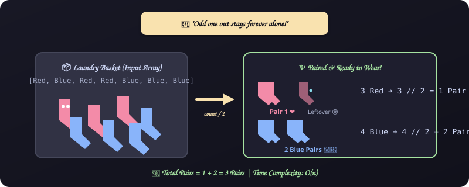
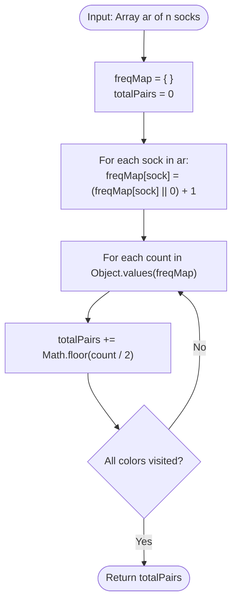

# 7. Sales by Match (Sock Merchant)

[⬅️ Back to Main Directory](../README.md)

---

### 📋 Problem Statement
Given an array of $n$ socks represented by integer color IDs, determine how many matching pairs of identical colors can be formed.

---

### 🎨 Graphical Cartoon Animation

  

---

### 🌲 Decision Flowchart

---

### 📐 Complexity Formulas
- **Time Complexity**:
  $$T(n) = \mathcal{O}(n) + \mathcal{O}(u) = \mathcal{O}(n)$$
  *Explanation*: Where $u \le n$ is the number of distinct sock colors. Tallying takes $n$ steps and pair division takes $u$ steps.
- **Space Complexity**:
  $$S(n) = \mathcal{O}(u)$$
  *Explanation*: Hash table stores frequency keys for each distinct color $u$.

---

### 💻 Solution Code
- **Solution File**: [`Javascript/salesByMatch.js`](../Javascript/salesByMatch.js)
