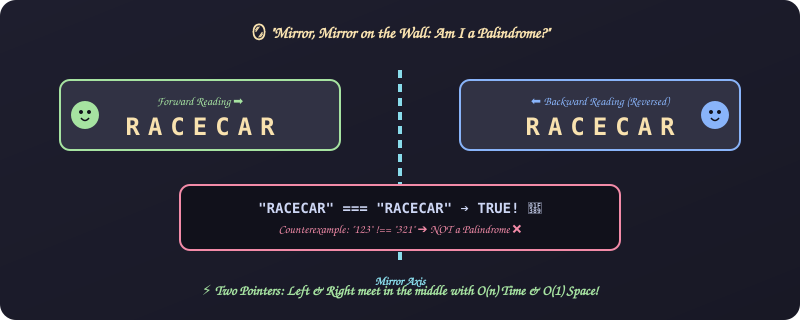
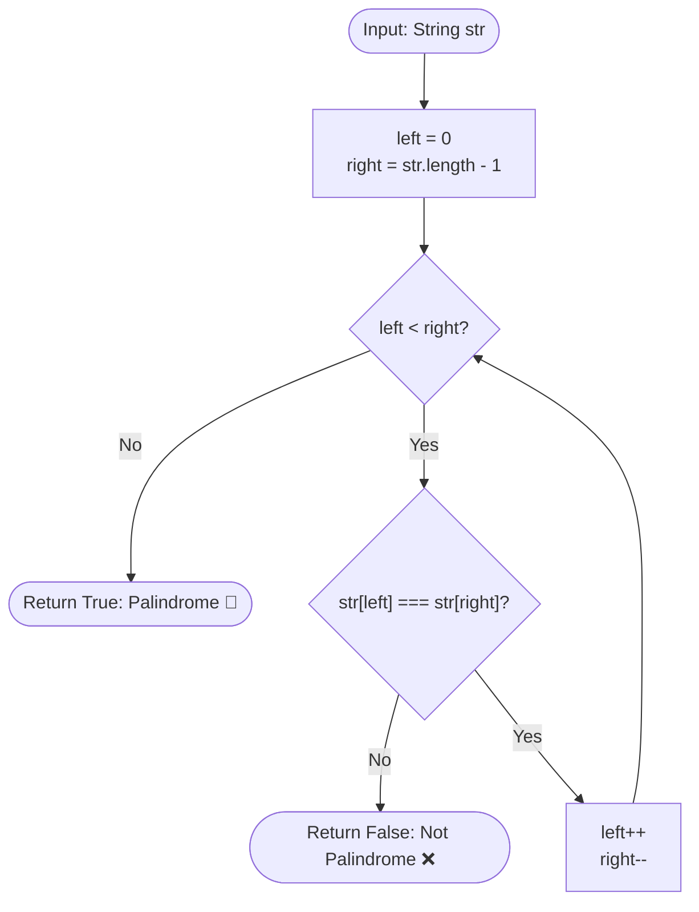

# 8. Palindrome Verification

[⬅️ Back to Main Directory](../README.md)

---

### 📋 Problem Statement
Determine whether a given string reads identical forwards and backwards (e.g. `"racecar"`, `"121"`, `"madam"`).

---

### 🎨 Graphical Cartoon Animation

  

---

### 🌲 Decision Flowchart

---

### 📐 Complexity Formulas
- **Two-Pointer Approach**:
  $$T(n) = \mathcal{O}\left(\frac{n}{2}\right) = \mathcal{O}(n), \quad S(n) = \mathcal{O}(1)$$
  *Explanation*: Pointers converge from outer ends towards center without auxiliary heap memory.
- **Built-in String Reversal (`split.reverse.join`)**:
  $$T(n) = \mathcal{O}(n), \quad S(n) = \mathcal{O}(n)$$
  *Explanation*: Creates an intermediate array and new reversed string buffer.

---

### 💻 Solution Code
- **Approach 1 (Built-in string methods)**: [`Javascript/validatePalidrom.js`](../Javascript/validatePalidrom.js)
- **Approach 2 (Iterative reverse loop)**: [`Javascript/validatePalidromUsingFor.js`](../Javascript/validatePalidromUsingFor.js)
