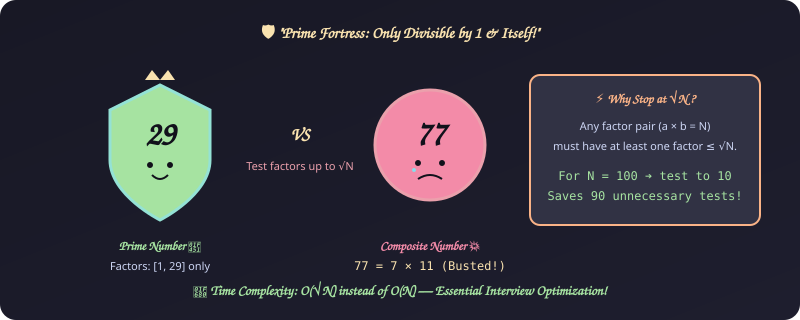
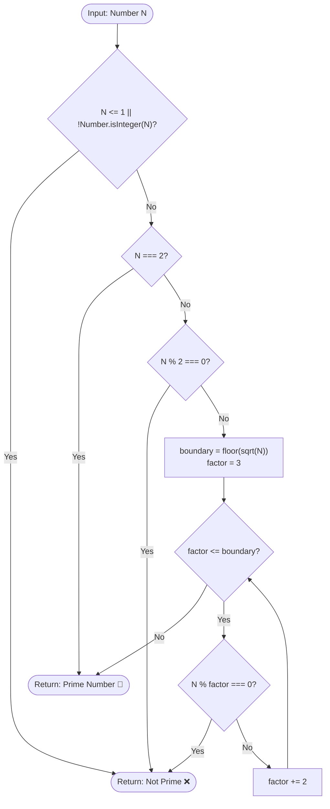

# 9. Prime Number Validator & Filter

[⬅️ Back to Main Directory](../README.md)

---

### 📋 Problem Statement
Determine if an integer $N$ is prime (divisible only by 1 and itself) or filter an array of numbers to extract all primes.

---

### 🎨 Graphical Cartoon Animation

  

---

### 🌲 Decision Flowchart

---

### 📐 Complexity Formulas
- **Time Complexity**:
  $$T(N) = \mathcal{O}(\sqrt{N})$$
  *Explanation*: Any factor pair $a \times b = N$ requires $\min(a, b) \le \sqrt{N}$. If no divisor is found in $[2, \lfloor\sqrt{N}\rfloor]$, $N$ is guaranteed prime.
- **Space Complexity**:
  $$S(N) = \mathcal{O}(1)$$
  *Explanation*: Constant scalar memory for loop index and square root boundary.

---

### 💻 Solution Code
- **Solution File**: [`Javascript/validatePrimeNumber.js`](../Javascript/validatePrimeNumber.js)
