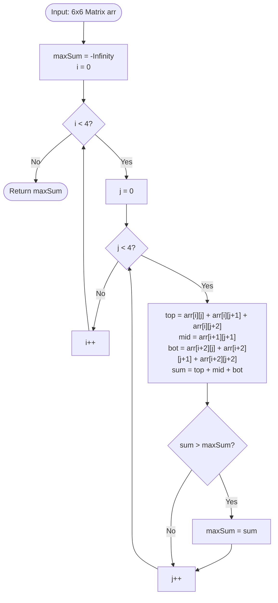

# 10. 2D Array - Hourglass Max Sum

[⬅️ Back to Main Directory](../README.md)

---

### 📋 Problem Statement
In a $6 \times 6$ 2D integer array, an hourglass shape is defined by 7 values:
```
a  b  c
   d
e  f  g
```
Compute all 16 hourglass sums and return the **maximum** value.

---

### 🎨 Graphical Cartoon Animation
<p align="center">
  
</p>

---

### 🌲 Decision Flowchart


---

### 📐 Complexity Formulas
- **Time Complexity**:
  $$T(R, C) = (R - 2) \times (C - 2) \times 7 = 4 \times 4 \times 7 = 112 \text{ operations} = \mathcal{O}(1)$$
  *Explanation*: Strictly bounded to 16 sliding windows on a fixed $6 \times 6$ grid.
- **Space Complexity**:
  $$S(R, C) = \mathcal{O}(1)$$
  *Explanation*: Operates directly in-place on the input matrix without auxiliary structures.

---

### 💻 Solution Code
- **Solution File**: [`Javascript/hourGalss.js`](../Javascript/hourGalss.js)
