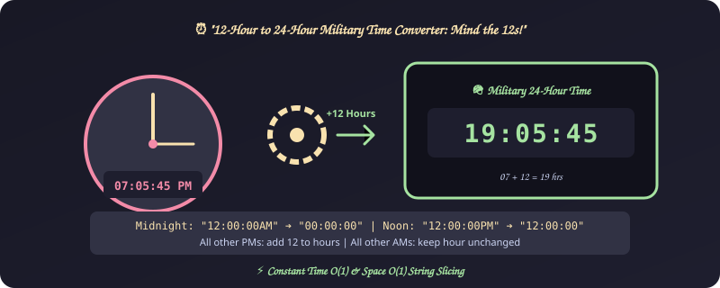
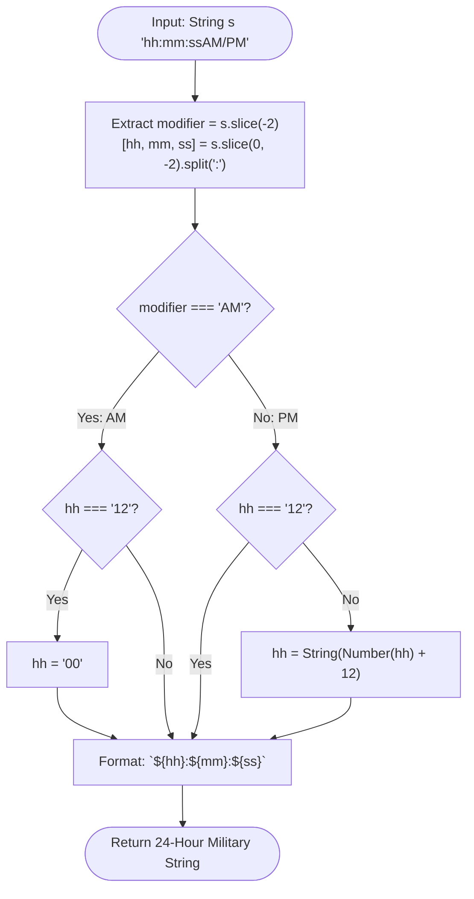

# 11. Military Time Conversion (12h to 24h)

[⬅️ Back to Main Directory](../README.md)

---

### 📋 Problem Statement
Convert a 12-hour AM/PM timestamp string (e.g. `"07:05:45PM"`) into a 24-hour military clock string (`"19:05:45"`).

---

### 🎨 Graphical Cartoon Animation

  

---

### 🌲 Decision Flowchart

---

### 📐 Complexity Formulas
- **Time Complexity**:
  $$T(n) = \mathcal{O}(1)$$
  *Explanation*: Slices and parses a string of constant length (exactly 10 characters).
- **Space Complexity**:
  $$S(n) = \mathcal{O}(1)$$
  *Explanation*: Allocates fixed substrings of size 2.

---

### 💻 Solution Code
- **Solution File**: [`Javascript/militaryTimeConverstion.js`](../Javascript/militaryTimeConverstion.js)
