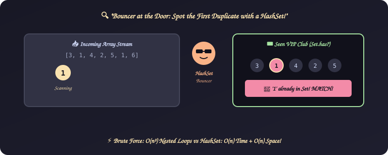
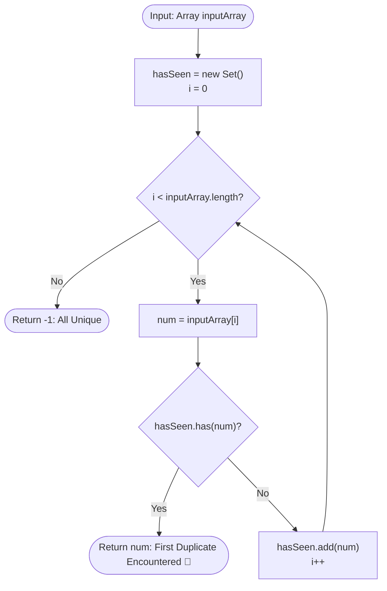

# 12. First Duplicate Occurrence

[⬅️ Back to Main Directory](../README.md)

---

### 📋 Problem Statement
Given an array of integers, identify the first number whose duplicate is encountered as you scan from left to right. If all numbers are distinct, return `-1`.

---

### 🎨 Graphical Cartoon Animation

  

---

### 🌲 Decision Flowchart

---

### 📐 Complexity Formulas
- **Brute Force Nested Search**:
  $$T(n) = \mathcal{O}(n^2), \quad S(n) = \mathcal{O}(1)$$
- **Optimal Hash Set Lookup**:
  $$T(n) = \mathcal{O}(n), \quad S(n) = \mathcal{O}(n)$$
  *Explanation*: Hash set provides average $\mathcal{O}(1)$ insertion and lookup, completing search in at most $n$ queries.

---

### 💻 Solution Code
- **Approach 1 (Brute force nested loop)**: [`Javascript/problemNew.js`](../Javascript/problemNew.js)
- **Approach 2 (Optimal Set lookup)**: [`Javascript/problenNewSet.js`](../Javascript/problenNewSet.js)
