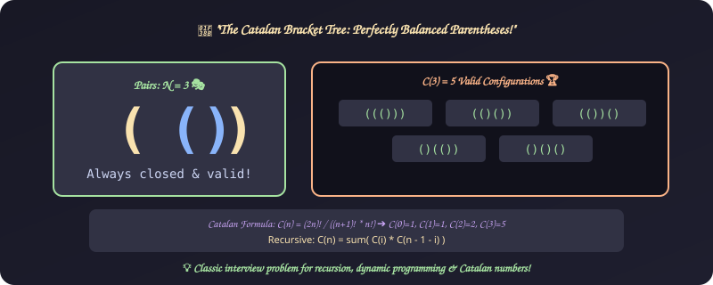
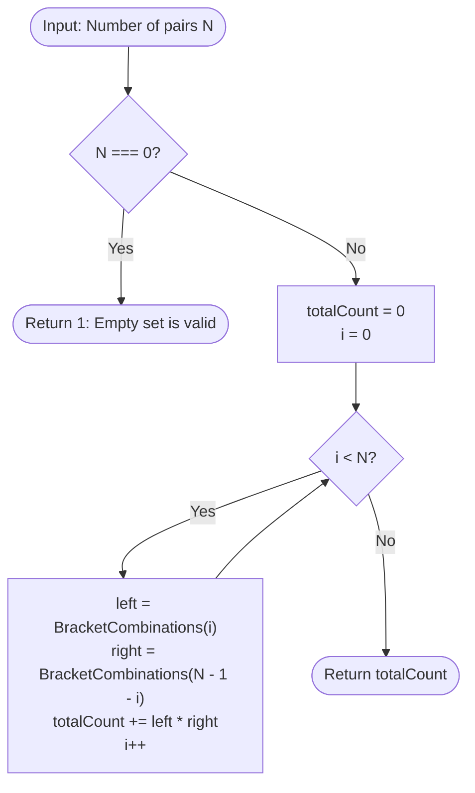

# 13. Bracket Combinations (Catalan Numbers)

[⬅️ Back to Main Directory](../README.md)

---

### 📋 Problem Statement
Given an integer $N \ge 0$, calculate the total number of well-formed, balanced bracket combinations that can be formed using $N$ pairs of parentheses.

---

### 🎨 Graphical Cartoon Animation

  

---

### 🌲 Decision Flowchart

---

### 📐 Complexity Formulas
- **Closed-Form Catalan Number**:
  $$C_n = \frac{1}{n + 1} \binom{2n}{n} = \frac{(2n)!}{(n + 1)! \, n!}$$
- **Time Complexity (Unmemoized Divide & Conquer)**:
  $$T(n) = \mathcal{O}\left(\frac{4^n}{n^{3/2}}\right)$$
- **Time Complexity (Dynamic Programming / Memoization)**:
  $$T(n) = \sum_{i=1}^n i = \mathcal{O}(n^2), \quad S(n) = \mathcal{O}(n)$$

---

### 💻 Solution Code
- **Solution File**: [`Javascript/bracket.js`](../Javascript/bracket.js)
