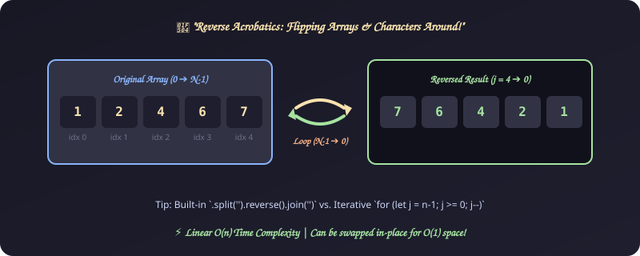
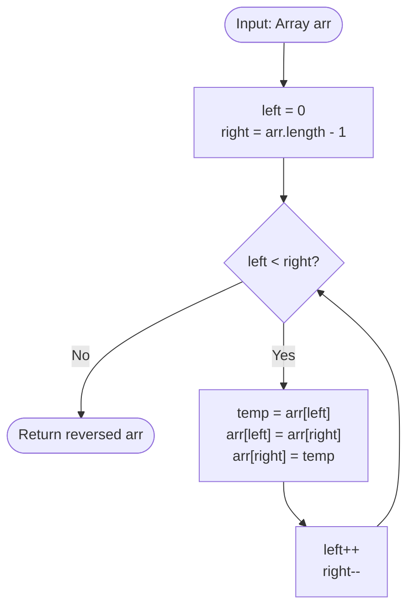

# 14. Reverse Array or String

[⬅️ Back to Main Directory](../README.md)

---

### 📋 Problem Statement
Reverse the elements of an array or string without using native `Array.prototype.reverse()`.

---

### 🎨 Graphical Cartoon Animation

  

---

### 🌲 Decision Flowchart

---

### 📐 Complexity Formulas
- **Time Complexity**:
  $$T(n) = \mathcal{O}\left(\frac{n}{2}\right) = \mathcal{O}(n)$$
  *Explanation*: Performs $\lfloor n / 2 \rfloor$ pairwise swaps.
- **Space Complexity**:
  $$S(n) = \mathcal{O}(1) \text{ in-place}$$
  *Explanation*: Only a single temporary variable is used for pointer swapping.

---

### 💻 Solution Code
- **Solution File**: [`Javascript/reverseString.js`](../Javascript/reverseString.js)
