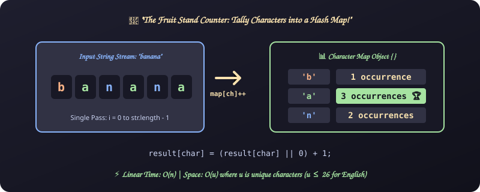
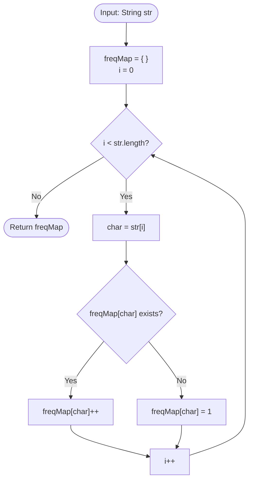

# 15. Character Frequency Count

[⬅️ Back to Main Directory](../README.md)

---

### 📋 Problem Statement
Given a string, count the occurrences of each individual character and return a frequency dictionary object `{ char: count }`.
Example: `"banana"` $\rightarrow$ `{ b: 1, a: 3, n: 2 }`.

---

### 🎨 Graphical Cartoon Animation

  

---

### 🌲 Decision Flowchart

---

### 📐 Complexity Formulas
- **Time Complexity**:
  $$T(n) = \mathcal{O}(n)$$
  *Explanation*: Traverses $n$ characters once with $\mathcal{O}(1)$ average object property lookups.
- **Space Complexity**:
  $$S(n) = \mathcal{O}(u)$$
  *Explanation*: Where $u \le n$ is the number of unique characters in string $str$ ($u \le 26$ for lowercase English alphabets).

---

### 💻 Solution Code
- **Solution File**: [`Javascript/chharCount.js`](../Javascript/chharCount.js)
