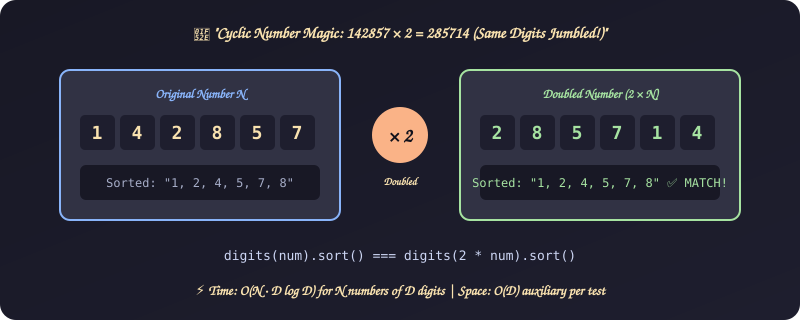
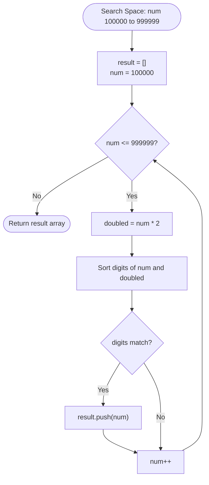

# 16. Cyclic Permutation of Digits (Number Doubling)

[⬅️ Back to Main Directory](../README.md)

---

### 📋 Problem Statement
Identify 6-digit integers $N \in [100000, 999999]$ such that multiplying $N$ by 2 produces a number containing the **exact same digits** in any permutation.
Famous example: $142857 \times 2 = 285714$.

---

### 🎨 Graphical Cartoon Animation

  

---

### 🌲 Decision Flowchart

---

### 📐 Complexity Formulas
- **Time Complexity**:
  $$T(N, D) = \mathcal{O}(N \cdot D \log D)$$
  *Explanation*: For $N = 900,000$ six-digit numbers ($D = 6$), each digit array of length $D$ is sorted in $D \log D$ steps. Since $D$ is a constant ($6$), runtime is effectively linear $\mathcal{O}(N)$.
- **Space Complexity**:
  $$S(D) = \mathcal{O}(D) = \mathcal{O}(1)$$
  *Explanation*: Digits array uses at most 6 characters per comparison iteration.

---

### 💻 Solution Code
- **Approach 1**: [`Javascript/question.js`](../Javascript/question.js)
- **Approach 2**: [`Javascript/sixDigit.js`](../Javascript/sixDigit.js)
