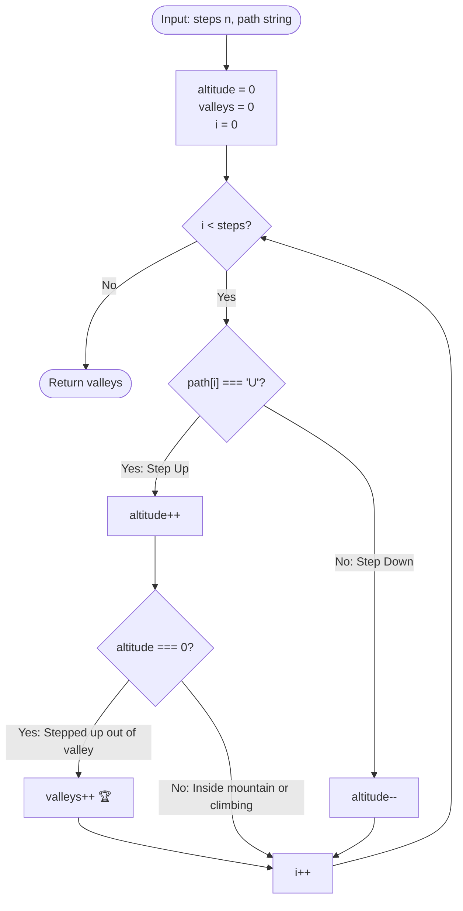

# 17. Counting Valleys

[⬅️ Back to Main Directory](../README.md)

---

### 📋 Problem Statement
An avid hiker tracks every single step of a hike as either `'U'` (uphill) or `'D'` (downhill).
The hike begins and concludes at sea level ($\text{altitude} = 0$), with each step causing a $+1$ or $-1$ change in vertical elevation.

- **Mountain**: A sequence of consecutive steps strictly above sea level ($\text{altitude} > 0$), beginning with a step up from sea level and ending with a step down to sea level.
- **Valley**: A sequence of consecutive steps strictly below sea level ($\text{altitude} < 0$), beginning with a step down from sea level and ending with a step up to sea level.

Given step count $n$ and the sequence of steps string `path`, count and return the total number of valleys traversed.

---

### 🎨 Graphical Cartoon Animation

  

---

### 🌲 Decision Flowchart

---

### 📐 Complexity Formulas
- **Time Complexity**:
  $$T(n) = \mathcal{O}(n)$$
  *Explanation*: Evaluates each step in the path string exactly once in a single linear pass of length $n$.
- **Space Complexity**:
  $$S(n) = \mathcal{O}(1)$$
  *Explanation*: Requires only two scalar integer counters (`altitude` and `valleys`), with zero dynamic heap allocations.

---

### 💻 Solution Code
- **Solution File**: [`Javascript/countingValleys.js`](../Javascript/countingValleys.js)
