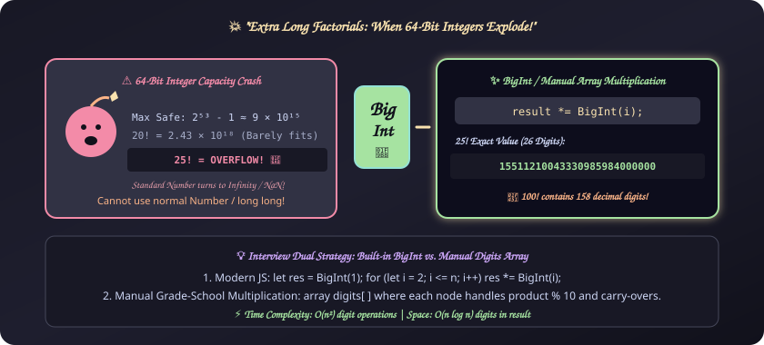
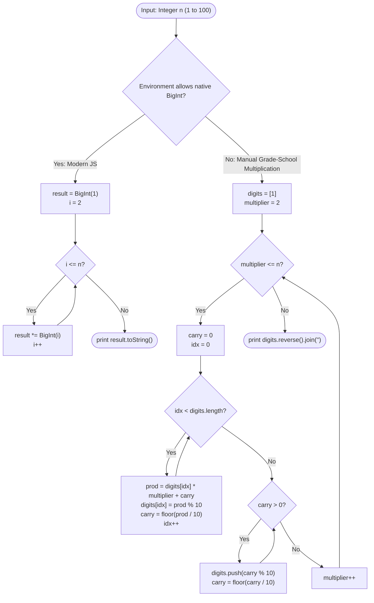

# 18. Extra Long Factorials

[⬅️ Back to Main Directory](../README.md)

---

### 📋 Problem Statement
The factorial of an integer $n$, written $n!$, is defined as:
$$n! = n \times (n - 1) \times (n - 2) \times \dots \times 3 \times 2 \times 1$$
Calculate and print the exact factorial of a given integer $n$ ($1 \le n \le 100$).

**The Core Challenge**:
Standard 64-bit integer formats (`long long` in C/C++, `Number.MAX_SAFE_INTEGER` in JavaScript = $2^{53} - 1 \approx 9 \times 10^{15}$) overflow around $n \ge 19$. For $n = 25$, $25!$ has 26 digits ($15,511,210,043,330,985,984,000,000$). For $n = 100$, $100!$ has **158 digits**! Arbitrary-precision numbers must be used.

---

### 🎨 Graphical Cartoon Animation

  

---

### 🌲 Decision Flowchart

---

### 📐 Complexity Formulas
- **Number of Digits in $n!$**:
  $$D(n) \approx \log_{10}(n!) = \sum_{i=1}^n \log_{10}(i) = \mathcal{O}(n \log n)$$
  *Example*: $100! \approx 9.33 \times 10^{157}$, yielding 158 digits.
- **Time Complexity**:
  $$T(n) = \sum_{k=2}^n \mathcal{O}(\text{digits in } (k-1)!) = \sum_{k=2}^n \mathcal{O}(k \log k) = \mathcal{O}(n^2 \log n) \approx \mathcal{O}(n^2)$$
  *Explanation*: Multiplying an array of size $k \log k$ digits by a scalar integer $k$ takes $\mathcal{O}(k \log k)$ operations.
- **Space Complexity**:
  $$S(n) = \mathcal{O}(n \log n)$$
  *Explanation*: Requires memory proportional to the length of the final digits string / array (158 digits for $n = 100$).

---

### 💻 Solution Code
- **Solution File**: [`Javascript/extraLongFactorials.js`](../Javascript/extraLongFactorials.js)
