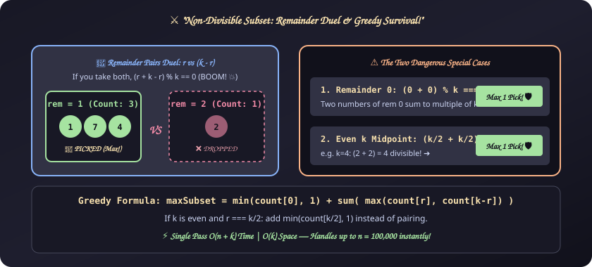
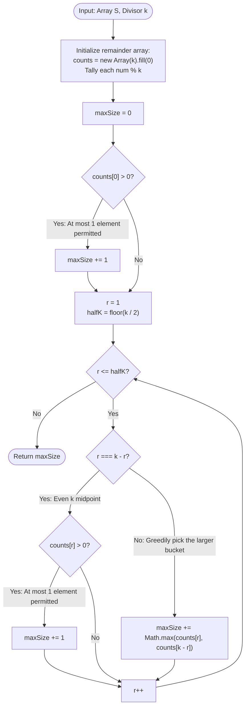

# 19. Non-Divisible Subset

[⬅️ Back to Main Directory](../README.md)

---

### 📋 Problem Statement
Given a set of distinct integers $S$ and an integer $k$, find and print the size of a **maximal subset** $S' \subseteq S$ such that the sum of any two numbers in $S'$ is **not evenly divisible** by $k$:
$$(a + b) \not\equiv 0 \pmod k \quad \forall a, b \in S', \, a \neq b$$

---

### 🎨 Graphical Cartoon Animation

  

---

### 🌲 Decision Flowchart

---

### 📐 Complexity Formulas
- **Mathematical Invariant**:
  $$(a + b) \equiv 0 \pmod k \iff ((a \bmod k) + (b \bmod k)) \equiv 0 \pmod k$$
  Therefore, numbers with remainder $r$ conflict exclusively with numbers having remainder $(k - r)$.
- **Greedy Selection Formula**:
  $$\text{Subset Size} = \min(1, \text{count}[0]) + \sum_{r=1}^{\lfloor k/2 \rfloor} \begin{cases} \min(1, \text{count}[r]) & \text{if } r = k - r \\ \max(\text{count}[r], \text{count}[k - r]) & \text{if } r \neq k - r \end{cases}$$
- **Time Complexity**:
  $$T(n, k) = \mathcal{O}(n + k)$$
  *Explanation*: A single linear pass through $n$ elements counts remainders, followed by $\lfloor k / 2 \rfloor$ greedy comparisons. Since $k \le 100$, this executes in sub-millisecond time.
- **Space Complexity**:
  $$S(k) = \mathcal{O}(k)$$
  *Explanation*: A fixed remainder frequency array of size $k \le 100$.

---

### 💻 Solution Code
- **Solution File**: [`Javascript/nonDivisibleSubset.js`](../Javascript/nonDivisibleSubset.js)
