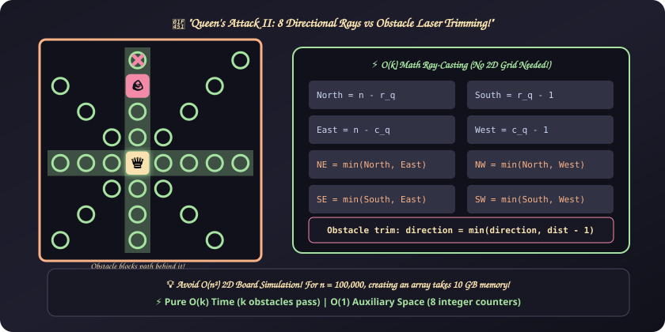

# 20. Queen's Attack II

[⬅️ Back to Main Directory](../README.md)

---

### 📋 Problem Statement
A queen is positioned on an $n \times n$ chessboard at square $(r_q, c_q)$. The board rows and columns are 1-indexed. Given $k$ obstacles located at coordinates $[r_o, c_o]$, calculate the total number of squares the queen can attack in a single move across all 8 cardinal and diagonal directions.

The queen can move any number of unobstructed squares in:
1. **Vertical**: North $(r+1, c)$, South $(r-1, c)$
2. **Horizontal**: East $(r, c+1)$, West $(r, c-1)$
3. **Diagonals**: North-East, North-West, South-East, South-West

An obstacle completely blocks the queen from attacking that square and any square situated behind it along that ray.

---

### 🎨 Graphical Cartoon Animation
<p align="center">
  
</p>

---

### 🌲 Decision Flowchart
```mermaid
flowchart TD
    Start(["Input: board n, queen (r_q, c_q), obstacles"]) --> InitRays["Initialize 8 distance bounds to edges:<br/>north = n - r_q, south = r_q - 1<br/>east = n - c_q, west = c_q - 1<br/>ne = min(n, e), nw = min(n, w)<br/>se = min(s, e), sw = min(s, w)"]
    InitRays --> ObstacleLoop{"For each obstacle (r_o, c_o)"}
    ObstacleLoop --> RayCheck{"Does obstacle lie on one of the 8 lines of sight?"}
    RayCheck -->|Vertical: dc === 0| TrimVert["dr &gt; 0: north = min(north, dr - 1)<br/>dr &lt; 0: south = min(south, -dr - 1)"] --> NextObs["Next Obstacle"]
    RayCheck -->|Horizontal: dr === 0| TrimHoriz["dc &gt; 0: east = min(east, dc - 1)<br/>dc &lt; 0: west = min(west, -dc - 1)"] --> NextObs
    RayCheck -->|Diagonal: abs(dr) === abs(dc)| TrimDiag["Prune NE, NW, SE, or SW to abs(dr) - 1"] --> NextObs
    RayCheck -->|Not in line of sight| NextObs
    NextObs --> MoreObs{"More obstacles?"}
    MoreObs -->|Yes| ObstacleLoop
    MoreObs -->|No| SumResult(["Return north + south + east + west + ne + nw + se + sw"])
```

---

### 📐 Complexity Formulas
- **Ray-Casting Invariant**:
  Instead of simulating grid cells ($\mathcal{O}(n)$ per direction which fails when $n = 100,000$), we initialize maximum ray reach from queen's coordinates:
  $$\begin{aligned}
  \text{North} &= n - r_q, & \text{South} &= r_q - 1 \\
  \text{East} &= n - c_q, & \text{West} &= c_q - 1 \\
  \text{NE} &= \min(\text{North}, \text{East}), & \text{NW} &= \min(\text{North}, \text{West}) \\
  \text{SE} &= \min(\text{South}, \text{East}), & \text{SW} &= \min(\text{South}, \text{West})
  \end{aligned}$$
- **Obstacle Trimming**:
  For an obstacle at $(r_o, c_o)$, if it intersects a direction ray, update:
  $$\text{reach} = \min(\text{reach}, \, \text{distance} - 1)$$
- **Time Complexity**:
  $$T(k) = \mathcal{O}(k)$$
  *Explanation*: A single pass over $k$ obstacles. Completely independent of the chessboard size $n$! Handles $n = 100,000$ in $\sim 5 \text{ ms}$.
- **Space Complexity**:
  $$S = \mathcal{O}(1)$$
  *Explanation*: Requires only 8 primitive directional integers.

---

### 💻 Solution Code
- **Solution File**: [`Javascript/queensAttack.js`](../Javascript/queensAttack.js)
