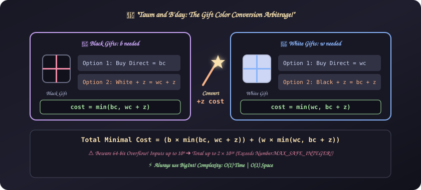
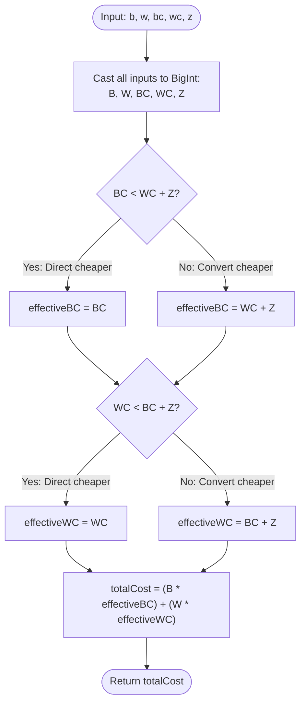

# 21. Taum and B'day

[⬅️ Back to Main Directory](../README.md)

---

### 📋 Problem Statement
Taum needs to purchase $b$ black gifts and $w$ white gifts for Diksha's birthday.
- Cost of buying a black gift directly = $bc$
- Cost of buying a white gift directly = $wc$
- Cost of converting a black gift to a white gift (or vice versa) = $z$

Determine the minimum total cost to obtain all required gifts.

---

### 🎨 Graphical Cartoon Animation

  

---

### 🌲 Decision Flowchart

---

### 📐 Complexity Formulas
- **Cost Arbitrage Formula**:
  $$\begin{aligned}
  \text{cost}_{\text{black}} &= \min(bc, \, wc + z) \\
  \text{cost}_{\text{white}} &= \min(wc, \, bc + z) \\
  \text{Total Cost} &= b \times \text{cost}_{\text{black}} + w \times \text{cost}_{\text{white}}
  \end{aligned}$$
- **Integer Overflow Considerations**:
  Since $b, w, bc, wc, z \le 10^9$, the maximum possible total cost is:
  $$\text{Max Cost} = 10^9 \times 10^9 + 10^9 \times 10^9 = 2 \times 10^{18}$$
  Standard 64-bit IEEE 754 floating-point (`Number.MAX_SAFE_INTEGER` $\approx 9 \times 10^{15}$) will lose precision. Using `BigInt` guarantees exact integer calculations.
- **Time Complexity**:
  $$T = \mathcal{O}(1)$$
  *Explanation*: A constant number of comparisons, additions, and multiplications.
- **Space Complexity**:
  $$S = \mathcal{O}(1)$$
  *Explanation*: Fixed number of primitive `BigInt` variables on the stack.

---

### 💻 Solution Code
- **Solution File**: [`Javascript/taumBday.js`](../Javascript/taumBday.js)
