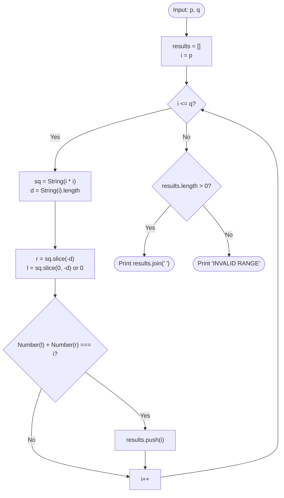

# 22. Modified Kaprekar Numbers

[⬅️ Back to Main Directory](../README.md)

---

### 📋 Problem Statement
A **modified Kaprekar number** is a positive whole number $n$ with $d$ digits such that:
1. Square it: $sq = n^2$ (which has either $2d - 1$ or $2d$ digits).
2. Split the string of $sq$ into two parts:
   - **Right part $r$**: exactly the last $d$ digits (may have leading zeros).
   - **Left part $l$**: the remaining prefix (treated as $0$ if empty).
3. If $l + r = n$, then $n$ is a modified Kaprekar number.

Given two positive integers $p < q$, print every modified Kaprekar number in $[p, q]$ space-separated in ascending order, or `INVALID RANGE` if there are none.

**Examples**
| $n$ | $n^2$ | $l$ | $r$ | $l + r$ | Kaprekar? |
|:---:|:---:|:---:|:---:|:---:|:---:|
| 1 | 1 | — (0) | 1 | 1 | ✅ |
| 5 | 25 | 2 | 5 | 7 | ❌ |
| 9 | 81 | 8 | 1 | 9 | ✅ |
| 45 | 2025 | 20 | 25 | 45 | ✅ |
| 99 | 9801 | 98 | 01 | 99 | ✅ |
| 297 | 88209 | 88 | 209 | 297 | ✅ |

**Sample**: `p = 1, q = 100` ➔ `1 9 45 55 99`

> **Spot the difference vs. the original Kaprekar number:** the original lets you split the square *anywhere*. The modified version fixes the split point: the right part must be exactly $d$ digits, where $d$ is the digit count of $n$.

---

### 🎨 Graphical Cartoon Animation

  

---

### 🌲 Decision Flowchart

---

### 🧠 Key Insights & Edge Cases
- **Empty left part**: For $n = 1$, $1^2 = 1$ has only $d = 1$ digit, so `sq.slice(0, -1)` is `""`. Treat it as $0$ (`parseInt("")` is `NaN`, so guard against it).
- **Leading zeros in $r$**: $99^2 = 9801$ ➔ $r = \text{"01"} = 1$. `parseInt("01", 10)` correctly gives $1$.
- **Right part of zero**: For $n = 10$, $100 \to l = 1, r = 00 = 0$, sum $= 1 \neq 10$. Using `|| 0` keeps `r` a number.
- **No overflow**: With $q \le 10^5$, $n^2 \le 10^{10}$, far below `Number.MAX_SAFE_INTEGER` $\approx 9 \times 10^{15}$. No `BigInt` needed.
- **String vs. math split**: Equivalently, $r = n^2 \bmod 10^d$ and $l = \lfloor n^2 / 10^d \rfloor$. That avoids string allocation entirely.

---

### 📐 Complexity Formulas
- **Kaprekar Condition**:
  $$\begin{aligned}
  d &= \lfloor \log_{10} n \rfloor + 1 \\
  r &= n^2 \bmod 10^{d} \\
  l &= \left\lfloor \frac{n^2}{10^{d}} \right\rfloor \\
  n \text{ is Kaprekar} &\iff l + r = n
  \end{aligned}$$
- **Time Complexity**:
  $$T = \mathcal{O}\big((q - p + 1) \cdot d\big)$$
  *Explanation*: Each number in the range is squared and split once; converting to string and slicing costs $\mathcal{O}(d)$, where $d \le 6$ for the given constraints, so it is effectively linear in the range size.
- **Space Complexity**:
  $$S = \mathcal{O}(k + d)$$
  *Explanation*: $k$ Kaprekar numbers are stored for output (very few exist; only 5 in $[1, 100]$), plus $\mathcal{O}(d)$ temporary strings per iteration.

---

### 💻 Solution Code
- **Solution File**: [`Javascript/kaprekarNumbers.js`](../Javascript/kaprekarNumbers.js)
