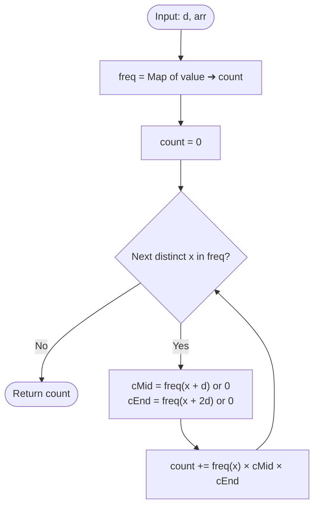

# 23. Beautiful Triplets

[⬅️ Back to Main Directory](../README.md)

---

### 📋 Problem Statement
Given a sequence of integers $arr$ sorted ascending and a value $d$, a triplet $(arr[i], arr[j], arr[k])$ is **beautiful** if:
1. $i < j < k$
2. $arr[j] - arr[i] = arr[k] - arr[j] = d$

Count the number of beautiful triplets in the sequence.

**Examples**
| $arr$ | $d$ | Beautiful triplets (by index) | Answer |
|:---:|:---:|:---:|:---:|
| `[2, 2, 3, 4, 5]` | 1 | `[0,2,3]`, `[1,2,3]`, `[2,3,4]` | **3** |
| `[1, 2, 4, 5, 7, 8, 10]` | 3 | `(1,4,7)`, `(4,7,10)`, `(2,5,8)` | **3** |
| `[1, 2, 3]` | 5 | — | **0** |

**Constraints**: $1 \le n \le 10^4$, $1 \le d \le 20$, $0 \le arr[i] \le 2 \times 10^4$, $arr[i] > arr[i-1]$.

---

### 🎨 Graphical Cartoon Animation

  

---

### 🌲 Decision Flowchart

---

### 🧠 Key Insights & Edge Cases
- **A triplet is just $(x,\ x+d,\ x+2d)$**: Both gaps equal $d$, so the middle and last values are fixed once you pick the first.
- **Sorted ➔ index order is free**: In a sorted array every $x$ sits before every $x+d$, which sits before every $x+2d$. So $i < j < k$ never needs checking.
- **Duplicates (the sample `[2, 2, 3, 4, 5]`)**: The constraints say strictly increasing, but the example has two `2`s. Multiplying counts, $2 \times 1 \times 1 = 2$ for $x = 2$ plus $1$ for $x = 3$, gives $3$, which matches the expected index-based answer.
- **Missing values**: `freq.get(...) || 0` turns a missing $x+d$ or $x+2d$ into $0$, which zeroes out that term.
- **Brute force**: Three nested loops is $\mathcal{O}(n^3) \approx 10^{12}$ for $n = 10^4$. Too slow. The hash-map approach is linear.
- **Strictly increasing shortcut**: If values are unique, the answer is simply how many $x$ have both $x+d$ and $x+2d$ present (a `Set` is enough).

---

### 📐 Complexity Formulas
- **Counting Formula**:
  $$\text{answer} = \sum_{x \in arr} c(x) \cdot c(x + d) \cdot c(x + 2d)$$
  where $c(v)$ is how many times $v$ occurs in $arr$ (summed over distinct $x$).
- **Time Complexity**:
  $$T = \mathcal{O}(n)$$
  *Explanation*: One pass to build the frequency map, then one pass over at most $n$ distinct values with $\mathcal{O}(1)$ lookups.
- **Space Complexity**:
  $$S = \mathcal{O}(n)$$
  *Explanation*: The frequency map holds up to $n$ distinct values.

---

### 💻 Solution Code
- **Solution File**: [`Javascript/beautifulTriplets.js`](../Javascript/beautifulTriplets.js)
