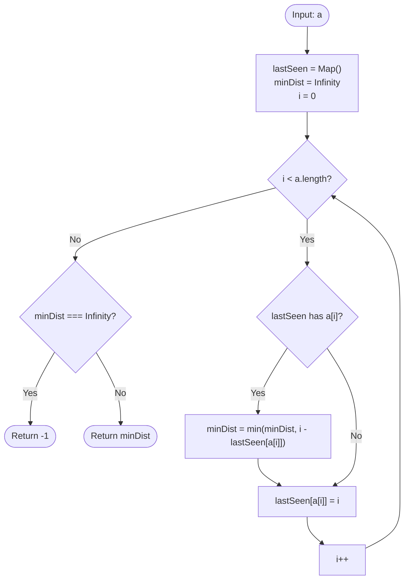

# 24. Minimum Distances

[⬅️ Back to Main Directory](../README.md)

---

### 📋 Problem Statement
The **distance** between two array values is the number of indices between them: $d[i, j] = |j - i|$.

Given an array $a$, find the minimum distance between any pair of **equal** elements. If no such pair exists, return $-1$.

**Examples**
| $a$ | Equal pairs (indices ➔ distance) | Answer |
|:---:|:---:|:---:|
| `[3, 2, 1, 2, 3]` | 3: (0,4) ➔ 4, 2: (1,3) ➔ 2 | **2** |
| `[7, 1, 3, 4, 1, 7]` | 7: (0,5) ➔ 5, 1: (1,4) ➔ 3 | **3** |
| `[1, 2, 3, 4]` | — | **-1** |

**Constraints**: $1 \le n \le 10^3$, $1 \le a[i] \le 10^5$.

---

### 🎨 Graphical Cartoon Animation

  

---

### 🌲 Decision Flowchart

---

### 🧠 Key Insights & Edge Cases
- **Only consecutive occurrences matter**: If a value appears at $p_1 < p_2 < p_3$, then $p_3 - p_1 > p_3 - p_2$. The closest pair for any value is always two neighbouring occurrences, so remembering just the **last** index is enough.
- **Always overwrite `lastSeen`**: Update the index even after a match. Otherwise `[5, 1, 5, 5]` would compare index 3 against index 0 instead of index 2 and miss the answer $1$.
- **No repeats**: `minDist` stays `Infinity`, so return $-1$.
- **Early exit (optional)**: The smallest possible distance is $1$, so you can stop as soon as you find it.
- **Brute force**: Comparing every pair is $\mathcal{O}(n^2) = 10^6$ for $n = 10^3$, which also passes. The single pass is cleaner and scales better.

---

### 📐 Complexity Formulas
- **Distance Formula**:
  $$\text{answer} = \min_{\substack{i < j \\ a[i] = a[j]}} (j - i), \quad \text{or } -1 \text{ if no such pair}$$
- **Time Complexity**:
  $$T = \mathcal{O}(n)$$
  *Explanation*: One pass over the array; each step does an $\mathcal{O}(1)$ map lookup and update.
- **Space Complexity**:
  $$S = \mathcal{O}(n)$$
  *Explanation*: The map stores one last-seen index per distinct value.

---

### 💻 Solution Code
- **Solution File**: [`Javascript/minimumDistances.js`](../Javascript/minimumDistances.js)
