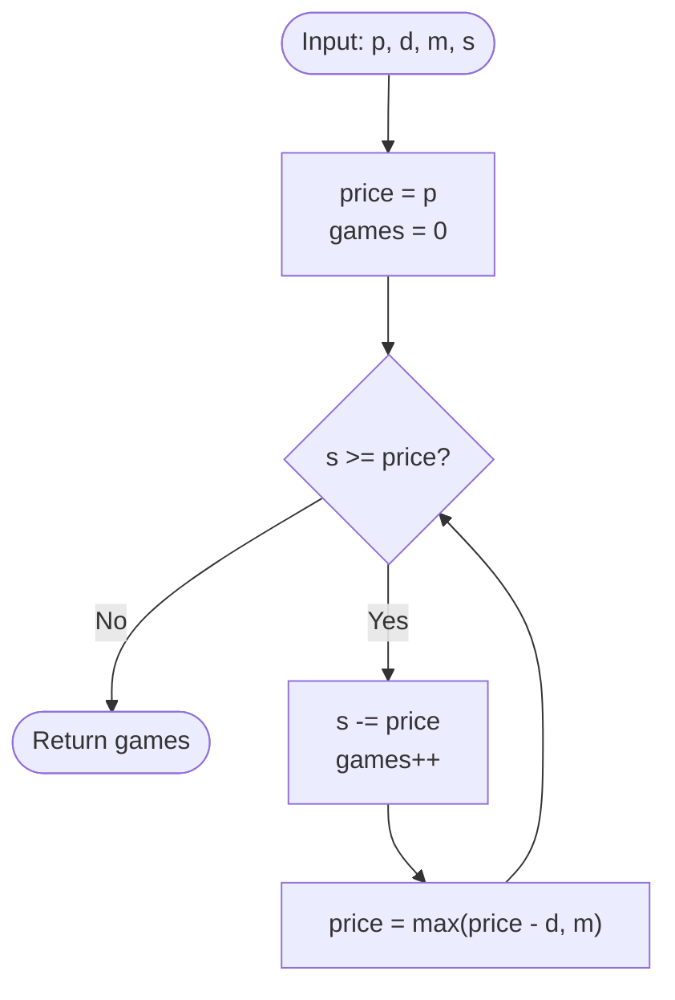

# 25. Halloween Sale

[⬅️ Back to Main Directory](../README.md)

---

### 📋 Problem Statement
During a Halloween sale, the **first** game costs $p$ dollars. Every subsequent game costs $d$ dollars **less** than the previous one, until the cost becomes less than or equal to $m$. After that, every game costs exactly $m$ dollars.

Given a starting budget $s$, how many games can you buy?

**Examples**
| $p$ | $d$ | $m$ | $s$ | Prices bought | Answer |
|:---:|:---:|:---:|:---:|:---|:---:|
| 20 | 3 | 6 | 70 | 20 + 17 + 14 + 11 + 8 = 70 | **5** |
| 20 | 3 | 6 | 80 | … + 6 = 76 (4 left) | **6** |
| 20 | 3 | 6 | 85 | … + 6 + 6 = 82 (3 left) | **7** |
| 20 | 3 | 6 | 19 | can't afford the first game | **0** |

**Constraints**: $1 \le m \le p \le 100$, $1 \le d \le 100$, $1 \le s \le 10^4$.

---

### 🎨 Graphical Cartoon Animation

  

---

### 🌲 Decision Flowchart

---

### 🧠 Key Insights & Edge Cases
- **Clamp with `max`**: $20 \to 17 \to 14 \to 11 \to 8 \to 5$, but $5 < m = 6$, so the price becomes $6$. `Math.max(price - d, m)` handles it in one step.
- **Can't afford the first game**: If $s < p$, the loop never runs and the answer is $0$.
- **$p = m$**: Every game costs $m$ from the start, so the answer is $\lfloor s / m \rfloor$.
- **Use `>=`, not `>`**: In the example the budget hits exactly $0$ after the 5th game. Spending the last dollar still counts.
- **Closed-form option**: Count the $k$ decreasing prices with an arithmetic series, then add $\lfloor \text{remaining} / m \rfloor$. That is $\mathcal{O}(1)$ but easy to get off-by-one. With $s \le 10^4$ the simulation is fast and much safer in an interview.

---

### 📐 Complexity Formulas
- **Price of the $k$-th game** ($k = 1, 2, \dots$):
  $$\text{price}_k = \max\big(p - (k - 1) \cdot d,\ m\big)$$
- **Answer**: the largest $n$ such that
  $$\sum_{k=1}^{n} \text{price}_k \le s$$
- **Time Complexity**:
  $$T = \mathcal{O}\left(\frac{s}{m}\right)$$
  *Explanation*: Each loop iteration buys one game costing at least $m$, so there are at most $s / m \le 10^4$ iterations.
- **Space Complexity**:
  $$S = \mathcal{O}(1)$$
  *Explanation*: Only `price` and `games` are tracked.

---

### 💻 Solution Code
- **Solution File**: [`Javascript/halloweenSale.js`](../Javascript/halloweenSale.js)
