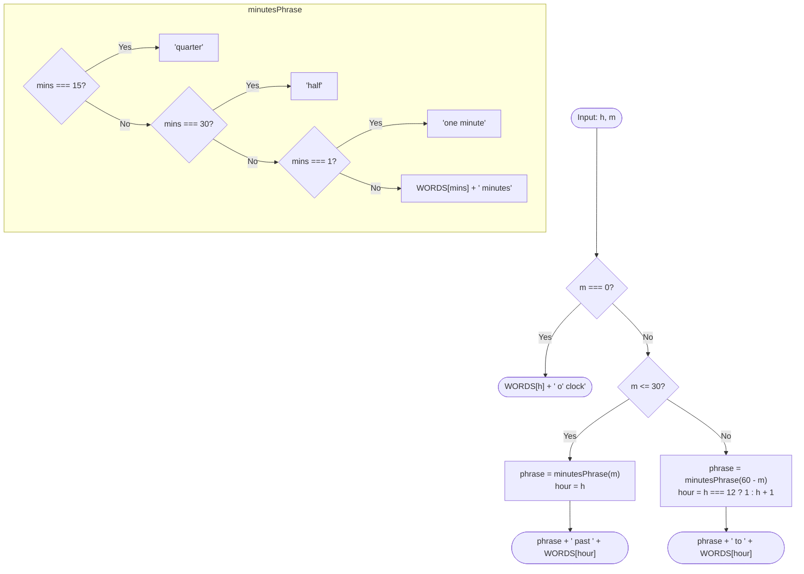

# 26. The Time in Words

[⬅️ Back to Main Directory](../README.md)

---

### 📋 Problem Statement
Given a time as hours $h$ and minutes $m$, print it in words:
- At $m = 0$, use **o' clock** (note the space between the apostrophe and *clock*).
- For $1 \le m \le 30$, use **past** the current hour.
- For $30 < m$, use **to** the next hour.

**Examples**
| Time | In words |
|:---:|:---|
| 5:00 | five o' clock |
| 5:01 | one minute past five |
| 5:10 | ten minutes past five |
| 5:15 | quarter past five |
| 5:28 | twenty eight minutes past five |
| 5:30 | half past five |
| 5:40 | twenty minutes to six |
| 5:45 | quarter to six |
| 5:47 | thirteen minutes to six |
| 12:59 | one minute to one |

**Constraints**: $1 \le h \le 12$, $0 \le m < 60$.

---

### 🎨 Graphical Cartoon Animation

  

---

### 🌲 Decision Flowchart

---

### 🧠 Key Insights & Edge Cases
- **One word table is enough**: "to" flips minutes to $60 - m \le 29$, and "past" uses at most $29$ (30 is "half"). Hours go up to $12$. So words for $1..29$ cover everything.
- **Singular "minute"**: $m = 1$ ➔ "one minute past", and $m = 59$ ➔ "one minute to". Both need the singular.
- **No "minutes" with quarter/half**: "quarter past five", not "quarter minutes past five".
- **Wrap 12 ➔ 1**: $12{:}45$ ➔ "quarter to one", not "quarter to thirteen".
- **Exact output format**: `o' clock` has a space after the apostrophe, and compound numbers use a space ("twenty eight"), not a hyphen.

---

### 📐 Complexity Formulas
- **Conversion rule**:
  $$\text{words}(h, m) = \begin{cases}
  W(h) \text{ o' clock} & m = 0 \\
  P(m) \text{ past } W(h) & 1 \le m \le 30 \\
  P(60 - m) \text{ to } W(h \bmod 12 + 1) & 30 < m
  \end{cases}$$
  where $P$ gives "quarter", "half", "one minute" or "$W(x)$ minutes".
- **Time Complexity**:
  $$T = \mathcal{O}(1)$$
  *Explanation*: A few comparisons and array lookups.
- **Space Complexity**:
  $$S = \mathcal{O}(1)$$
  *Explanation*: A fixed table of 30 words.

---

### 💻 Solution Code
- **Solution File**: [`Javascript/timeInWords.js`](../Javascript/timeInWords.js)
