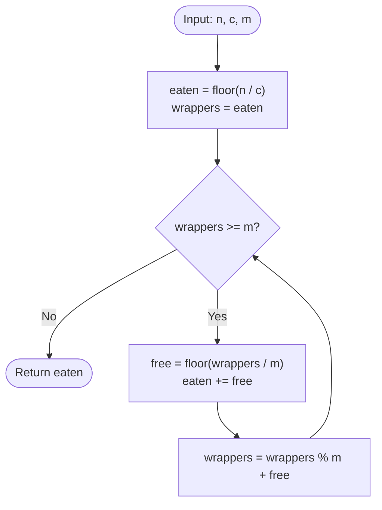

# 27. Chocolate Feast

[⬅️ Back to Main Directory](../README.md)

---

### 📋 Problem Statement
Bobby has $n$ money to spend. Each chocolate bar costs $c$, and $m$ wrappers can be turned in for one **free** bar. A free bar leaves a wrapper too, and Bobby always trades whenever he has enough wrappers.

How many bars does Bobby eat in total?

**Examples**
| $n$ | $c$ | $m$ | Trace (eaten ➔ wrappers left) | Answer |
|:---:|:---:|:---:|:---|:---:|
| 15 | 3 | 2 | buy 5 ➔ 5, +2 ➔ 3, +1 ➔ 2, +1 ➔ 1 | **9** |
| 10 | 2 | 5 | buy 5 ➔ 5, +1 ➔ 1 | **6** |
| 12 | 4 | 4 | buy 3 ➔ 3 (not enough to trade) | **3** |
| 6 | 2 | 2 | buy 3 ➔ 3, +1 ➔ 2, +1 ➔ 1 | **5** |

**Constraints**: $1 \le t \le 1000$, $2 \le n \le 10^5$, $1 \le c \le n$, $2 \le m \le n$.

---

### 🎨 Graphical Cartoon Animation

  

---

### 🌲 Decision Flowchart

---

### 🧠 Key Insights & Edge Cases
- **Free bars give wrappers too**: After a trade, the new wrapper count is the leftovers **plus** one wrapper per free bar: `wrappers % m + free`. Forgetting the `+ free` gives too small an answer.
- **Trade in bulk**: Trading all possible wrappers at once (`floor(wrappers / m)`) is faster than one bar at a time and gives the same total.
- **Not enough wrappers**: If $\lfloor n / c \rfloor < m$, Bobby never trades ($12, 4, 4 \to 3$).
- **Integer division**: JavaScript `/` returns decimals, so always use `Math.floor`.
- **Closed form**: Each free bar effectively costs $m - 1$ wrappers, and you need at least one wrapper left to hold. With $b = \lfloor n / c \rfloor$, the answer is $b + \left\lfloor \frac{b - 1}{m - 1} \right\rfloor$ (for $b \ge 1$). Good to mention in an interview, but the loop is easier to explain and verify.

---

### 📐 Complexity Formulas
- **Wrapper update** per round:
  $$\text{free} = \left\lfloor \frac{w}{m} \right\rfloor, \qquad w' = (w \bmod m) + \text{free}$$
- **Total**:
  $$\text{eaten} = \left\lfloor \frac{n}{c} \right\rfloor + \sum_{\text{rounds}} \text{free}$$
- **Time Complexity**:
  $$T = \mathcal{O}\left(\log_m \frac{n}{c}\right)$$
  *Explanation*: Each round shrinks the wrapper count roughly by a factor of $m$ (from $w$ to about $w / m$ plus a small remainder).
- **Space Complexity**:
  $$S = \mathcal{O}(1)$$
  *Explanation*: Only `eaten` and `wrappers` are tracked.

---

### 💻 Solution Code
- **Solution File**: [`Javascript/chocolateFeast.js`](../Javascript/chocolateFeast.js)
