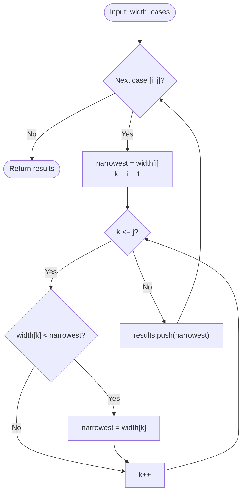

# 28. Service Lane

[⬅️ Back to Main Directory](../README.md)

---

### 📋 Problem Statement
A service lane runs parallel to a highway, and its width changes along its length. You are given `width[k]`, the lane width at each point $k$, and a list of cases $[i, j]$ (entry and exit points, **inclusive**).

For each case, find the widest vehicle that can travel from $i$ to $j$ safely.

**Examples** (0-based, `width = [2, 3, 1, 2, 3, 2, 3, 3]`)
| Case $[i, j]$ | Widths in segment | Answer |
|:---:|:---:|:---:|
| [0, 3] | 2, 3, **1**, 2 | **1** |
| [4, 6] | 3, **2**, 3 | **2** |
| [6, 7] | **3**, **3** | **3** |
| [3, 5] | **2**, 3, **2** | **2** |
| [0, 7] | every point | **1** |

> **Index base gotcha:** The statement's example (`width = [2, 3, 2, 1]`, cases `[[1, 2], [2, 4]]` ➔ `2, 1`) is **1-based**. Index 4 doesn't exist in a 0-based array of 4. The constraints ($0 \le i < j < n$) and the real input are **0-based**.

**Constraints**: $2 \le n \le 10^5$, $1 \le t \le 1000$, $0 \le i < j < n$, $2 \le j - i + 1 \le \min(n, 1000)$.

---

### 🎨 Graphical Cartoon Animation

  

---

### 🌲 Decision Flowchart

---

### 🧠 Key Insights & Edge Cases
- **The bottleneck decides**: A vehicle must fit through every point it passes, so the answer is the **minimum** width in the segment.
- **Inclusive range**: Scan from $i$ **through** $j$. Using `k < j` would skip the exit point.
- **Template quirk**: HackerRank's stub is `serviceLane(n, cases)`, which doesn't receive `width`. Change the signature to accept `width` and pass it from `main`.
- **Why brute force is fine**: Each segment has at most $1000$ points and there are at most $1000$ cases, so the scan is at most $10^6$ steps.
- **Scaling up**: With many long queries you would use a **sparse table** ($\mathcal{O}(n \log n)$ build, $\mathcal{O}(1)$ per query) or a segment tree. Worth mentioning in an interview, but not needed here.
- **Avoid `Math.min(...width.slice(i, j + 1))`**: It works for these sizes but allocates a new array per case. A plain loop is just as short.

---

### 📐 Complexity Formulas
- **Answer per case**:
  $$\text{answer}(i, j) = \min_{i \le k \le j} \text{width}[k]$$
- **Time Complexity**:
  $$T = \mathcal{O}\Big(\sum_{\text{cases}} (j - i + 1)\Big) \le \mathcal{O}(t \cdot 1000)$$
  *Explanation*: Each case scans its own segment once.
- **Space Complexity**:
  $$S = \mathcal{O}(t)$$
  *Explanation*: One result per case. The scan itself uses $\mathcal{O}(1)$ extra space.

---

### 💻 Solution Code
- **Solution File**: [`Javascript/serviceLane.js`](../Javascript/serviceLane.js)
