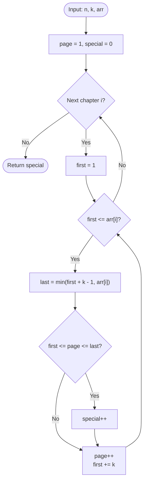

# 29. Lisa's Workbook

[⬅️ Back to Main Directory](../README.md)

---

### 📋 Problem Statement
Lisa's workbook has $n$ chapters. Chapter $i$ has `arr[i]` problems, numbered $1$ to `arr[i]`. Each page holds up to $k$ problems, and **every chapter starts on a new page**, so a page never mixes chapters. Page numbers start at $1$.

A problem is **special** if its number within its chapter equals the page number it is printed on. Count the special problems.

**Example** (`arr = [4, 2]`, `k = 3`)
| Page | Chapter | Problems on page | Special? |
|:---:|:---:|:---:|:---:|
| 1 | 1 | 1, 2, 3 | ✅ Problem **1** |
| 2 | 1 | 4 | ❌ |
| 3 | 2 | 1, 2 | ❌ |

**Answer: 1**

**Sample** (`n = 5`, `k = 3`, `arr = [4, 2, 6, 1, 10]`) ➔ **4**

**Constraints**: $1 \le n, k, \text{arr}[i] \le 100$.

---

### 🎨 Graphical Cartoon Animation

  

---

### 🌲 Decision Flowchart

---

### 🧠 Key Insights & Edge Cases
- **Each page is a range of problem numbers**: A page holds the problems from `first` to `last`, where `first` goes $1, k+1, 2k+1, \dots$ and `last = min(first + k - 1, arr[i])`.
- **At most one special problem per page**: Only the problem whose number equals the page number can be special. So one range check per page is enough, and there is no need to visit each problem.
- **New chapter, new page**: The page counter keeps going across chapters, but problem numbering restarts at $1$. A short last page (fewer than $k$ problems) still takes up a whole page.
- **Pages run ahead of problem numbers**: Page numbers keep growing while each chapter's problem numbers restart. In later chapters the page number is often larger than any problem number, so specials tend to show up early in the book.
- **Off-by-one trap**: The last problem on a page is `first + k - 1`, not `first + k`. Using `first + k` counts one problem twice.

---

### 📐 Complexity Formulas
- **Pages in chapter $i$**:
  $$P_i = \left\lceil \frac{\text{arr}[i]}{k} \right\rceil$$
- **Time Complexity**:
  $$T = \mathcal{O}\Big(\sum_{i=1}^{n} P_i\Big) \le \mathcal{O}\Big(\sum_{i=1}^{n} \text{arr}[i]\Big)$$
  *Explanation*: The code does constant work per page.
- **Space Complexity**:
  $$S = \mathcal{O}(1)$$
  *Explanation*: It only keeps a few counters.

---

### 💻 Solution Code
- **Solution File**: [`Javascript/lisasWorkbook.js`](../Javascript/lisasWorkbook.js)
