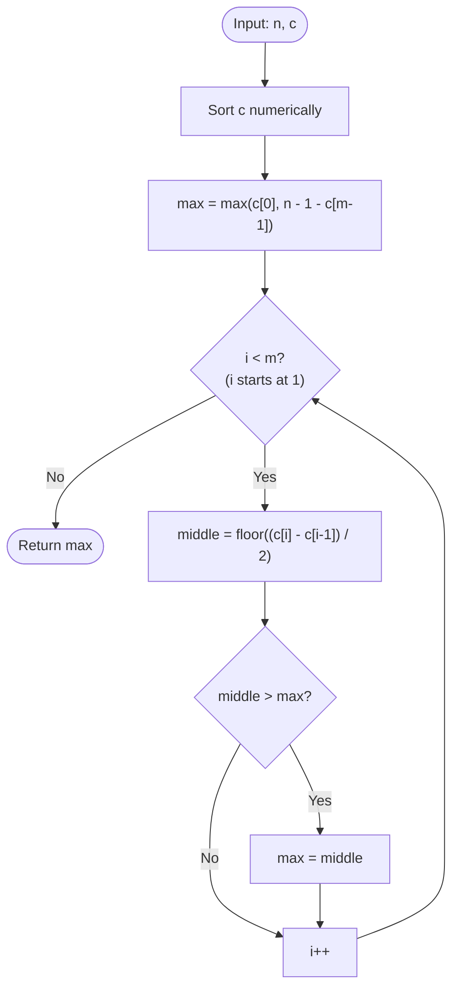

# 30. Flatland Space Stations

[⬅️ Back to Main Directory](../README.md)

---

### 📋 Problem Statement
Flatland has $n$ cities numbered $0$ to $n-1$ in a straight line, each $1$ km from the next. The route is **not circular**, so city $0$ and city $n-1$ are not connected. Some cities have a space station; their indices are given in `c` (**unordered** and distinct).

Find the **maximum** distance from any city to its **nearest** space station.

**Examples**
| $n$ | `c` | Worst city | Answer |
|:---:|:---:|:---:|:---:|
| 3 | [1] | city 0 or 2 | **1** |
| 5 | [0, 4] | city 2 | **2** |
| 6 | [0, 1, 2, 4, 3, 5] | every city has a station | **0** |
| 10 | [1, 8] | city 4 or 5 | **3** |

**Constraints**: $1 \le n \le 10^5$, $1 \le m \le n$, at least one city has a station, no city has more than one.

---

### 🎨 Graphical Cartoon Animation

  

---

### 🌲 Decision Flowchart

---

### 🧠 Key Insights & Edge Cases
- **Only three kinds of stretches**: cities before the first station, cities between two neighbouring stations, and cities after the last station. Check each one and keep the largest.
- **Edges are one-sided**: Before the first station there is no station on the left, so city $0$ is the worst, at distance `c[0]`. Likewise city $n-1$ is `(n - 1) - c[m-1]` away from the last station.
- **Gaps are two-sided**: Between stations $a$ and $b$, the worst city is in the middle, at distance $\lfloor (b - a) / 2 \rfloor$. For an odd gap (like $1 \to 8$) two middle cities tie.
- **Sort numerically**: `c.sort()` without a comparator sorts as strings (`[10, 9]` stays `[10, 9]`). Always use `(a, b) => a - b`.
- **Don't scan every city × every station**: That is $\mathcal{O}(n \cdot m)$, up to $10^{10}$ steps when both are $10^5$. Sorting first makes it $\mathcal{O}(m \log m)$.
- **Station everywhere**: If $m = n$, every gap is $1$, so $\lfloor 1/2 \rfloor = 0$ and both edges are $0$. The answer is $0$.

---

### 📐 Complexity Formulas
- **Answer** (with `c` sorted):
  $$\text{answer} = \max\Big(c_0,\; (n - 1) - c_{m-1},\; \max_{1 \le i < m} \Big\lfloor \frac{c_i - c_{i-1}}{2} \Big\rfloor\Big)$$
- **Time Complexity**:
  $$T = \mathcal{O}(m \log m)$$
  *Explanation*: Sorting dominates. The scan over neighbouring stations is $\mathcal{O}(m)$.
- **Space Complexity**:
  $$S = \mathcal{O}(1) \text{ extra}$$
  *Explanation*: `c` is sorted in place and only a few variables are kept (the engine's sort may use some internal memory).

---

### 💻 Solution Code
- **Solution File**: [`Javascript/flatlandSpaceStations.js`](../Javascript/flatlandSpaceStations.js)
