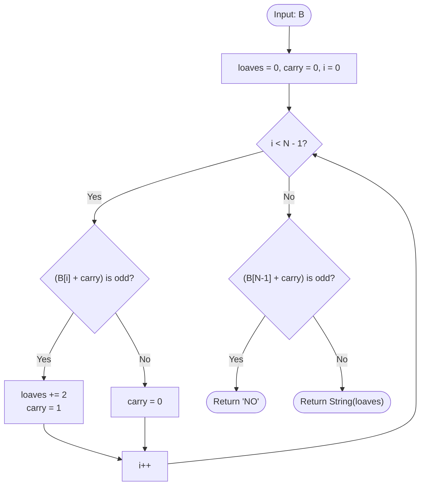

# 31. Fair Rations

[⬅️ Back to Main Directory](../README.md)

---

### 📋 Problem Statement
You are the ruler of Rankhacker Castle, handing out bread to people standing in a line. `B[i]` is how many loaves person $i$ already has. The rules:
1. Every time you give a loaf to person $i$, you must also give one to a neighbour ($i - 1$ or $i + 1$).
2. At the end, everyone must have an **even** number of loaves.

Return the **minimum** number of loaves to hand out, as a string, or `"NO"` if it can't be done.

**Examples**
| `B` | Steps | Answer |
|:---:|:---|:---:|
| [4, 5, 6, 7] | give to 1 & 2 ➔ [4, 6, 7, 7], give to 2 & 3 ➔ [4, 6, 8, 8] | **"4"** |
| [2, 3, 4, 5, 6] | give to 1 & 2 ➔ [2, 4, 5, 5, 6], give to 2 & 3 ➔ [2, 4, 6, 6, 6] | **"4"** |
| [1, 2] | give to 0 & 1 ➔ [2, 3], person 1 is left odd with no one behind | **"NO"** |

**Constraints**: $2 \le N \le 1000$, $1 \le B[i] \le 10$.

---

### 🎨 Graphical Cartoon Animation

  

---

### 🌲 Decision Flowchart

---

### 🧠 Key Insights & Edge Cases
- **Greedy is forced**: Going left to right, an odd person $i$ can only be fixed by giving to $i$ and $i + 1$. Giving to $i - 1$ instead would make the person you already fixed odd again. So there is never a choice, and the greedy count is the minimum.
- **Only parity matters**: Each step adds exactly one loaf to two people, so you only need to track whether each count is odd or even. The `carry` flag records whether the previous step gave this person a loaf, so `B` is never modified.
- **When is it impossible?** Each step adds $2$ loaves in total, so the parity of the **sum** never changes. If the sum is odd, everyone can never be even. In the loop this shows up as the last person being odd with no one behind them.
- **Shortcut check**: You could return `"NO"` up front when `sum(B)` is odd. When the sum is even, the greedy always succeeds.
- **Return a string**: HackerRank expects `"4"`, not the number `4`, because the other possible answer is `"NO"`.

---

### 📐 Complexity Formulas
- **Answer**:
  $$\text{answer} = \begin{cases} \texttt{"NO"} & \text{if } \sum B[i] \text{ is odd} \\ 2 \times (\text{number of greedy steps}) & \text{otherwise} \end{cases}$$
- **Time Complexity**:
  $$T = \mathcal{O}(N)$$
  *Explanation*: One pass along the line with constant work per person.
- **Space Complexity**:
  $$S = \mathcal{O}(1)$$
  *Explanation*: Only `loaves` and the `carry` flag are kept.

---

### 💻 Solution Code
- **Solution File**: [`Javascript/fairRations.js`](../Javascript/fairRations.js)
