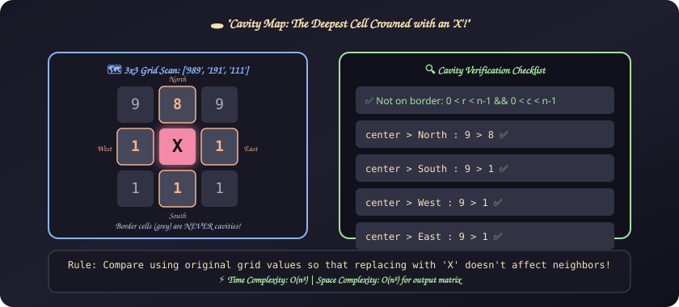
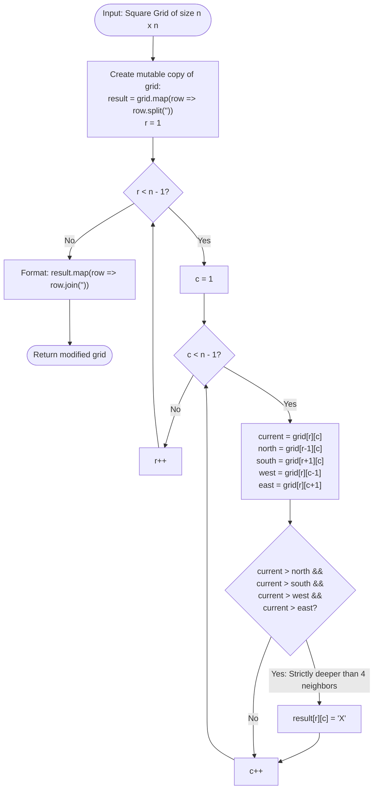

# 32. Cavity Map

[⬅️ Back to Main Directory](../README.md)

---

### 📋 Problem Statement
You are given a square map as an $n \times n$ matrix of integer strings. Each cell has a value denoting its depth.

A cell is called a **cavity** if and only if:
1. It is **not** on the border of the map ($0 < r < n - 1$ and $0 < c < n - 1$).
2. Each of the 4 adjacent cells sharing an edge (North, South, East, West) has a **strictly smaller** depth.

Find all cavities on the map and replace their depth with the uppercase character `'X'`.

---

### 🎨 Graphical Cartoon Animation

  

---

### 🌲 Decision Flowchart

---

### 📐 Complexity Formulas
- **Time Complexity**:
  $$T(n) = \mathcal{O}(n^2)$$
  *Explanation*: We examine the interior cells in an $(n-2) \times (n-2)$ matrix. For each interior cell, exactly 4 edge neighbors are checked in $\mathcal{O}(1)$ time, yielding total time $\mathcal{O}(n^2)$.
- **Space Complexity**:
  $$S(n) = \mathcal{O}(n^2)$$
  *Explanation*: A 2D mutable matrix of size $n \times n$ is created to store and return the modified grid without corrupting the original input readings.

---

### 💻 Solution Code
- **Solution File**: [`Javascript/cavityMap.js`](../Javascript/cavityMap.js)
