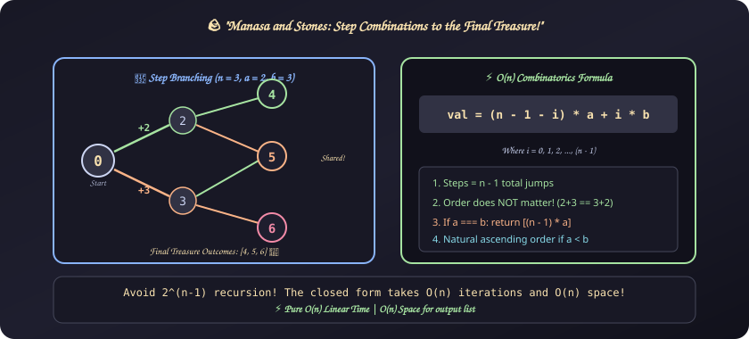
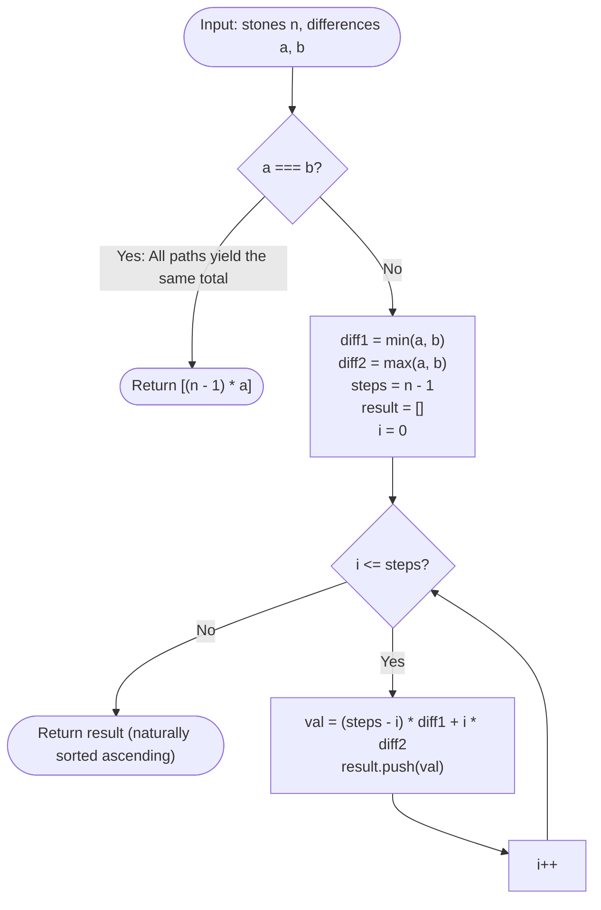

# 33. Manasa and Stones

[⬅️ Back to Main Directory](../README.md)

---

### 📋 Problem Statement
Manasa is out on a hike and finds a trail of stones. She starts with stone `0` (not counted in $n$).
She finds $n$ stones in total, meaning there are $n - 1$ steps between the starting stone $0$ and the final stone.
At each step, the value of the stone increases by either $a$ or $b$.

Legend has it that there is a treasure trove at the end of the trail. If Manasa can predict all possible values of the last stone, the treasure will be hers.

Compute all possible numbers that might occur on the last stone, sorted in ascending order with duplicates removed.

---

### 🎨 Graphical Cartoon Animation

  

---

### 🌲 Decision Flowchart

---

### 📐 Complexity Formulas
- **Combinatorial Invariant**:
  Between stone 0 and stone $n$, there are exactly $n - 1$ transitions.
  If $i$ transitions choose difference $b$ and $(n - 1 - i)$ choose difference $a$:
  $$\text{Value} = (n - 1 - i) \cdot a + i \cdot b \quad \text{for } i \in \{0, 1, 2, \dots, n - 1\}$$
  Since addition is commutative, the permutation order of steps does not affect the final sum.
- **Time Complexity**:
  $$T(n) = \mathcal{O}(n)$$
  *Explanation*: A single loop iterates $n$ times ($0 \le i \le n - 1$). Since we choose $\min(a, b)$ as `diff1`, values are generated in strictly increasing order without needing a separate $\mathcal{O}(n \log n)$ sort.
- **Space Complexity**:
  $$S(n) = \mathcal{O}(n)$$
  *Explanation*: Stores at most $n$ distinct integer values in the result array.

---

### 💻 Solution Code
- **Solution File**: [`Javascript/manasaAndStones.js`](../Javascript/manasaAndStones.js)
