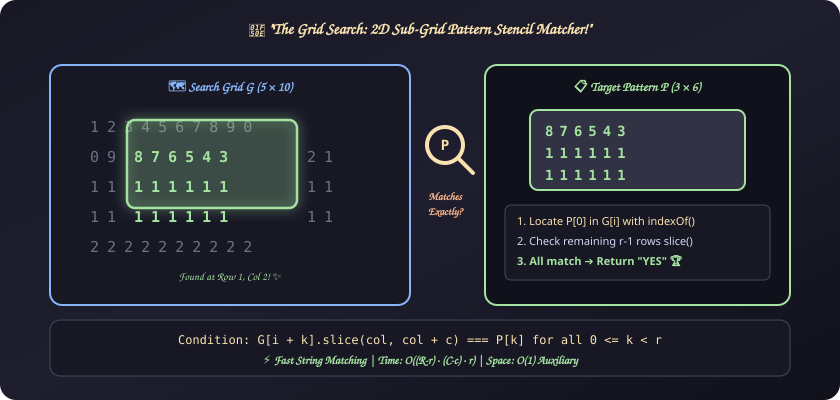
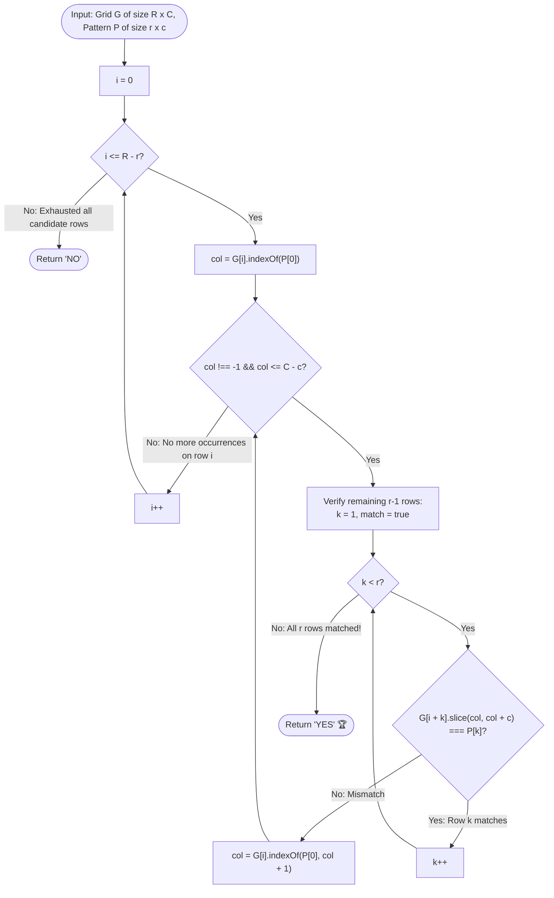

# 34. The Grid Search

[⬅️ Back to Main Directory](../README.md)

---

### 📋 Problem Statement
Given a 2D grid of digits $G$ of dimensions $R \times C$ and a smaller pattern of digits $P$ of dimensions $r \times c$, determine whether the pattern exists anywhere within the grid as a contiguous sub-grid.

Return `"YES"` if the pattern exists in the grid, or `"NO"` otherwise.

---

### 🎨 Graphical Cartoon Animation

  

---

### 🌲 Decision Flowchart

---

### 📐 Complexity Formulas
- **Sliding Window Search Space**:
  The top-left corner of pattern $P$ can start at any $(i, j)$ such that:
  $$0 \le i \le R - r \quad \text{and} \quad 0 \le j \le C - c$$
  The total number of candidate starting positions is:
  $$(R - r + 1) \times (C - c + 1)$$
- **Pruning via `indexOf`**:
  Instead of testing every $(i, j)$ pair blindly, we find the column offsets $j$ where $G[i]$ contains $P[0]$. On average, this drastically reduces the number of full sub-grid validations.
- **Time Complexity**:
  $$T = \mathcal{O}((R - r + 1) \times (C - c + 1) \times r \times c) \quad \text{(Worst-Case)}$$
  $$\text{Average Case} \approx \mathcal{O}(R \times C)$$
- **Space Complexity**:
  $$S = \mathcal{O}(1)$$
  *Explanation*: Substring checks operate directly on the string arrays without allocating auxiliary matrices.

---

### 💻 Solution Code
- **Solution File**: [`Javascript/gridSearch.js`](../Javascript/gridSearch.js)
