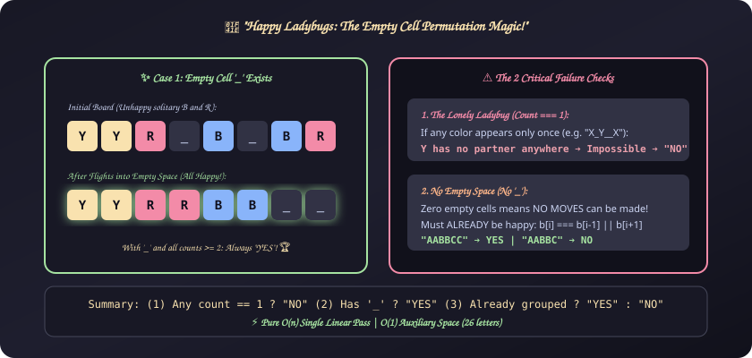
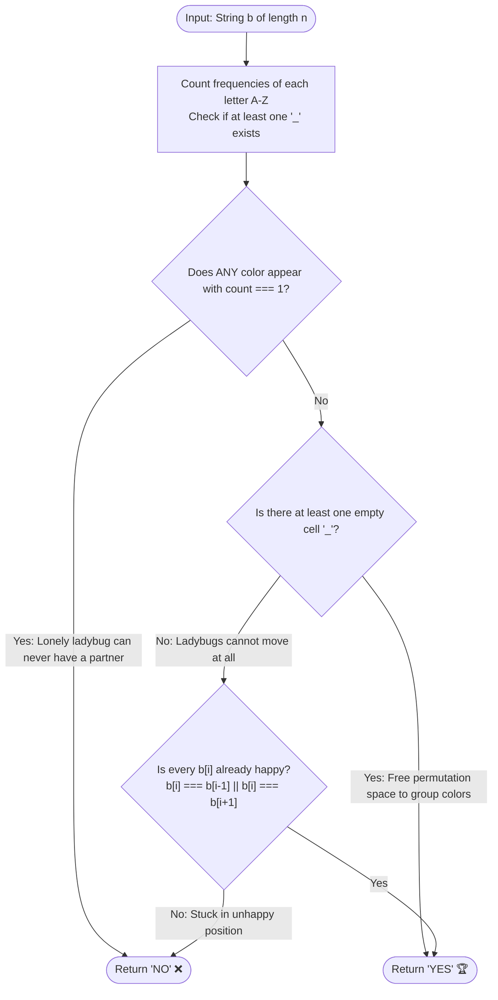

# 35. Happy Ladybugs

[⬅️ Back to Main Directory](../README.md)

---

### 📋 Problem Statement
Happy Ladybugs is a board game represented by a string $b$ of length $n$:
- Each character in $b$ is either an underscore `'_'` (an empty cell) or an uppercase letter `'A'`–`'Z'` representing a ladybug of that color.
- A ladybug is **happy** if and only if at least one of its adjacent neighbors ($b[i - 1]$ or $b[i + 1]$) has the **same** color.
- In a single move, any ladybug can fly to any empty cell `'_'`.

Determine whether it is possible to make all ladybugs on the board happy. Return `"YES"` if possible, or `"NO"` otherwise.

---

### 🎨 Graphical Cartoon Animation

  

---

### 🌲 Decision Flowchart

---

### 📐 Complexity Formulas
- **Logical Deductions**:
  1. **Solitary Ladybug ($count = 1$)**: A lone ladybug cannot pair with anyone anywhere on the board $\rightarrow$ `"NO"`.
  2. **Free Movement ($\text{hasEmpty} = \text{true}$)**: An empty cell acts as a sliding buffer allowing arbitrary permutations $\rightarrow$ `"YES"`.
  3. **No Movement ($\text{hasEmpty} = \text{false}$)**: No moves can be made; the board must already be happy $\rightarrow$ check $b[i] == b[i-1] \lor b[i] == b[i+1]$.
- **Time Complexity**:
  $$T(n) = \mathcal{O}(n)$$
  *Explanation*: A single linear scan tallies frequencies and checks adjacent neighbors if no empty cell exists.
- **Space Complexity**:
  $$S = \mathcal{O}(1)$$
  *Explanation*: The hash map / frequency table stores at most 26 uppercase English letters ($A$ through $Z$).

---

### 💻 Solution Code
- **Solution File**: [`Javascript/happyLadybugs.js`](../Javascript/happyLadybugs.js)
