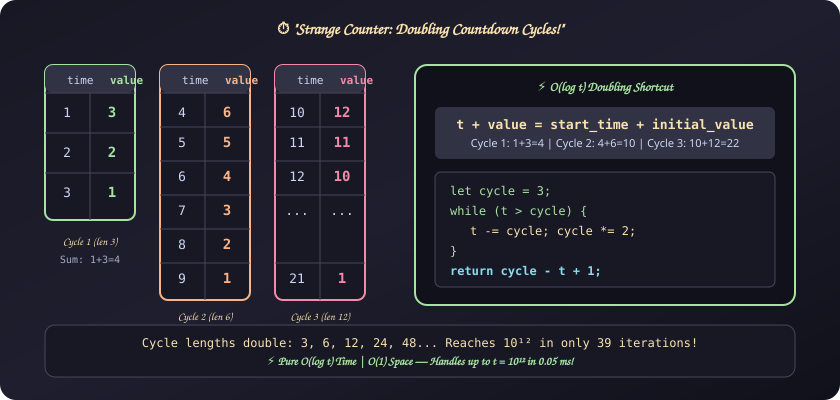
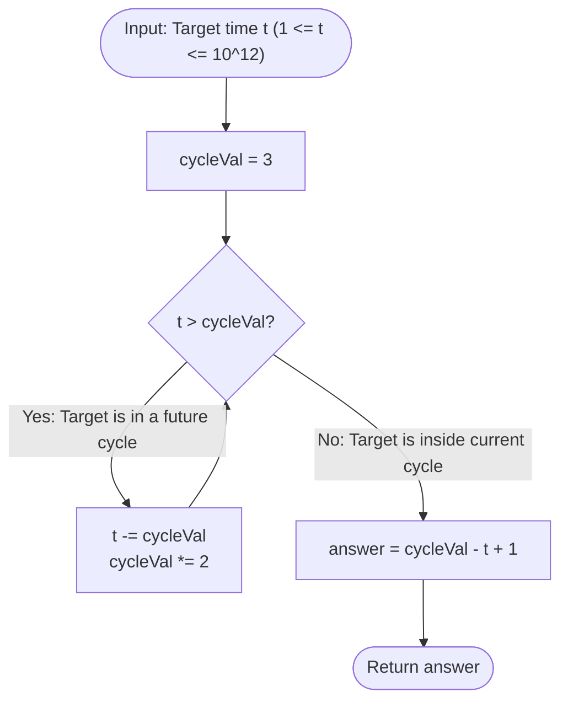

# 36. Strange Counter

[⬅️ Back to Main Directory](../README.md)

---

### 📋 Problem Statement
There is a strange counter. At time $t = 1$, it displays the number $3$.
Each second, the number displayed decrements by $1$ until it reaches $1$.
In the very next second, the timer resets to $2 \times (\text{initial value for the prior cycle})$ and continues counting down.

Cycles:
- **Cycle 1**: starts at $t = 1$, initial value = $3$, length = $3$, $t \in [1, 3]$
- **Cycle 2**: starts at $t = 4$, initial value = $6$, length = $6$, $t \in [4, 9]$
- **Cycle 3**: starts at $t = 10$, initial value = $12$, length = $12$, $t \in [10, 21]$
- **Cycle $k$**: initial value = $3 \times 2^{k-1}$, length = $3 \times 2^{k-1}$

Given time $t$, calculate and return the value displayed on the counter.

---

### 🎨 Graphical Cartoon Animation

  

---

### 🌲 Decision Flowchart

---

### 📐 Complexity Formulas
- **Mathematical Invariant**:
  For any time $t$ in a cycle:
  $$t + \text{value} = \text{start\_time} + \text{initial\_value}$$
  Inside the remaining cycle of length `cycleVal`:
  $$\text{value} = \text{cycleVal} - t + 1$$
- **Doubling Cycles**:
  Cycle lengths follow a geometric progression:
  $$3, 6, 12, 24, 48, \dots, 3 \cdot 2^{k-1}$$
  For $t = 10^{12}$, the number of iterations required to find the cycle is:
  $$k \approx \log_2\left(\frac{10^{12}}{3}\right) \approx 39 \text{ iterations}$$
- **Time Complexity**:
  $$T(t) = \mathcal{O}(\log t)$$
  *Explanation*: The cycle length doubles each step, resolving $t = 10^{12}$ in less than $40$ iterations.
- **Space Complexity**:
  $$S = \mathcal{O}(1)$$
  *Explanation*: Requires only a single integer tracking `cycleVal`.

---

### 💻 Solution Code
- **Solution File**: [`Javascript/strangeCounter.js`](../Javascript/strangeCounter.js)
