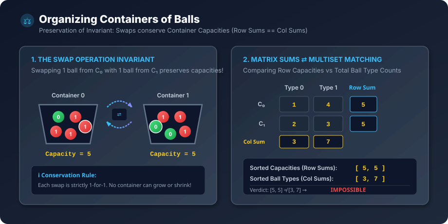
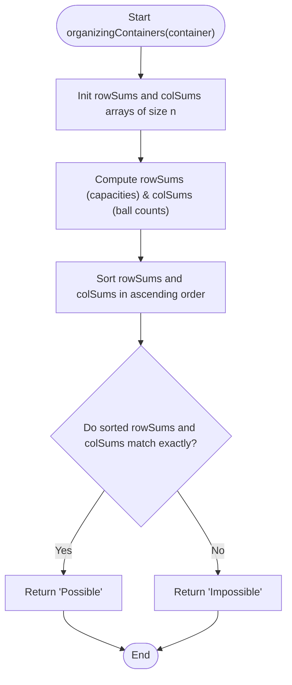

# Organizing Containers of Balls

## Problem Overview

David has $n$ containers and $n$ different types of balls, both numbered from $0$ to $n - 1$. The initial distribution of balls across containers is represented by an $n \times n$ matrix `container`, where `container[i][j]` denotes the number of balls of type $j$ currently inside container $i$.

In a single operation, David can swap **one ball** from one container with **one ball** from another container.

David wants to perform any number of swap operations such that:
1. Each container contains only balls of a single unique type.
2. No two balls of the same type are located in different containers.

Determine whether it is possible to organize the balls this way. Return `"Possible"` if it can be achieved, or `"Impossible"` otherwise.

---

## Visual Intuition: Preservation of Invariant

The key insight relies on **invariant conservation**:
- Every operation swaps exactly **one** ball from container $A$ with **one** ball from container $B$.
- Therefore, the **total capacity (number of balls)** in each container remains constant throughout any number of swaps!
- For each container to eventually hold all balls of a distinct type, the set of final container capacities must be an exact permutation of the total counts of each ball type.

---

## Algorithm Steps

1. **Calculate Row Sums (Container Capacities)**:
   For each container $i$, compute its total number of balls:
   $$\text{capacity}[i] = \sum_{j=0}^{n-1} \text{container}[i][j]$$

2. **Calculate Column Sums (Total Count of Each Ball Type)**:
   For each ball type $j$, compute the total count of balls of that type:
   $$\text{typeCount}[j] = \sum_{i=0}^{n-1} \text{container}[i][j]$$

3. **Sort Both Multisets**:
   Sort both the `capacity` array and the `typeCount` array in ascending order.

4. **Compare Sorted Arrays**:
   - If $\text{capacity}[k] == \text{typeCount}[k]$ for all $0 \le k < n$, every type can be paired with a container of identical capacity $\implies$ return `"Possible"`.
   - If any index differs, it is mathematically impossible $\implies$ return `"Impossible"`.

---

## Flowchart

---

## Complexity Analysis

- **Time Complexity**: $\mathcal{O}(n^2 + n \log n) = \mathcal{O}(n^2)$
  - Computing row and column sums traverses the $n \times n$ matrix once: $\mathcal{O}(n^2)$.
  - Sorting both arrays of length $n$ takes $\mathcal{O}(n \log n)$.
  - Comparing the sorted arrays takes $\mathcal{O}(n)$.
  - For $n \le 100$, $n^2 \le 10,000$ operations, which executes in a few milliseconds.
- **Space Complexity**: $\mathcal{O}(n)$
  - Auxiliary storage for `rowSums` and `colSums` arrays of length $n$.

---

## JavaScript Solution

- View the implementation: [organizingContainers.js](../Javascript/organizingContainers.js)
