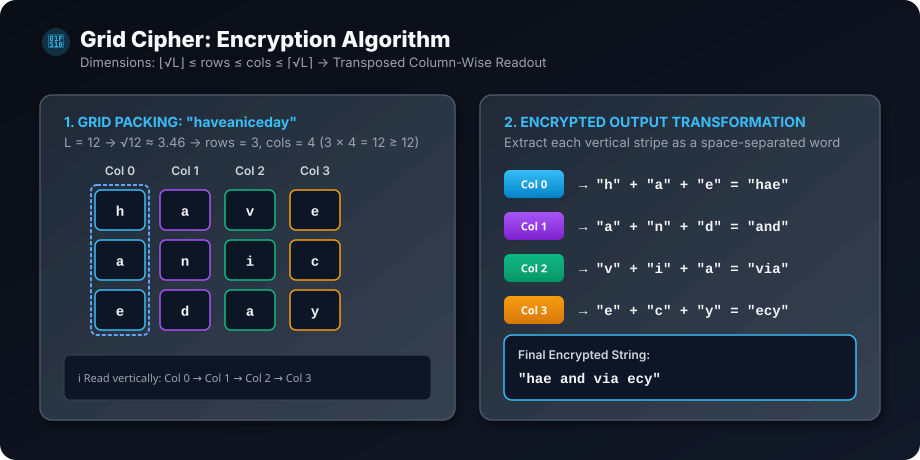
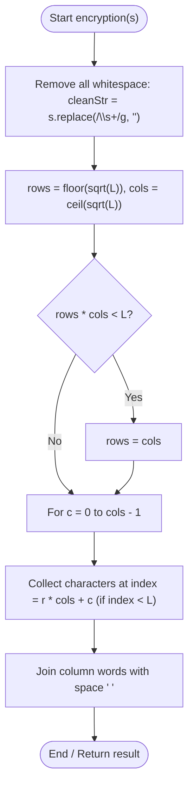

# Encryption

## Problem Overview

An English text needs to be encrypted using a grid transposition scheme:

1. **Remove Spaces**: First, strip all spaces from the text. Let $L$ be the length of this clean text.
2. **Determine Grid Dimensions**:
   Construct a grid with `rows` and `columns` constrained by:
   $$\lfloor \sqrt{L} \rfloor \le \text{rows} \le \text{columns} \le \lceil \sqrt{L} \rceil$$
   Subject to:
   $$\text{rows} \times \text{columns} \ge L$$
   If multiple pairs satisfy these conditions, choose the pair with the **minimum area** ($\text{rows} \times \text{columns}$).
3. **Encode Message**:
   Write the text row-by-row into the grid. The encoded message is produced by reading the characters **column by column**, separating the text from each column with a single space.

---

## Visual Intuition: Grid Transposition

Consider the text: `"haveaniceday"` ($L = 12$).
- $\sqrt{12} \approx 3.464 \implies \lfloor \sqrt{12} \rfloor = 3$, $\lceil \sqrt{12} \rceil = 4$.
- We choose $\text{rows} = 3, \text{columns} = 4$, which yields an area of $3 \times 4 = 12 \ge 12$.
- The text is written into 3 rows of 4 characters each:
  ```text
  h a v e
  a n i c
  e d a y
  ```
- Reading column-wise gives:
  - Column 0: `h` + `a` + `e` $\to$ `"hae"`
  - Column 1: `a` + `n` + `d` $\to$ `"and"`
  - Column 2: `v` + `i` + `a` $\to$ `"via"`
  - Column 3: `e` + `c` + `y` $\to$ `"ecy"`
- Encrypted result: `"hae and via ecy"`.



---

## Algorithm Steps

1. **Clean String**:
   Remove all whitespace using regular expressions: `s.replace(/\s+/g, '')`. Let $L$ be its length.
2. **Calculate Dimensions**:
   - `rows = Math.floor(Math.sqrt(L))`
   - `cols = Math.ceil(Math.sqrt(L))`
   - If `rows * cols < L`, increment `rows = cols` to ensure the entire text fits within the grid.
3. **Traverse Columns**:
   - Loop through each column $c$ from $0$ to $\text{cols} - 1$.
   - For each column, collect characters at 1D positions:
     $$\text{index} = r \times \text{cols} + c \quad (0 \le r < \text{rows})$$
   - Only append characters where $\text{index} < L$.
4. **Join with Spaces**:
   Return the array of column words joined by spaces.

---

## Flowchart



---

## Complexity Analysis

- **Time Complexity**: $\mathcal{O}(L)$
  - Stripping spaces and measuring length takes $\mathcal{O}(L)$.
  - Extracting column words visits each character exactly once: $\mathcal{O}(L)$.
  - Joining words takes $\mathcal{O}(L)$.
  - Total Time: $\mathcal{O}(L)$, where $L$ is the length of the string without spaces.
- **Space Complexity**: $\mathcal{O}(L)$
  - To store the cleaned string and the resulting encrypted string.

---

## JavaScript Solution

- View the implementation: [encryption.js](../Javascript/encryption.js)
