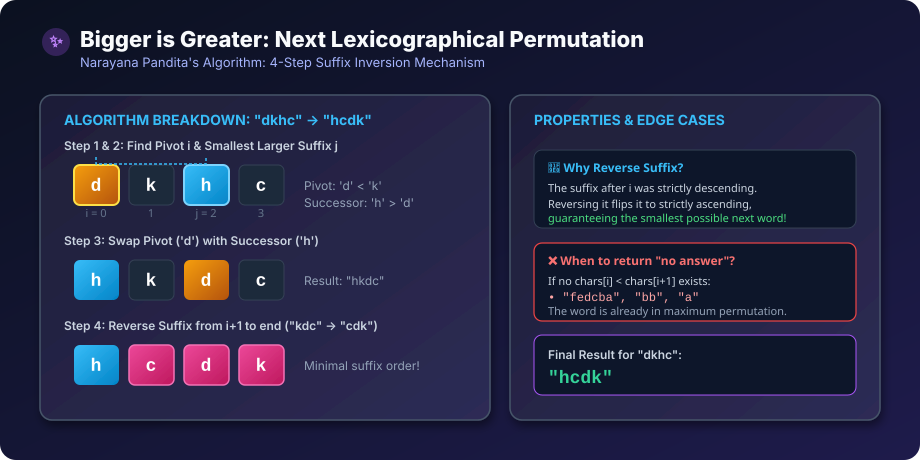
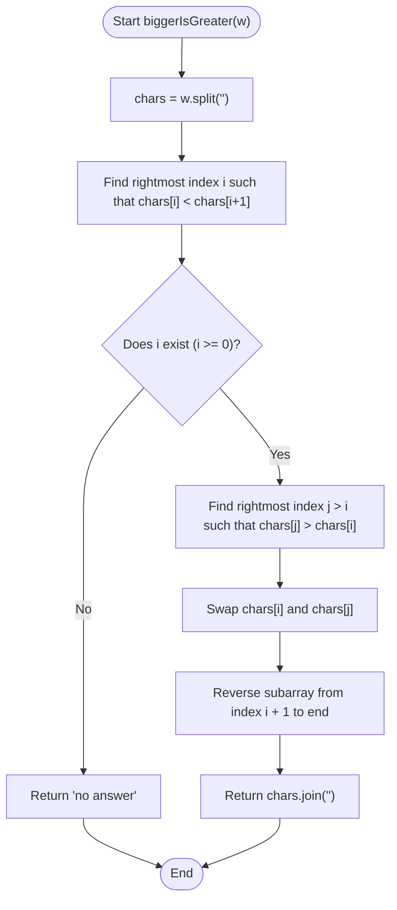

# Bigger is Greater (Next Lexicographical Permutation)

## Problem Overview

Lexicographical order is alphabetical order when dealing with strings. A string is considered greater than another if it comes later in a dictionary.

Given a word $w$, create a new word by rearranging some or all of its characters such that:
1. It is strictly greater than the original word lexicographically.
2. It is the **smallest** word that meets the first condition (the immediate next lexicographical permutation).

If no such word exists (i.e. the characters are already in non-increasing order), return `"no answer"`.

---

## Visual Intuition: Narayana Pandita's Permutation Algorithm

To find the next smallest permutation, we want to modify the string as far to the right as possible (preserving the longest possible prefix).

Consider the word `"dkhc"`:
1. **Find the Pivot ($i$)**: Scan right-to-left to find the first character that is strictly smaller than the character directly following it.
   - For `"dkhc"`, scanning from the right gives `c < h` (no), `h < k` (no), `k > d` (yes! Pivot is index $0$, character `'d'`).
2. **Find the Successor ($j$)**: Scan from the right end to find the smallest character strictly greater than `w[i]`.
   - Characters to the right of `'d'` are `'k', 'h', 'c'`. The smallest character greater than `'d'` is `'h'` (index $2$).
3. **Swap ($w[i]$ and $w[j]$)**:
   - Swap `'d'` and `'h'` $\implies$ `"hkdc"`.
4. **Reverse the Suffix ($i + 1$ to end)**:
   - The suffix `"kdc"` is currently sorted descending (its maximum permutation).
   - Reversing `"kdc"` yields `"cdk"`, which is sorted ascending (its minimum permutation).
   - Final string: `"hcdk"`.

---

## Algorithm Steps

1. Let $n = \text{length}(w)$. Convert the string into a mutable character array.
2. **Find Pivot $i$**:
   - Start $i = n - 2$ and decrement while $i \ge 0$ and $w[i] \ge w[i + 1]$.
   - If $i < 0$, all characters are weakly descending $\implies$ return `"no answer"`.
3. **Find Successor $j$**:
   - Start $j = n - 1$ and decrement while $w[j] \le w[i]$.
4. **Swap**:
   - Swap $w[i]$ and $w[j]$.
5. **Reverse Suffix**:
   - Use two pointers, `left = i + 1` and `right = n - 1`, swapping characters until `left >= right`.
6. Return the joined string.

---

## Flowchart

---

## Complexity Analysis

- **Time Complexity**: $\mathcal{O}(n)$ per test case
  - Finding pivot $i$ scans at most $n$ characters.
  - Finding successor $j$ scans at most $n$ characters.
  - Swapping is $\mathcal{O}(1)$.
  - Reversing the suffix takes at most $n / 2$ swaps.
  - Overall time is strictly linear $\mathcal{O}(n)$, which runs in well under 1 millisecond per query for $n \le 100$.
- **Space Complexity**: $\mathcal{O}(n)$
  - Required to store the mutable character array of length $n$.

---

## JavaScript Solution

- View the implementation: [biggerIsGreater.js](../Javascript/biggerIsGreater.js)
