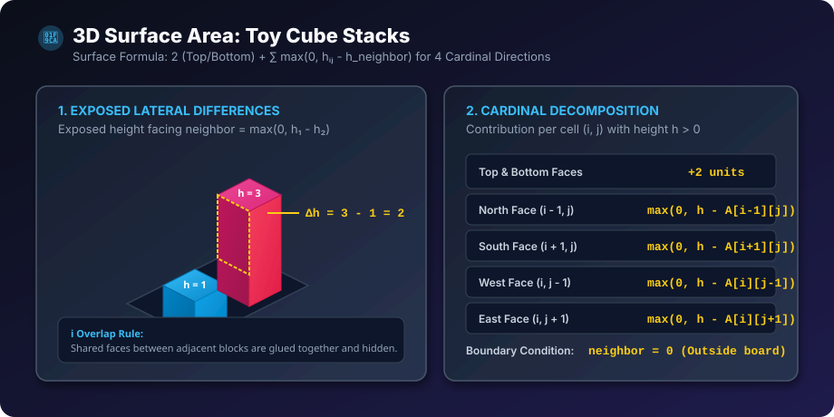
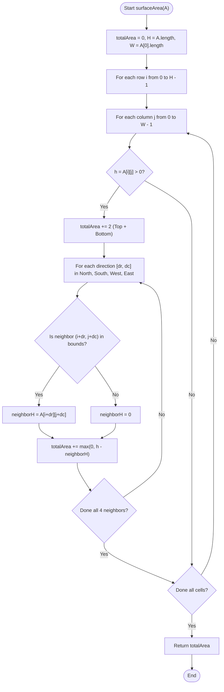

# 3D Surface Area

## Problem Overview

Madison has a 2D board $A$ of size $H \times W$ (having $H$ rows and $W$ columns) with $1 \times 1$ grid cells.
Each cell $(i, j)$ contains a vertical stack of $A_{i,j}$ cubes, each of size $1 \times 1 \times 1$.

The price of the toy is equal to its total **3D surface area** (all externally exposed faces of the connected cubes). Find the total surface area.

---

## Visual Intuition: Face Contributions

Every cell $(i, j)$ with height $h = A_{i,j}$ ($h \ge 1$) contributes to the overall surface area in two ways:
1. **Vertical Faces (Top and Bottom)**:
   - There is always 1 top face exposed to the air.
   - There is always 1 bottom face touching the table/base.
   - Total contribution: **$+2$** units for every non-empty cell.
2. **Horizontal/Lateral Faces (North, South, East, West)**:
   - Along each of the 4 cardinal edges, a cube face is exposed only if the current stack is taller than the neighboring stack.
   - The exposed vertical height facing an adjacent cell with height $h_{\text{neighbor}}$ is:
     $$\max(0, h - h_{\text{neighbor}})$$
   - If the cell lies on the board boundary, its neighbor has height $0$, so all $h$ units on that side are fully exposed to the outside.

---

## Mathematical Formulation

The total 3D surface area is given by:

$$\text{Surface Area} = \sum_{i=0}^{H-1} \sum_{j=0}^{W-1} \left[ 2 + \sum_{(di, dj) \in \text{cardinal}} \max(0, A_{i,j} - A_{i+di, j+dj}) \right]$$

where $A_{i+di, j+dj} = 0$ whenever $(i+di, j+dj)$ is out of the grid bounds ($i+di < 0$, $i+di \ge H$, $j+dj < 0$, or $j+dj \ge W$).

---

## Flowchart

---

## Complexity Analysis

- **Time Complexity**: $\mathcal{O}(H \times W)$
  - We iterate through each of the $H \times W$ cells once.
  - For each cell, we inspect exactly 4 constant-time neighbors.
  - Given $H, W \le 100$, total iterations $\le 10,000$, executing in under $5\text{ ms}$.
- **Space Complexity**: $\mathcal{O}(1)$
  - Constant auxiliary space used for accumulators and direction offsets.

---

## JavaScript Solution

- View the implementation: [surfaceArea.js](../Javascript/surfaceArea.js)
