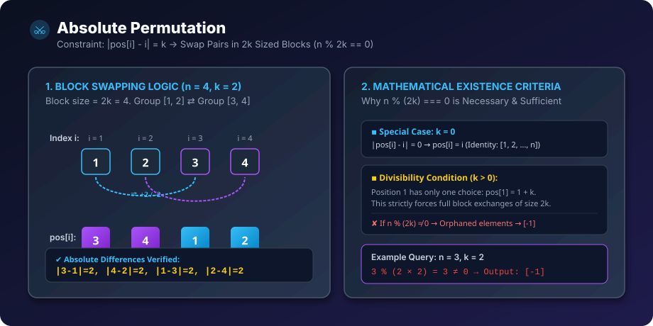
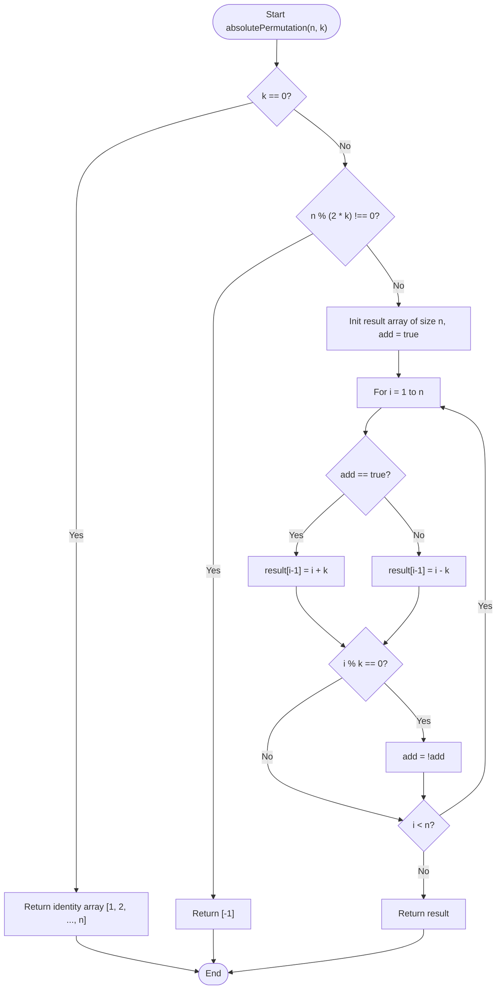

# Absolute Permutation

## Problem Overview

We define $P$ to be a permutation of the first $n$ natural numbers in the range $[1, n]$. Let $\text{pos}[i]$ denote the value at position $i$ in permutation $P$ using 1-based indexing.

$P$ is considered an **absolute permutation** if:
$$|\text{pos}[i] - i| = k \quad \text{for every } i \in [1, n]$$

Given $n$ and $k$, print the **lexicographically smallest** absolute permutation $P$. If no absolute permutation exists, return $[-1]$.

---

## Visual Intuition: Block Swapping Mechanism

### Case 1: $k = 0$
- If $k = 0$, $|\text{pos}[i] - i| = 0 \implies \text{pos}[i] = i$.
- The identity permutation $[1, 2, 3, \dots, n]$ is always valid and lexicographically smallest.

### Case 2: $k > 0$
- Consider position $1$: $\text{pos}[1] - 1$ must equal $\pm k$. Since $\text{pos}[1] \ge 1$, $1 - k \le 0$ (invalid), so $\text{pos}[1]$ **must** equal $1 + k$.
- Because value $1$ has already been claimed by position $1$, position $1 + k$ cannot take $(1 + k) + k$ without leaving value $1$ orphaned. Thus, position $1 + k$ **must take value $1$** ($\text{pos}[1 + k] = (1 + k) - k = 1$).
- By induction, the entire permutation is partitioned into disjoint blocks of size $2k$:
  - The first $k$ elements $[1 \dots k]$ add $+k$: $\text{pos}[i] = i + k$.
  - The next $k$ elements $[k + 1 \dots 2k]$ subtract $-k$: $\text{pos}[i] = i - k$.
- For these blocks to cover all $n$ numbers without leaving incomplete trailing blocks, $n$ **must be divisible by $2k$** ($n \pmod{2k} = 0$).
- If $n \pmod{2k} \ne 0$, no valid permutation exists $\implies$ return $[-1]$.

---

## Algorithm Steps

1. If $k = 0$, return $[1, 2, \dots, n]$.
2. If $n \pmod{2k} \ne 0$, return $[-1]$.
3. Initialize an empty result array of size $n$, and a boolean toggle `add = true`.
4. Iterate $i$ from $1$ to $n$:
   - If `add` is true, $\text{pos}[i] = i + k$.
   - If `add` is false, $\text{pos}[i] = i - k$.
   - After processing every $k$ elements (i.e. when $i \pmod k == 0$), invert `add = !add`.
5. Return the resulting array.

---

## Flowchart

---

## Complexity Analysis

- **Time Complexity**: $\mathcal{O}(n)$
  - A single loop from $1$ to $n$ constructs the entire permutation in linear time.
  - Given $n \le 10^5$, it runs in $\approx 10\text{ ms}$.
- **Space Complexity**: $\mathcal{O}(n)$
  - Auxiliary storage for the return permutation array of size $n$.

---

## JavaScript Solution

- View the implementation: [absolutePermutation.js](../Javascript/absolutePermutation.js)
