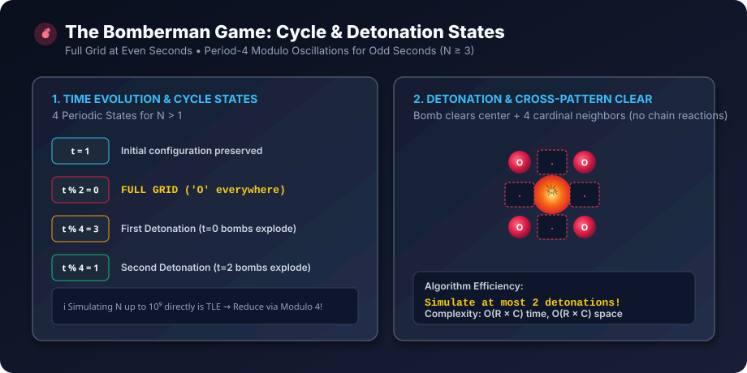
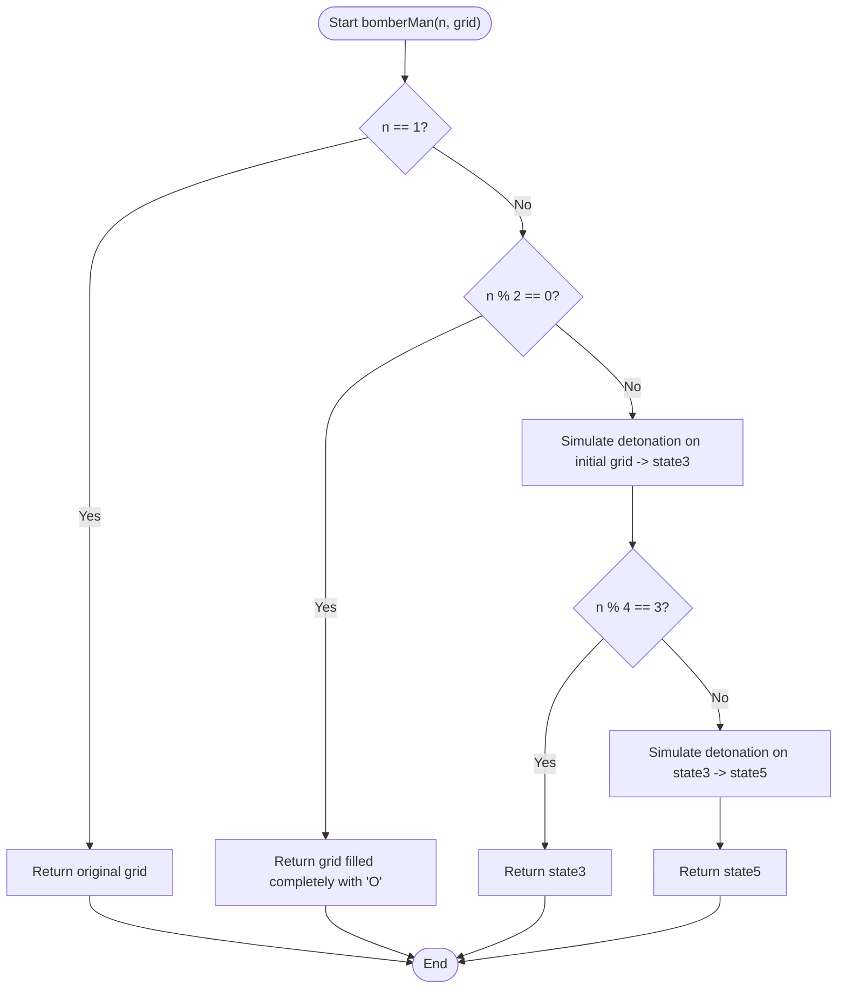

# The Bomberman Game

## Problem Overview

Bomberman lives in a rectangular grid of $R$ rows and $C$ columns. Each cell contains either a bomb (`'O'`) or nothing (`'.'`).

Bombs detonate after exactly 3 seconds. When a bomb detonates, it is destroyed along with any objects in its 4 cardinal adjacent cells (North, South, East, West). If a neighboring cell also contains a bomb, that bomb is cleared without triggering a chain reaction detonation.

Bomberman follows this repeating lifecycle:
1. **$t = 0$**: Bomberman sets up the initial bombs.
2. **$t = 1$**: Bomberman does nothing (grid remains identical to $t = 0$).
3. **$t = 2$**: Bomberman fills all empty cells with new bombs (the entire grid is filled with `'O'`).
4. **$t = 3$**: The bombs planted at $t = 0$ detonate, clearing themselves and their adjacent neighbors.
5. **$t = 4$**: Bomberman fills all newly emptied cells with bombs again (the entire grid is filled with `'O'`).
6. **$t = 5$**: The bombs planted at $t = 2$ detonate.
7. Bomberman repeats this cycle indefinitely.

Given the initial grid and elapsed time $N$, determine the grid state after $N$ seconds.

---

## Visual Intuition: Cycle & Period-4 Modulo

Because $N$ can be up to $10^9$, simulating second-by-second would cause Time Limit Exceeded (TLE). We analyze the grid states:

| Elapsed Seconds $N$ | Condition | Grid State |
| :--- | :--- | :--- |
| **$N = 1$** | $N = 1$ | Identical to initial input grid. |
| **$N$ is even** | $N \pmod 2 = 0$ | **Full Grid**: Every cell has `'O'`. |
| **$N \pmod 4 = 3$** | e.g. $t = 3, 7, 11, \dots$ | **State 3**: Single detonation of initial bombs ($t = 0$). |
| **$N \pmod 4 = 1$ ($N > 1$)** | e.g. $t = 5, 9, 13, \dots$ | **State 5**: Detonation of bombs planted at $t = 2$ (detonating on top of State 3). |

The pattern has a fundamental period of 4 for all $N \ge 2$, meaning we need to simulate at most **two detonations** regardless of how large $N$ is!

---

## Detonation Mechanics

To detonate a grid state `sourceGrid`:
1. Start with a fresh grid filled entirely with `'O'`.
2. For every cell $(r, c)$ where `sourceGrid[r][c] === 'O'`:
   - Set $(r, c)$ and all 4 valid neighbors $(r \pm 1, c), (r, c \pm 1)$ to `'.'`.
3. Return the resulting cleared grid.

---

## Flowchart

---

## Complexity Analysis

- **Time Complexity**: $\mathcal{O}(R \times C)$
  - Constructing full grids takes $\mathcal{O}(R \times C)$.
  - A detonation simulation visits each cell and checks at most 5 positions, taking $\mathcal{O}(R \times C)$.
  - At most 2 detonations are ever computed.
  - Overall time is $\mathcal{O}(R \times C)$, running in $< 15\text{ ms}$ for $R, C \le 200$, even when $N = 10^9$.
- **Space Complexity**: $\mathcal{O}(R \times C)$
  - Auxiliary memory used to store 2D character matrices for detonation results.

---

## JavaScript Solution

- View the implementation: [bomberMan.js](../Javascript/bomberMan.js)
