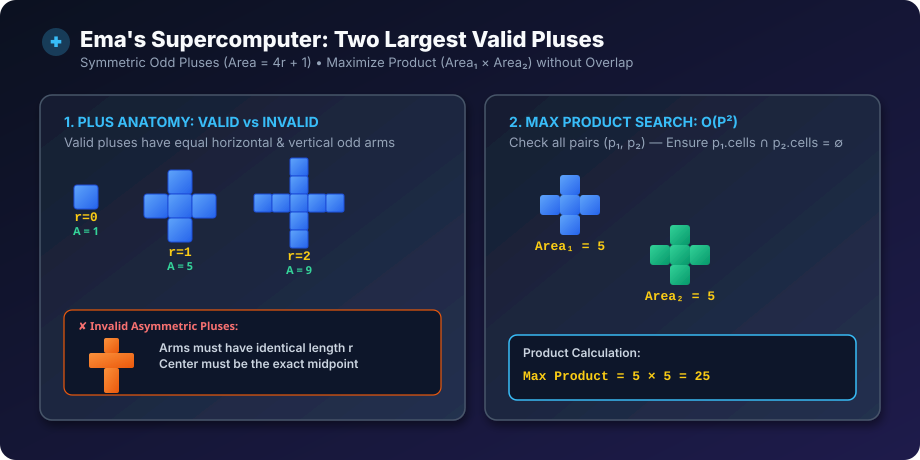
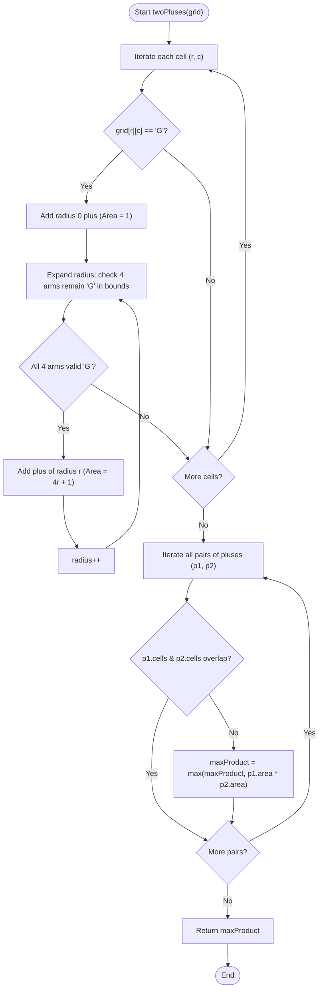

# Ema's Supercomputer (Two Pluses)

## Problem Overview

Given a grid of size $n \times m$, each cell is either `'G'` (good) or `'B'` (bad).

A valid plus is defined as the orthogonal crossing of two segments of equal odd length such that:
- The segments cross at their exact middle cell (the center of the plus).
- If radius is $r \ge 0$, length of both segments is $2r + 1$, and area of the plus is $4r + 1$.
- All cells covered by the plus must be `'G'`.

Find two **non-overlapping** valid pluses that can be drawn on good cells, and return the **maximum product** of their areas ($\text{Area}_1 \times \text{Area}_2$).

---

## Visual Intuition: Plus Anatomy & Pair Search

1. **Plus Symmetry**:
   - Radius $r = 0 \implies \text{Area} = 1$ (single cell)
   - Radius $r = 1 \implies \text{Area} = 5$ (center $+ 4$ arms of length 1)
   - Radius $r = 2 \implies \text{Area} = 9$ (center $+ 4$ arms of length 2)
   - In general, $\text{Area} = 4r + 1$.

2. **Enumeration Strategy**:
   - Because $2 \le n, m \le 15$, the grid size is very small ($n \times m \le 225$).
   - We can exhaustively enumerate every valid plus centered at every `'G'` cell for all possible radii $r \ge 0$.
   - For every valid plus, we record its area and the coordinates of all cells it occupies.
   - We then test all pairs of pluses $(p_1, p_2)$ to check if they share any overlapping cell ($p_1.\text{cells} \cap p_2.\text{cells} = \emptyset$).
   - Among all disjoint pairs, we maintain the maximum product $\text{Area}_1 \times \text{Area}_2$.

---

## Algorithm Steps

1. **Find All Valid Pluses**:
   - Iterate over each cell $(r, c)$ in the grid.
   - If `grid[r][c] === 'G'`, initialize a plus of radius $0$ ($\text{Area} = 1$).
   - Increment radius while all four arm cells:
     $$(r - \text{rad}, c), (r + \text{rad}, c), (r, c - \text{rad}), (r, c + \text{rad})$$
     are within bounds and contain `'G'`.
   - Store every valid configuration $\{ \text{area}, \text{cells} \}$.
2. **Pairwise Disjoint Comparison**:
   - Compare all pairs of pluses $(i, j)$ where $i < j$.
   - Skip pairs whose product cannot beat `maxProduct`.
   - Check if any cell in $p_1$ exists in $p_2$.
   - If they are disjoint, update `maxProduct = Math.max(maxProduct, p1.area * p2.area)`.
3. Return `maxProduct`.

---

## Flowchart

---

## Complexity Analysis

- **Time Complexity**: $\mathcal{O}(P^2)$, where $P$ is the total number of valid pluses.
  - In a $15 \times 15$ grid, $P \le 225 \times 8 \approx 1,800$ (in practice much smaller, $\le 300$).
  - Pairwise disjoint testing takes $\mathcal{O}(P^2 \times \text{arm length}) \approx \text{a few thousand operations}$, executing in $\approx 2\text{ ms}$.
- **Space Complexity**: $\mathcal{O}(P)$
  - Memory to store the cells of each identified valid plus.

---

## JavaScript Solution

- View the implementation: [twoPluses.js](../Javascript/twoPluses.js)
