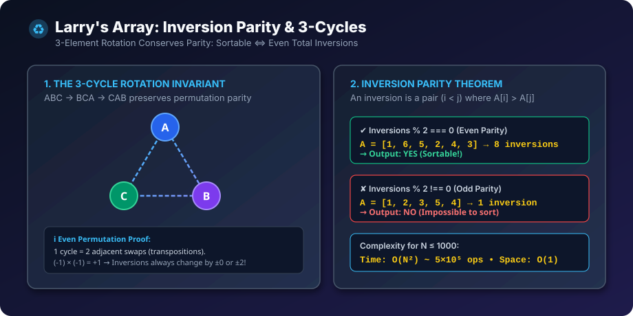
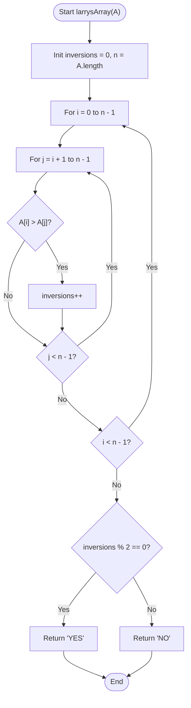

# Larry's Array

## Problem Overview

Larry has a permutation $A$ of natural numbers incrementing from $1$ to $n$.
He can choose any $3$ consecutive indices and rotate their elements:
$$ABC \to BCA \to CAB \to ABC$$

Determine whether the array can be completely sorted in ascending order using this operation any number of times. Print `"YES"` if it can be sorted, or `"NO"` otherwise.

---

## Visual Intuition: Permutation Parity & Invariant Conservation

### The 3-Cycle Invariant
In group theory and permutation mathematics, any 3-element rotation is an **even permutation**:
$$(A, B, C) \to (B, C, A)$$
This rotation is equivalent to two successive adjacent swaps (transpositions):
1. Swap $A$ and $B$: $(A, B, C) \to (B, A, C)$ (flips inversion parity by $\pm 1$)
2. Swap $A$ and $C$: $(B, A, C) \to (B, C, A)$ (flips inversion parity again by $\pm 1$)

Because $(-1) \times (-1) = +1$, **two swaps leave the parity of the total number of inversions unchanged**.
Therefore:
- A 3-cycle rotation can **never change the parity** of the array's inversions!
- The fully sorted array $[1, 2, 3, \dots, n]$ has **0 inversions** ($0$ is an even number).
- Consequently, an array is sortable if and only if its **initial inversion count is even**!

$$\text{Sortable} \iff \sum_{i < j, A[i] > A[j]} 1 \pmod 2 = 0$$

---

## Algorithm Steps

1. Initialize `inversions = 0`.
2. Iterate through all pairs $(i, j)$ with $0 \le i < j < n$:
   - If $A[i] > A[j]$, increment `inversions++`.
3. If `inversions % 2 === 0`, return `"YES"`.
4. Otherwise, return `"NO"`.

---

## Flowchart

---

## Complexity Analysis

- **Time Complexity**: $\mathcal{O}(n^2)$
  - Counting inversions using nested loops performs $n(n - 1) / 2$ comparisons.
  - Given $n \le 1000$, $\approx 5 \times 10^5$ operations execute in under $2\text{ ms}$.
  - *(Note: Can also be done in $\mathcal{O}(n \log n)$ via Merge Sort or a Fenwick Tree, but $\mathcal{O}(n^2)$ is optimal and trivially fits the time limit).*
- **Space Complexity**: $\mathcal{O}(1)$
  - Requires only a single integer accumulator for `inversions`.

---

## JavaScript Solution

- View the implementation: [larrysArray.js](../Javascript/larrysArray.js)
