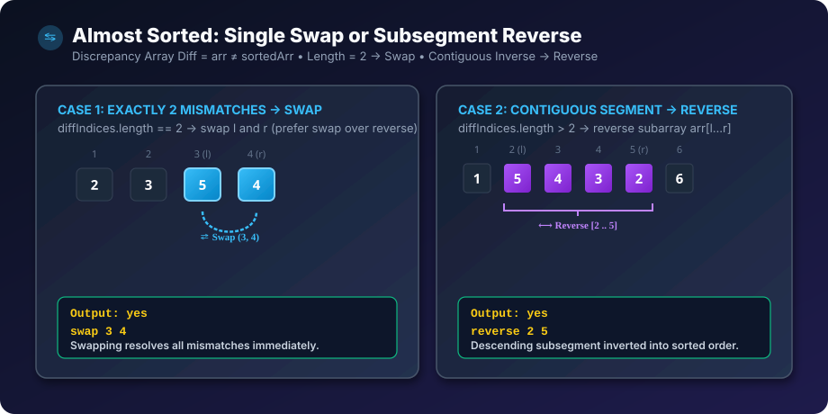
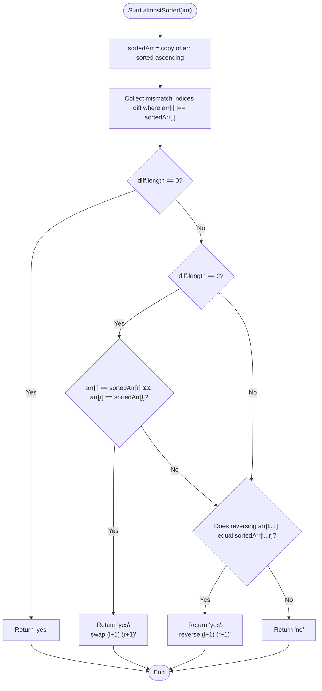

# Almost Sorted

## Problem Overview

Given an array of integers $arr$, determine whether the array can be sorted in ascending order using **only one** of the following operations exactly once:
1. **Swap** two elements: $arr[l]$ and $arr[r]$.
2. **Reverse** one contiguous sub-segment: $arr[l \dots r]$.

Output specification:
1. If the array is already sorted, print:
   ```text
   yes
   ```
2. If it can be sorted with a single operation:
   - If swapping works, print:
     ```text
     yes
     swap l r
     ```
     *(using 1-based indices $l$ and $r$)*.
   - If reversing works, print:
     ```text
     yes
     reverse l r
     ```
     *(using 1-based indices $l$ and $r$)*.
   - **Preference Rule**: If both operations can sort the array (e.g., a subarray of length 2), **choose swap**.
3. If neither operation can sort the array, print:
   ```text
   no
   ```

---

## Visual Intuition: Comparison with the Sorted Array

The most robust technique is comparing `arr` with its ideal sorted version `sortedArr`:
1. Find all indices $i$ where $arr[i] \ne \text{sortedArr}[i]$. Store these indices in a list `diff`.
2. **Condition 1 (Already Sorted)**:
   - If `diff.length === 0` $\implies$ `"yes"`.
3. **Condition 2 (Swap)**:
   - If `diff.length === 2`:
     - Let $l = \text{diff}[0]$ and $r = \text{diff}[1]$.
     - If $arr[l] == \text{sortedArr}[r]$ and $arr[r] == \text{sortedArr}[l]$, swapping them sorts the entire array!
     - Output `"yes\nswap " + (l + 1) + " " + (r + 1)`.
4. **Condition 3 (Reverse)**:
   - If `diff.length > 2`:
     - Let $l = \text{diff}[0]$ and $r = \text{diff}[\text{diff.length} - 1]$.
     - Check if reversing the subarray $arr[l \dots r]$ matches $\text{sortedArr}[l \dots r]$ (i.e. $arr[l + k] == \text{sortedArr}[r - k]$ for all $0 \le k \le r - l$).
     - If valid $\implies$ output `"yes\nreverse " + (l + 1) + " " + (r + 1)`.
5. **Condition 4 (Impossible)**:
   - If neither condition holds $\implies$ output `"no"`.



---

## Flowchart



---

## Complexity Analysis

- **Time Complexity**: $\mathcal{O}(n \log n)$
  - Sorting a copy of the array of size $n$ takes $\mathcal{O}(n \log n)$.
  - Identifying mismatch indices takes a single linear pass: $\mathcal{O}(n)$.
  - Testing the swap or reversing the subsegment $arr[l \dots r]$ takes at most $\mathcal{O}(n)$.
  - For $n = 100,000$, $\mathcal{O}(n \log n)$ operations execute in $\approx 25\text{ ms}$.
- **Space Complexity**: $\mathcal{O}(n)$
  - Storage for the sorted copy of the array and the index mismatch list.

---

## JavaScript Solution

- View the implementation: [almostSorted.js](../Javascript/almostSorted.js)
