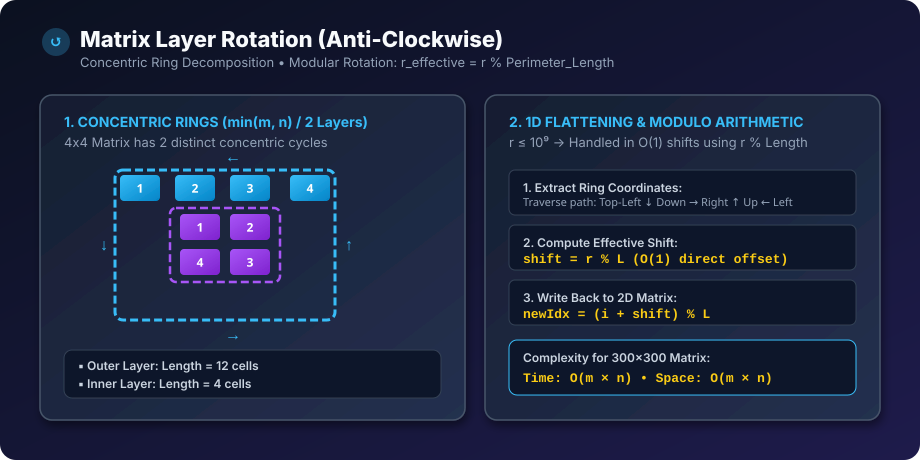
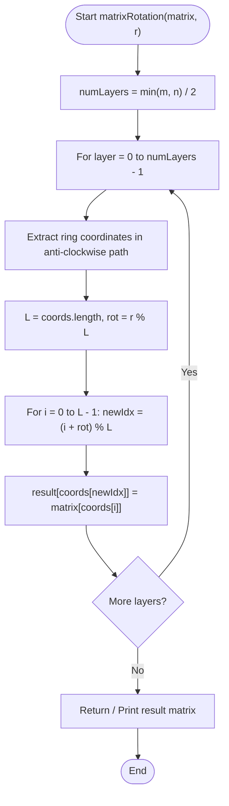

# Matrix Layer Rotation

## Problem Overview

You are given a 2D matrix of dimension $m \times n$ and a positive integer $r$. You have to rotate the matrix $r$ times in an **anti-clockwise** direction and print the resulting matrix.

It is guaranteed that $\min(m, n)$ is even.

---

## Visual Intuition: Concentric Ring Decomposition

Any $m \times n$ matrix can be decomposed into concentric rectangular layers (or rings).
The number of layers is:
$$\text{numLayers} = \frac{\min(m, n)}{2}$$

For each layer $k$ ($0 \le k < \text{numLayers}$):
- Perimeter boundaries are:
  - $\text{top} = k$
  - $\text{bottom} = m - 1 - k$
  - $\text{left} = k$
  - $\text{right} = n - 1 - k$
- The number of elements in the ring (its cycle perimeter) is:
  $$L = 2 \times (\text{bottom} - \text{top}) + 2 \times (\text{right} - \text{left})$$
- Because $r$ can be up to $10^9$, performing step-by-step simulations will lead to Time Limit Exceeded (TLE).
- Instead, rotating by $r$ steps on a cycle of length $L$ is equivalent to rotating by:
  $$\text{effective\_shift} = r \pmod L$$

### Anti-Clockwise Movement Flow
Following the anti-clockwise motion arrows:
1. **Left Column**: Elements move **down** from $(\text{top}, \text{left})$ to $(\text{bottom}, \text{left})$.
2. **Bottom Row**: Elements move **right** from $(\text{bottom}, \text{left} + 1)$ to $(\text{bottom}, \text{right})$.
3. **Right Column**: Elements move **up** from $(\text{bottom} - 1, \text{right})$ to $(\text{top}, \text{right})$.
4. **Top Row**: Elements move **left** from $(\text{top}, \text{right} - 1)$ to $(\text{top}, \text{left} + 1)$.

By extracting coordinates in this exact sequence into a 1D array, each element simply advances by `rot = r % L` positions!

---

## Flowchart

---

## Complexity Analysis

- **Time Complexity**: $\mathcal{O}(m \times n)$
  - Every cell belongs to exactly one layer.
  - Extracting coordinates, shifting using modulo arithmetic, and writing back to the result matrix takes $\mathcal{O}(1)$ time per cell.
  - Overall time is strictly linear in the total number of cells: $\mathcal{O}(m \times n)$.
  - For $m, n \le 300$, $m \times n \le 90,000$, executing in under $10\text{ ms}$ even for $r = 10^9$.
- **Space Complexity**: $\mathcal{O}(m \times n)$
  - Auxiliary storage for the rotated result matrix and the 1D ring coordinate buffers.

---

## JavaScript Solution

- View the implementation: [matrixRotation.js](../Javascript/matrixRotation.js)
