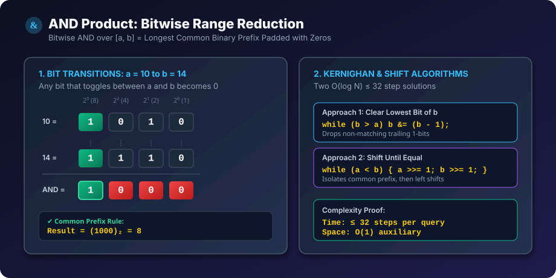
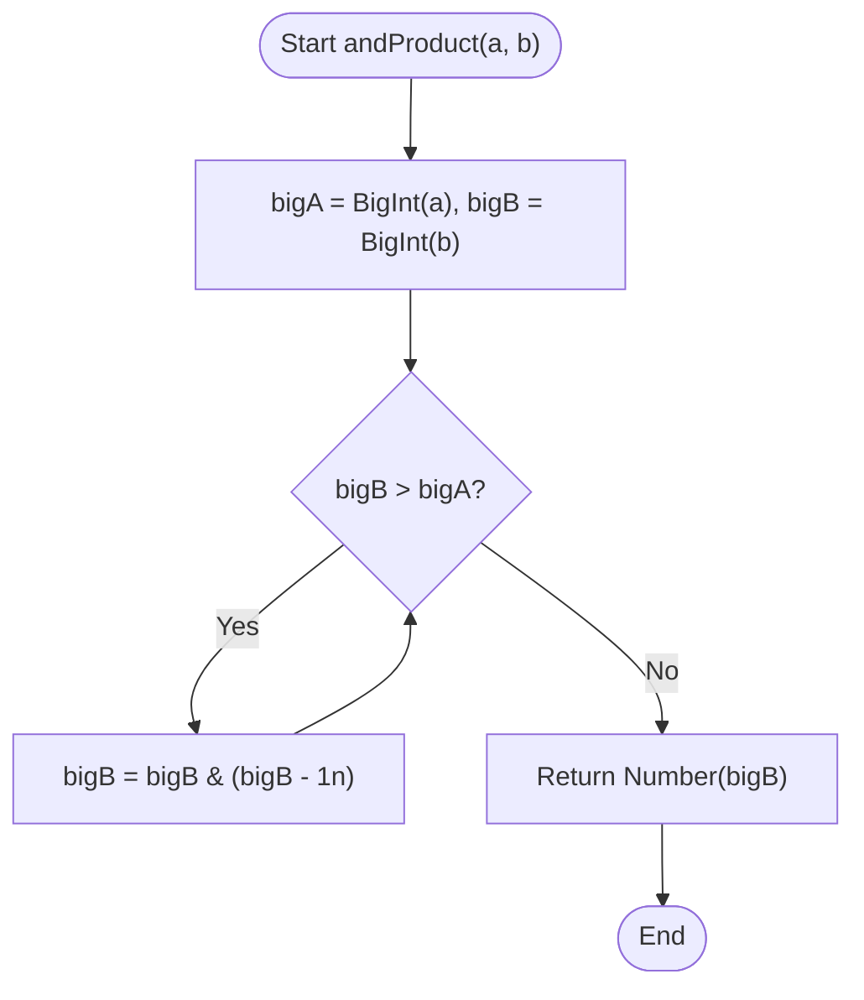

# AND Product (Bitwise Range AND)

## Problem Overview

Consider two non-negative long integers $a$ and $b$, where $a \le b < 2^{32}$. The bitwise AND of all integers in the inclusive range between $a$ and $b$ is:
$$a \ \& \ (a + 1) \ \& \ \dots \ \& \ (b - 1) \ \& \ b$$

Given $n$ intervals $[a_i, b_i]$, compute and print the bitwise AND product for each interval.

---

## Visual Intuition: Longest Common Binary Prefix

In the range $[a, b]$:
1. For any bit position that changes between $a$ and $b$, there exists at least one integer in $[a, b]$ where that bit is $0$.
2. Because the bitwise AND operator returns $0$ whenever any number in the series has a $0$ at that bit position, **any bit that flips anywhere in $[a, b]$ will inevitably be turned into $0$ in the final result**.
3. Consequently, the only bits that remain $1$ in the final result are the **common leading bits (longest common binary prefix)** of $a$ and $b$ that remain identical across the entire range $[a, b]$.
4. All bit positions after the common prefix become $0$.

### Example: $a = 10, b = 14$
- $10 = (1010)_2$
- $11 = (1011)_2$
- $12 = (1100)_2$
- $13 = (1101)_2$
- $14 = (1110)_2$

Notice the bits:
- Most significant bit ($2^3 = 8$): identical ($1$) across all numbers $\implies$ remains $1$.
- Lower 3 bits: flip between $0$ and $1$ $\implies$ cleared to $0$.
- Result: $(1000)_2 = 8$.



---

## Algorithms

### Method 1: Brian Kernighan's Range Reduction (Used in Solution)
Repeatedly clear the lowest set bit of $b$ using `b = b & (b - 1n)` until $b \le a$:
```javascript
while (b > a) {
    b = b & (b - 1n);
}
return b;
```
Each iteration eliminates the rightmost set bit that differs from $a$. Runs in at most 32 operations!

### Method 2: Bitwise Right Shift
Shift both $a$ and $b$ to the right until they become equal (isolating the common prefix), then shift back to the left by the number of steps shifted.

---

## Flowchart



---

## Complexity Analysis

- **Time Complexity**: $\mathcal{O}(\log(\max(a, b)))$
  - Since $a, b < 2^{32}$, numbers have at most 32 bits.
  - The loop executes at most 32 times (often far fewer, equal to the number of set bits in $b$).
  - For $n \le 200$ test cases, total operations $\le 6,400$, executing in $< 1\text{ ms}$.
- **Space Complexity**: $\mathcal{O}(1)$
  - Uses only a couple of BigInt variables for bitwise manipulation.

---

## JavaScript Solution

- View the implementation: [andProduct.js](../Javascript/andProduct.js)
